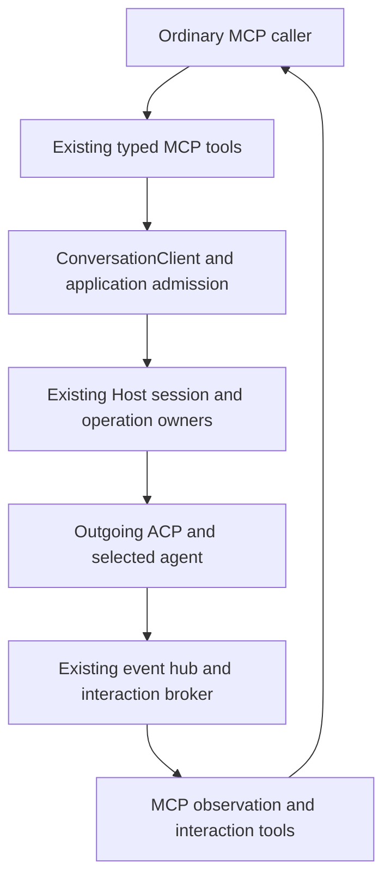

# MCP tools for the same agent control

An MCP caller controls Claude or Cursor through ordinary tools over the existing Host. It does not send ACP frames, acquire another raw connection or become the agent's ACP editor client. This chunk realizes R23 with the existing R12–R14/R19/R20 ownership rules. No tunnel is delivered or planned.

The first deliverable is a qualified text/session lifecycle through the existing tools, with real provider and original CLI proof. The inventory below also exposes capabilities outside that first deliverable; their presence in ACP is not a claim that MCP already supports them. The earlier CLI backlog and bound incoming-ACP work retain their own obligations.

Read the [first facade PR plan](plans/2026-11-05-mcp-facade-lifecycle.html) for scope, sequence and proof. The [delivery overview](plans/overview.html) distinguishes this result from later interface work.

## One owner, different representations

`collaboration-mcp` owns tool decoding/result projection. Carrier tools use `ConversationClient` and the selected endpoint's existing transport; provider settings/lifecycle, observation and interaction tools use their existing application operations. `collaboration-service` retains admission and recovery; the Host retains dispatch, session actors and operation settlement. A uniform external outcome does not require replacing those distinct entry contracts with a generic executor.

Constructors continue receiving the current `CollaborationApplication`, carrier access and tool-call registry. Do not add an MCP-specific provider runtime, raw-method tool, connection-handle store or new DI layer. Provider behavior remains injected below the facade and independent of MCP DTOs. A new provider must not require a provider-name execution branch in each tool.

## Capability inventory and discovery

The maintained coverage table maps protocol concepts to the current facade. Execution's lasting verification inventory links each claimed implemented row to its actual tool schema, owner and proof. It is verification data, never a runtime dispatch registry or another backend capability source. Compare tool discovery and the locked ACP method set so added/unmapped members fail the coverage check rather than disappear. Optional or compile-gated methods remain identified as such.

`tools/list` describes available Router tools; it is not a per-provider guarantee. The caller reads `endpoints_list` and the selected session's real `provider_session_inspect` report/catalogue for support and prerequisites. Preserve existing unavailable/unsupported responses. Do not withdraw existing global tools merely because one endpoint lacks a capability, and do not infer support from a parser branch or schema alone.

| ACP concept / direction | Existing ordinary MCP representation | Supplier and exact scope |
| --- | --- | --- |
| Initialize/authenticate, caller → agent | Normal MCP initialize/tool discovery; `endpoints_list` and provider inspection report availability/authentication. | MCP negotiation and Host-owned provider handshake are different. The facade neither exports credentials nor forwards arbitrary `authenticate`. |
| Session new | `conversation_create`; create-and-prompt remains its existing composite. | Existing create admission, creator/Approver/policy and inspectable operation. No new session identity. |
| Session list | `provider_sessions_list` for managed provider scope; existing Codex inventory stays separate. | Existing inventory owner; a list read does not resume a session. Opaque equal IDs on different endpoints remain different targets. |
| Session load/resume | `conversation_load`, `conversation_resume`. | Current qualified backend semantics; load replay and resume without provider replay are not interchangeable. |
| Prompt | `conversation_prompt`. | Current public text input, caller/requester and operation admission. Rich native/ACP submissions must not be routed through this text DTO and truncated. Media/embedded context is an explicit facade gap until its typed public input contract is realized; it is not advertised by this first text profile. |
| Session updates/output | `events_observe` plus provider inspection and operation show/wait/reconcile. | Existing session hub/operation owners. Notifications and bounded results are representations of their facts, not a second event journal. |
| Mode/configuration | `conversation_settings_set`, inspect, and settings-accept with its existing distinct meaning. | Current qualified mode/model/effort operation. Other provider config categories/value kinds are not exposed as writable until their actual typed setter exists. Native model normalization remains its own boundary. |
| Session cancel | `conversation_cancel` for the existing exact operation contract; native turn interrupt retains its native scope. | Explicit target operation and actual cancellation settlement. There is no conversion from an MCP call cancellation to session-cancel. Do not silently choose the current operation when the caller supplied an exact one. |
| Session close | `conversation_close`. | Current close owner and observed result; no deletion or shared-process shutdown promise. |
| Delete/fork/logout and compile-gated protocol methods | Preserve existing supported native operations; no provider facade offer without a qualified owner and representation. | Not inferred from the SDK. Their unsupported/unqualified disposition stays explicit per backend/profile. They are not raw-passthrough escape hatches. |
| Permission and elicitation, agent → client | Existing approval/question list and exact decide/answer tools; `events_observe` carries corresponding pending facts. | Broker and stored Approver own settlement. A tool caller cannot manufacture a Human identity or persistent consent. MCP elicitation is an optional representation, not an auto-approval route or a replacement broker. |
| Filesystem/terminal callbacks, agent → client | No current outgoing-client offer; no MCP execution tool is invented. | These would execute on the ACP client's side. The current profile advertises neither client filesystem nor terminal support. An agent requiring them is not qualified by this design merely because prompt works. |
| Client MCP server setup | The existing session-tools chapter owns per-session composition and its active/cold semantics. The current public MCP create/load/resume input lacks that field. | Host owns its collaboration entry; client tools remain a separate setup input. Extending ordinary MCP setup is a named remaining facade gap, not permission to copy bearer values or mutate global defaults. |
| Host queue/steer and provider extensions | Preserve the existing qualified message/control paths and their declared supplier. Expose an added typed facade operation only with its own exact contract and proof. | Host features are not contingent on provider-native support. `message_send` keeps its delivery semantics; it is not renamed into a task or a raw ACP method. |

This table does not waive U13's complete coverage outcome. The first lifecycle deliverable must name the remaining rich-input, full-config, session-setup and extension gaps in its PR; it cannot claim full ACP parity. Any later deliverable changing an observable input or supported profile goes through the corresponding Specification/How/proof owner before its implementation plan.

## Callers and identity representation

The local operator uses the existing Human identity; a hosted agent uses its own existing SessionRef. On the current private-local MCP surface these are reported identities, not authenticated claims. The access layer and existing admission/role owners retain their current guarantees; passing the local service-ID check is not proof that a request originated from that session. A future adopted Fleet session binding remains its owner's authority, not a new mechanism in the facade.

| Tool family | Local operator | Hosted session acting as itself |
| --- | --- | --- |
| Create | Typed existing Human `createdBy`; explicit actual Approver under the existing create contract | Existing SessionRef or typed Session `createdBy`; independent Approver retained |
| Load/resume/close/settings | Existing `ProviderIdentity` Human requester, with stored/explicit Approver as that operation already requires | Existing `ProviderIdentity` Session requester and unchanged Approver rules |
| Prompt/cancel | Widen the public requester boundary to carry the existing Human identity into the application's already-supported `ProviderIdentity` | Preserve the existing SessionRef request shape and convert it to the same application's Session identity |
| Approval/question decision | The actual declared Approver under the existing interaction contract; not automatically the MCP operator | The actual declared session Approver; not permission obtained from tool discovery or session attachment |
| Observation/operation reads | Existing service/access and target rules; no new requester field is invented | Same read contract; no ownership/authentication inferred from a readable target |

The first facade PR realizes the operator prompt/cancel representation; naming the operator as unsupported would not complete its ordinary-caller lifecycle. Reuse the established boundary codec in `conversation_create_actor.rs`, generalizing its name/home to `ConversationActor` because creator and requester are now both consumers. It keeps the existing untagged SessionRef and typed board Human/Session shapes, with one conversion to the existing `ProviderIdentity`. Use it for `ConversationPromptInput.requested_by` and `ConversationCancelInput.requested_by` as well as creation. Keep field names and existing SessionRef JSON unchanged; update consumers rather than leave a second alias/codec. No new domain identity, permission rule or persisted format is introduced.

The provider path passes that actual identity and the existing Approver through to `ConversationPromptRequest`/`ConversationCancelRequest`. The native Codex path still requires its supported Session actors and returns explicit unsupported input for a Human before native dispatch; it never substitutes another session. Provider create-and-prompt uses the same actor conversion and the already-supported separate create/prompt operation IDs, preserving a known target if the second step fails. Native composite behavior stays unchanged. Human-authored input uses the existing `HumanUser` content; an agent's sender retains that agent's own SessionRef. The facade does not mint a Human identity or treat a test driver's arbitrary session label as a real caller.

A runtime allocation must declare the real operator identity from the existing owner source, or an actual hosted requester SessionRef. If it cannot obtain that identity, the run is not ready. Controlled fixtures may supply explicit fixture identities at their existing application seam; their role-refusal tests prove only the declared-role/admission contract. They cannot establish authentication, stronger isolation or a new Fleet attribution guarantee.

The current API does not validate a relationship between the reported operation requester and reported prompt content author. They remain separate inputs: an existing Session requester may legitimately submit `HumanUser` content, and that caller behavior is preserved. The facade therefore cannot claim that a content `Agent.sender` was authenticated or equals the requester. A contradictory sender claim is not used as positive identity evidence in qualification: the operator driver uses `HumanUser`, and a driver acting as a hosted agent uses its own SessionRef as requester and content sender. Adding a sender/requester equality restriction would change the public content contract and is not selected for this PR. This is a declared attribution limit, not a new authorization grant.

Keep the [Fleet compatibility and shared-file handoff rules](interface-design.md#compatibility-with-fleet-work) when these changes touch MCP/client files. On a base with the separately adopted access binding, a session caller uses its own bound address; an operator uses the unbound operator path with its Human identity. No session sender is synthesized on that operator path, and no URL filter, bearer minting or alternate permission route is added here.

## Identities, authority and results

Reuse E1/E3/E4/E7/E8/E10: full endpoint/session target, MCP connection/request correlation, admitted input, observed turn, existing durable operation and its actual offer. The facade has no extra persistent entity. Input request/result schemas stay in the existing `collaboration-client` conversation DTOs and `collaboration-protocol` operation/inspection/observation/interaction contracts; rmcp derives their tool schemas. Keep ACP SDK types out of the application contract.

MCP request IDs correlate a tool call; caller-supplied operation IDs retain their existing supported-backend meaning. Native Codex's differing operation-ID rules remain explicit. A replay/reconcile read cannot resubmit an unknown mutation. `ConversationClient` preserves the current endpoint transport selection; a provider is still an external-provider backend, not routed through the new bound ACP socket merely because another frontend now exists.

The application retains its declared caller/creator/Approver, locality, generation, policy and target checks. It does not authenticate a reported identity merely by decoding it. A capability offer is not authorization. Global tool registration does not add authority. Do not route these richer requests through the convenience session command by dropping operation or role fields. Unknown effects retain their inspectable operation and any known target; they are not successful completion.

The existing result variants remain authoritative: created/pending create; completed/running or pending prompt as supported; actual settings result; typed unavailable/refusal and known/unknown failure. Inspectable admission and a terminal provider turn are separate from fulfillment of an application task. No task completion or result acceptance is fabricated by the facade.

## Output observation without a new subscription owner

Use the current bounded observation contract. For a managed provider, `events_observe` returns `target`, `generation`, `attached`, `events`, `endReason`, `continuationGap` and `epoch`; streaming notifications include the same event and an optional `{ epoch, afterSequence }` cursor. Subsequent reads pass both cursor fields. The hub attaches its retained snapshot and receiver under its existing lock, and projects retained item state; it does not promise replay of every intermediate text delta.

The caller can take a bounded baseline before sending an input, keep the returned epoch/last sequence, submit one input, then resume bounded reads from that position and correlate the actual turn/operation. An empty baseline has no last sequence: retain its epoch and start without inventing an event. This earns reconstructed output/terminal observation, not a claim that the network stream was attached before the input. A controlled live-stream test may hold the peer until the existing hub attachment is observed at its test seam, with the production owner still doing the attachment.

Preserve `resyncRequired`, backend-disconnected and event-too-large outcomes. A stale epoch cannot be continued as complete output. The current `continuationGap` flag is true for bounded provider reads, including ordinary bounded endings; it does not alone mean an event was lost. Use the documented cursor/end reason and actual resync markers, not a reinterpreted boolean or a guessed last event. Native observations have their separate no-cursor contract. No new durable event store, ready notification, or automatic mutation replay is introduced.

## Caller loss, cancellation and isolation

An MCP timeout, cancelled observation or dropped waiter ends that call-local attachment. Work already admitted stays owned according to the existing backend contract. A caller uses operation show/wait/reconcile and session readback to learn its outcome; the facade never resends to repair a lost response.

Explicit work cancellation uses the current typed operation and existing effect-side fences. Do not upgrade an accepted cancellation to observed cessation; keep any unsettled result inspectable. The earlier exact-control realization stays authoritative. Concurrent sessions and operations share no mutable facade “current target”; a stale cancellation cannot be retargeted to a newer input. Closing the MCP call or session cannot kill unrelated work through a shared provider connection.

Messages, board records and automation operations retain their current meaning and persistence. A future task application may invoke this control boundary and exchange messages, while owning hierarchical result acceptance separately. No task schema, storage owner or parent/child cancellation policy is added here.

## Source and alternatives

Current-source anchors are `collaboration-mcp/src/mcp_server/{carrier_tools,interaction_tools,conversation_operation_tools,session_tools}.rs`, `collaboration-client/src/{conversation_client,provider_session_observation}.rs`, `collaboration-protocol/src/session_observation_contract.rs`, `collaboration-service/src/collaboration_application/provider_observation_operations.rs` and the existing Host/runtime owners. Main `0f9af21f6` includes A's authentication/model corrections; B's older runtime source is not the product execution base to reuse blindly.

Selected ordinary typed tools reuse known ownership and inspectable outcomes; their maintenance cost is explicit capability/result/proof mapping. A generic raw-ACP tool would couple ordinary callers to ACP framing, callbacks and another connection lifecycle and is excluded by the owner. A second high-level MCP API would duplicate established controls without an unmet consumer; extend an existing typed owner only for an evidenced gap. These alternatives add no deferred tunnel phase.

## R23 realization and proof seam

| U | R | E | Owner | Interface and shape home | State/failure | Proof seam |
| --- | --- | --- | --- | --- | --- | --- |
| U13/U8/U2/U6/U7 | R23 ordinary MCP control | E1–E13 reused; no new entity | MCP projection; existing application admission, Host/runtime, hub and broker | Existing typed conversation, operation, observation and interaction DTOs; schema homes above; coverage inventory is verification-only | Admitted, pending, terminal and unknown remain distinct; cursor/resync and caller detach preserve their meanings; wrong actor/target and unsupported shape refuse before effect where applicable | Production MCP → actual Host/supervisor/runtime → controlled peer, then actual Claude/Cursor and original CLI full turns; complete tool/protocol inventory catches missing mappings. Scripted application success or catalogue-only tests cannot close it. |
