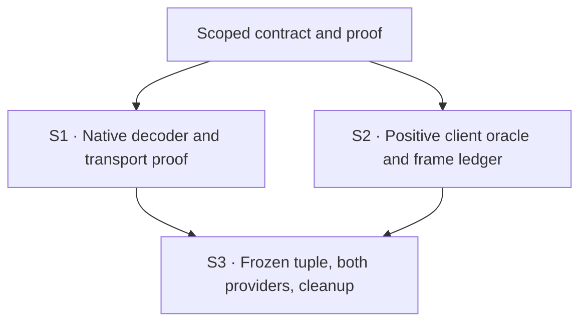

# M1 — Remove the extra model-save error

After a real Claude or Cursor model selection, acknowledge only Codex's extra model/effort-default save. Keep the provider's intended setting application and leave Codex configuration untouched.

This is the independently specified first repair. It does not wait for the full unavailable-command, information, startup or broader ACP-control design. Those outcomes remain open in the project roadmap. **The requested terminal is plan-only:** this document describes implementation and proof; it does not authorize code execution, select a PR split or grant merge authority.

## Result and governing basis

| Field | Value |
| --- | --- |
| Plan path | `docs/specs/2026-11-02-acp-shared-control/plans/2026-11-02-m1-default-save.md` |
| Planning result | ready, for bounded M1 only |
| Originating planner | plan-implementation |
| Supersedes | none; the broader delivery roadmap is proposed, not an earlier canonical ready plan |
| Governing basis | reviewed-four-document-design, affected M1 scope below |
| Requirements | [Requirements](../requirements.md), U3/U6/U7 and the fixed unchanged-client/provider-only boundaries |
| Specification | [Specification](../specification.md), R4; exact model/effort-default family of R3/R9; corresponding R10/R11 proof/hygiene |
| Program Design | [Program Design](../program-design.md), First CLI changes and incorporated [Default-save compatibility](../../2026-10-31-codex-cli-acp-actions/program-design.md#default-save-compatibility), Intent decoding and Configuration intent coverage |
| Verification Design | [Verification Design](../verification-design.md), U3 row, routes A/B, regular PersistModelSelection witness and test dispositions |
| Current scoped review | Immutable shared review artifact: Router project post `01a19cf3-8397-7024-b6b8-c5d6bc756604`, retrievable with `post_show`. It preserves the exact baseline push `01a19cd8-eeb5-7a91-a0e9-6bf56b4439fa` and correction/final push `01a19cdf-20a5-7700-b3b4-936b79651692`, which returns scoped ready-for-planning. Push IDs are not board post IDs. |
| Applicability | Branch `feat/acp-cli-actions`, planned at `1ea651a19610c476c633e89b28bb1fbea7d6492a`; product unchanged from bridge parent `82a0d53bba6e2c9ae7ad0f42ef96eecc6927e999`; native source `360319d8dee62d87e2d59fc0c21805d79519cfed` / unchanged Codex 0.165 |
| Delivery context | requested terminal: plan-only; delivery grouping: single:M1-default-save; PR topology: not-applicable; repository: Codex Router |

The sole plan authority is this Markdown document; its HTML is a generated reader. The existing work board is retained outside the canonical record. No whole-set ready result is implied, and a carrier must not upgrade plan-only to implementation authority.

## The bounded contract

Recognize `config/batchWrite` only when the whole request is the checked model-default intent: exactly one `replace` edit for nonempty NUL-free `model`; one `replace` edit for null or nonempty NUL-free `model_reasoning_effort`; no duplicate/other edits; no file target or expected version; `reloadUserConfig: true`. Optional null/omitted file/version fields mean no target/version. Keep `provider` and custom effort strings valid; no provider catalogue read is needed for this harmless receipt.

Return the native-compatible receipt: `status: "ok"`, `version: "acp-compat-noop-v1"`, `filePath: "/dev/null"`, `overriddenMetadata: null`, preserving the request ID. The sink path is a receipt marker, never a file to create/write or a compare-and-set version. All unmatched writes retain their existing refusal/error contract. Validate the full batch before recognizing any subset.

The handler adds zero setting calls, filesystem writes, trust grants or provider-default persistence. Ordinary model/effort selection remains the existing provider path and can legitimately make separate model and effort calls. No ProviderBehavior method, DI container, settings store, new native command or global method-registry rollout belongs in M1.

Outside this plan: duplicate input/history, full command enumeration implementation, other native persistence intents, Max/Ultra/Plan/all-modes qualification, inference after model selection, provider-package upgrades, context/security snapshots, startup repair, exact-control changes, F1 exposure, Host/process separation and production replacement. Native/reverse preservation is retained, but full R1 and broad U3/R3/R9 remain project obligations rather than claims earned by M1. This model-only proof allows no model prompt; successful inference is not inferred from settings readback.

## Sequence and ownership



S1 and S2 may overlap after the contract is fixed: Implementer owns native Rust, paired Verifier owns the assigned TS apparatus. One writer per shared capture/schema file; serialize Git/index and integrated runs. Neither depends on M4. S3 begins only after both relevant local gates pass on one source tuple.

### S1 — Native behavior and controlled proof

**Reads:** governing contract above; current `router_session_app_server_methods.rs:82–98`, `native_request_dispatch.rs` generic-method path, `native_provider_settings.rs:141–163`, the native `config_update.rs:56–104,155–172`, `model_defaults.rs:121–133` and `v2/config.rs:345–371,1123–1146` at the declared pin.

**Write surfaces:** `crates/collaboration-runtime/src/router_session_app_server_methods.rs`; a private `native_model_defaults.rs` with sibling `native_model_defaults_test.rs` for the narrow typed recognition/receipt; the existing colocated `router_session_app_server_test.rs` for real native WebSocket integration. Declare the private helper from the owning native module. Keep it free of command-port, provider, trust-store and file-writer dependencies. No crate or Cargo dependency is added.

1. Establish permanent failing cases against the current refusal, then implement the exact recognition/receipt and wire it only into the provider-session facade's `config/batchWrite` branch.
2. Use a table over the rule: both edit orders; null, `provider` and custom efforts; null/omitted optional target/version fields; actual NUL versus harmless literal backslash-zero.
3. Countercases cover empty/non-string/NUL values, duplicate/missing/extra edits, wrong strategy/reload, explicit file targets (including `/dev/null`), expected versions (including the receipt version), mixed trust/hooks/features and single-value/legacy methods. None can yield the compatibility receipt or an effect.
4. Through the actual native WebSocket server and existing controlled ports, apply the ordinary setting sequence, record its baseline, then send the extra batch. Assert its correlated exact receipt, no additional setting/command calls and unchanged controlled configuration. A direct helper test alone does not prove dispatch.

**Existing tests:** keep the CWD test `default_model_batch_write_is_refused_without_project_trust_advice` as a negative case: it supplies an explicit file path. Keep trust/mixed/empty/unknown-method refusals. Do not flip every model batch from refusal to success or remove a negative test. New unit bodies are in the sibling `_test.rs`; no temporary test file.

**Earns:** R4 and the exact R3/R9 family, VD-A. Independent oracle: the owner-authorized no-op shape and pinned client DTO/consumer, not the new helper's own output. Expected pre-change signal: the recognized no-target batch returns the old `-32000` refusal instead of the specified receipt. S1's WebSocket gate runs before S3.

### S2 — Lasting positive client proof

**Reads:** VD-B's bounded M1 witness; `codex-acp-model-scenes.ts` and its current refusal-accepting test; common scene/checkpoint matching; `codex-acp-run.ts:331–347,392–485`; `terminal/pty-grid-driver.ts:168–200,227–245`; native `model_popups.rs:291–333,478–591,715–719,769–774`, `event_dispatch.rs:2563–2595` and `config_persistence.rs:1036–1048`.

**Write surfaces:** existing `scripts/verification/tui/codex-acp` model scenes, shared checkpoint matcher/run modules and their sibling `.test.ts` files; a focused `codex-acp-frame-observation.ts` and sibling test for the already-required whole-run frame ledger. Reuse the existing wterm core and original PTY bytes/resize history. No new renderer, provider fixture server, G4 transport control or arbitrary `--remote` override is required.

1. Make default-apply positive proof require the regular success-only persistence info cell after this run's primary Enter. Derive its exact text from the native formatter: wire effort spelling/lowercase, `default` for None/None-effort, and the actual model ID. Menu effort labels are not message labels. Declare a viewport where the selected literal fits unwrapped.
2. Extend the existing checkpoint shape with exact info-cell matching. Reject suffix-only advanced/session/mode confirmations, stale pre-action text, two visible matching messages, an open popup and the red save error. Repainted frames do not count as repeated messages.
3. Repair the test that currently permits the default-save refusal as the expected positive outcome. Keep that old red frame as a sensitivity case that the positive oracle rejects. Preserve unrelated negative journeys.
4. Inspect the whole retained PTY stream with the existing wterm parser, observing completed synchronized frames rather than only checkpoints or one final snapshot per read. The current core's afterChunk callback is per byte chunk, not per frame. Pin the actual synchronizedOutput/generation semantics with a permanent literal BSU/ESU two-frame/split-chunk test before using them. Reuse byte order and the complete in-process resize history, including events after the last checkpoint, and take a stream-end snapshot for unbracketed output. Do not grep raw ANSI or lose an error when one read contains several frames. Record the first forbidden error and frame/byte identity; missing/partial observation cannot pass. Existing originals and child/lifecycle checks remain intact.
5. Add permanent chunk-boundary/multi-frame tests, exact-message countercases and a controlled runner test showing that a forbidden error cannot disappear behind a later clean checkpoint. Replaying smaller slices through the existing createTerminalCore is sufficient; no writeRaw afterChunk-as-frame assumption, baseline blessing or custom terminal parser. Use the same bytes/resize offsets to check final-grid equivalence.

**Earns:** R10 for M1 and the UI portion of R4, VD-B. Independent oracle: native regular PersistModelSelection emits this confirmation only after a successful typed receipt. The other conversation-change line can skip persistence and must fail this witness. Keep all existing error gates; a setup/earlier failure cannot be relabelled M1 success. Whole-run capture does not itself prove provider state or absence of writes.

### S3 — Integrated declared-target qualification

**Reads:** S1/S2 results; VD-A/B and the project recipe `.agents/skills/verify-codex-router/SKILL.md`, `references/codex-acp-journeys.md` and `references/acp-metadata.md`; current target/run/observer schemas and config guards. Recipe history is prior evidence only. Its older instruction to accept the default-save refusal is superseded for this exact M1 positive case; other safeguards stay.

1. Freeze one clean source/build/client/provider tuple. Use normal signed debug Host/Router and the existing signed Rust PTY driver; no scratch Cargo target, installed replacement, provider upgrade or production process action. Inspect current base/source drift and tool/provider versions before input. A changed native consumer invalidates the receipt qualification.
2. Declare isolated Claude and Cursor targets separately using the existing recipe, with trusted launch cwd, raw Session/native alias, real sockets/service/epoch, tool hashes, permitted model-setting effects and bounded lifetime. Create private provider Sessions through the public setup route with the owner as approver (`--approver-owner`), then use the existing **resume** target. Do not reuse the owner's manual conversation or a stopped allocation's socket. M1 needs neither G4 fresh-start acquisition nor its held-response control.
3. Record the actual pre-selection values and choose an advertised non-delegated plain model/effort that changes at least one of them; an unchanged target could hide a failed setter. Press primary Enter and require the regular persistence confirmation plus the whole-run no-error result. Do not choose `s`, Max/Ultra, Plan/all-modes or merely declare a matching outcome string. If no applicable change/path is available, report that setup gap before claiming R4.
4. Run the same-session observer through its CLI entry; require the native model/effort and provider Session catalogue's current values to agree. The UI line is the persistence witness, not the effective-model oracle. Retain normal setting application and S1's proof of zero extra save calls. Guard normal Codex configuration before/after under the existing recipe; native save adds no write, while ordinary provider-owned persistence retains its established meaning.
5. This uses the recipe's model-only journey: no ordinary reply, skill, image, retries or diagnostic model probes. Capture normal quit, owned child/session/Host settlement and final config guard. The broader model-plus-inference gate remains explicitly unverified by M1; adding it requires its own declared input/proof scope. Credential/setup failure is not a product pass and does not authorize changing accounts, roots or production.

**Earns:** the actual-provider/client part of R4 and M1 R10; scoped preservation only. Package/native/reverse controls remain kept; no universal CLI or full R1/R5 claim. If an unrelated known startup/route/receipt defect prevents this gate, retain the evidence and route the exact defect to the Lead; do not weaken the oracle or silently expand M1. Debug auth-file residue remains the owner's accepted non-blocker, not a new cleanup prerequisite.

## Obligation and proof ledger

| Obligation | Slice / deciding gate | Kept limits |
| --- | --- | --- |
| R4 exact receipt/no extra effects | S1 permanent rule table + actual WebSocket/controlled-port test | Any explicit file/CAS/mixed batch still refuses; no provider defaults store |
| R3/R9 exact housekeeping family | S1 negative family + unchanged other-method/refusal cases | Rest of R3/R9 and broader U3 remain open |
| R4 actually exercised by the client | S2 exact success-only cell; S3 original CLI primary apply | Advanced skipped-save text, session-only text and picker presence cannot pass |
| R4 actual selected state/config | S3 same-session provider/native readback + config guards; S1 no extra dispatch | No source/capture alone establishes effective provider state |
| R10 M1 sensitivity/lifecycle | S2 old-red/multi-frame checks; S3 success-only witness, actual model/effort readback, whole-run errors and normal exit | A blocked run or later clean frame is not a pass; no inference is claimed |
| R11 structural hygiene | S1/S2 colocated discovery, package checks and cycle ratchet | No broad native registry, provider DI change, new dependency or baseline weakening |

Proof layers follow the project recipe: permanent native transport/controlled-peer checks, TS apparatus checks, then original PTY/wterm plus real-provider observation. A stand-in earns only its controlled boundary. There is no missing provider stand-in to invent; unavailable actual access leaves S3 unverified.

## Commands and gates

Run from the repository root. Do not run these merely to author this plan.

```sh
cargo check --locked -p collaboration-runtime
cargo nextest run --profile ci --locked -p collaboration-runtime -E 'test(native_model_defaults) | test(router_session_app_server)'
cargo clippy --locked -p collaboration-runtime --all-targets -- -D warnings
cargo fmt --all -- --check
pnpm --dir scripts/verification/tui install --frozen-lockfile
pnpm --dir scripts/verification/tui run typecheck
pnpm --dir scripts/verification/tui run lint
pnpm --dir scripts/verification/tui run format:check
pnpm --dir scripts/verification/tui run test
pnpm --dir verification install --frozen-lockfile
pnpm --dir verification run check
pnpm --dir verification run lint
pnpm --dir verification run format:check
pnpm --dir verification test
cargo nextest run --profile ci --locked -p collaboration-runtime
cargo nextest run -p workspace-architecture-check --run-ignored only
```

Verify focused test discovery/names before accepting that filter; zero matched cases is failure. Use the repository's nextest reservations and signing runner. No `ARCHITECTURE_BLESS` growth, skipped gate, retry-as-success or deadline expansion.

Build the existing PTY test artifact, then build/sign the normal binaries separately so test features do not become the shipping candidate:

```sh
cargo test --locked -p codex-router-quota-reset-test-harness --test quota_storyboard_capture_test --no-run --message-format=json-render-diagnostics
cargo build --locked -p codex-router-cli --bin codex-router --message-format=json-render-diagnostics
cargo build --locked -p codex-router-host --bin automation-debug-host --message-format=json-render-diagnostics
cargo build --locked -p agent-collaboration --bin agent-collaboration --message-format=json-render-diagnostics
scripts/cargo_debug_signing_runner.sh --sign-only target/debug/codex-router target/debug/automation-debug-host target/debug/agent-collaboration
```

Retain compiler records in private run evidence, resolve/sign the exact derived driver artifact, and record source/features/signature/hash through the recipe. Use the normal-dependency `automation-debug-host` bin, not its example. The normal candidate must have empty test-guard features. The current main recipe's normal `target/debug` rule and repository build-storage instructions take precedence over the older metadata reference's separate-target wording. No copied binary, scratch Cargo target or invented launcher is used.

For each validated private run/observer plan:

```sh
node scripts/verification/tui/capture/capture-run.ts --codex-acp-only --codex-acp-plan PLAN.json --check
node scripts/verification/tui/capture/capture-run.ts --codex-acp-only --codex-acp-plan PLAN.json
node verification/observations/acp-journey-observation.ts OBSERVER_PLAN.json
```

`PLAN.json` is a declared target, not a placeholder permission to launch anything. Node is the declared runtime; Bun support must be separately qualified before claiming it. S3 may not start until the signed target, access, lifetime and allowed effects are concrete. No browser automation replaces the original PTY/wterm route.

## Completion and stop conditions

M1's eventual implementation is complete only when its permanent/static gates pass, both real provider/client cases earn the positive persistence witness and actual readback, configuration/no-extra-effect controls hold, owned lifecycle settles, and the Lead assesses the current evidence. Record commands, counts, exits and uncovered behavior. This plan's **plan-only** terminal is reached by delivering the reviewed scoped plan and readable HTML, with broader outcomes still open.

Stop/replan if recognition/receipt needs another client contract; the real regular picker path cannot be qualified; frame observation can miss the relevant error; a test changes an oracle instead of behavior; source/provider drift changes meaning; the repair needs a provider trait/store, trust grant, new transport or unrelated effect; or a gate is blocked. Bring the exact semantic/proof gap to the Lead. A later implementation/PR terminal requires a new declared delivery context; this record grants neither. Before any future user-facing merge, satisfy the repository's unused-version/Cargo.lock and release requirements under separate merge/release authority.
