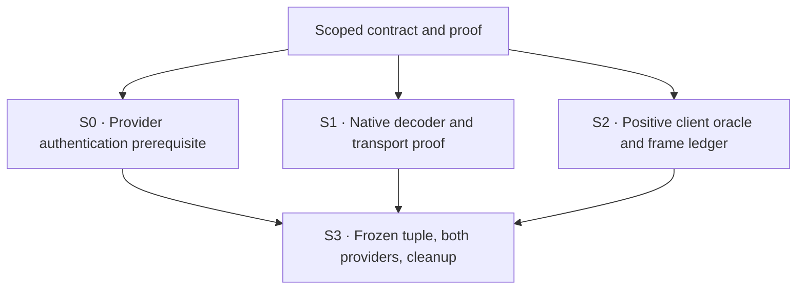

# M1 — Clean model selection without inherited effort writes

Apply the CLI's model-only update without pinning an unavailable inherited effort, then acknowledge only Codex's extra model/effort-default save. Keep actual provider state truthful and Codex configuration untouched.

This bounded repair retains the native default-save contract and required Cursor connection authentication, and adds the reviewed catalogue-qualified model-only translation. It does not wait for the full unavailable-command, information, client-startup or broader ACP-control design. Those outcomes remain open in the project roadmap. **Requested terminal: pr-ready-unmerged**, under the owner's A repair-fork commission. One bounded repair PR; no merge, release, install or production replacement.

## Result and governing basis

| Field | Value |
| --- | --- |
| Plan path | `docs/specs/2026-11-02-acp-shared-control/plans/2026-11-02-m1-model-only-selection.md` |
| Planning result | ready, for bounded M1 model-only/default-save handling plus its provider-startup prerequisite only |
| Originating planner | plan-update |
| Supersedes | [2026-11-02-m1-provider-authentication.md](2026-11-02-m1-provider-authentication.md), unchanged at its original path |
| Governing basis | reviewed-four-document-design, affected M1 scope below |
| Requirements | [Requirements](../requirements.md), affected U1/U3/U4/U6/U7 and fixed unchanged-client/provider-only boundaries |
| Specification | [Specification](../specification.md), R1 provider-startup prerequisite, R3/R5 model-only family, R4 and exact default-save family of R3/R9; corresponding R10/R11 and unchanged R12–R14 authority |
| Program Design | [Program Design](../program-design.md), Model selection without an inherited effort write and its target-row table; Provider startup; incorporated [Default-save compatibility](../../2026-10-31-codex-cli-acp-actions/program-design.md#default-save-compatibility), intent/config rules |
| Verification Design | [Verification Design](../verification-design.md), A0 authentication, A1 model-only/provider-effort preservation, U3/U4 rows, routes A/B, regular PersistModelSelection witness and test dispositions |
| Scoped review basis | Model-only/A1 four-document correction: project post `01a19f3e-cb56-75ba-b0c0-df0f1b08f094`, preserving independent Reviewer baseline `01a19f39-191a-71d3-ba5a-2bafc125f80e` and correction `01a19f3e-2e0f-7721-af3c-2b211ce5417d`. Unchanged native/default-save basis: post `01a19cf3-8397-7024-b6b8-c5d6bc756604`; auth/A0 basis: post `01a19e52-d2e8-71fa-8571-92e1ecd758d2`. Posts use post_show; pushes use router_show. |
| Applicability | Execution branch `fix/cli-bridge-repairs`, product checkpoint `bdef71cffb02df3fb18e2ff3e856fcf3ddaf3a0c` on bridge `82a0d53bba6e2c9ae7ad0f42ef96eecc6927e999`; reviewed design `7cee8dce3a472116d61384fda8d8c00c6eb6a024`; native `360319d8dee62d87e2d59fc0c21805d79519cfed` / unchanged Codex 0.165. Parent current-main integration remains a separate readiness dependency. |
| Delivery context | requested terminal: pr-ready-unmerged; delivery grouping: single:M1-default-save; PR topology: one-pr; execution repository/worktree: `/Users/shravansunder/code/projects/codex-router.fix-cli-bridge-repairs`; governing plan/design remain in the B worktree at these linked paths |

The sole plan authority is this Markdown document; its HTML is a generated reader. The existing work board is retained outside the canonical record. No whole-set ready result or merge authority is implied. Execute only under the owner's current A commission and this declared delivery context.

## Changed from the authentication plan

| Change | What it invalidates or preserves |
| --- | --- |
| Add the closed model-only decoder translation to S1 | The earlier first-refusal/complete-mask policy for this family. Actual model application replaces refusal; neither an inherited unavailable effort nor a guessed default is written. Existing explicit, offered Select and null/default paths remain. |
| Add VD A1 and its target-row countercases | A ProviderSettings-only happy path could hide the sibling Select/unoffered-hint error. Require both that repair and the offered-value control; preserve actual saved effort and next-turn checks. |
| Requalify S2's early settings-error sensitivity and S3 on the final tuple | An earlier successful default-save receipt or a later clean frame cannot qualify the model-only repair. Both real provider journeys must change the actual model; effort-only changes do not exercise the first update. Whole-run error and config/lifecycle gates remain. |
| Preserve independent model requests | The old failing diagnostic's one model setter is not a preservation rule. A successful two-request ProviderSettings pair makes two explicit model setters before any next prompt, zero effort setters, and no extra setter from the save. No coalescer/cache change. |
| Retain S0 authentication and exact default-save behavior | Their earlier source-scoped evidence remains reusable where dependencies are unchanged. Do not rebuild those mechanisms or repeat equivalent proof without a changed dependency or unresolved concern. |
| Keep delivery grouping and boundaries | Same bounded repair PR and pr-ready-unmerged terminal; no extra PR split, parent integration, full command/control exposure, model prompt or provider upgrade is added. |

Retain the existing authentication, native-save and frame-ledger implementations as inputs. Re-plan only the model-only decoder, its missing controlled countercases and early-error sensitivity, then qualify the final combined tuple. Existing evidence stays at its original source identity; it never turns the previous failed Cursor journey into a pass. Parent integration remains outside A's repair write set and is still a readiness dependency.

## The bounded contract

### Apply the model-only update

Use the reviewed PD's complete family, not top-level null alone: SettingsUpdate source; actual nonempty NUL-free top model; omitted/null top effort; well-formed Default mask with the same model and permitted hint/developer-instruction fields; existing unsupported-field checks unchanged. The target row either offers only ProviderSettings, or is Select and its non-null inherited hint is absent from that row's values. Reuse the existing ProviderSettings intent to apply the actual model with no effort command. A Select row offering the hint, or with omitted/null hint, retains existing precedence/default behavior.

Success follows actual model application and confirmed state. Do not substitute a known Select default as a requested write, fake the first ACK, wait for a partner RPC or add rollback. The separate effort request retains its existing meaning and fresh validation. ProviderSettings pairs have zero effort writes; a later explicit offered Select effort may write its selected value normally. Exact authority, expected-model, uncertainty, failure and truthful partial-effect rules remain. This explicitly supersedes only the earlier model design's first-refusal cost for this closed family.

### Acknowledge the extra default save

Recognize `config/batchWrite` only when the whole request is the checked model-default intent: exactly one `replace` edit for nonempty NUL-free `model`; one `replace` edit for null or nonempty NUL-free `model_reasoning_effort`; no duplicate/other edits; no file target or expected version; `reloadUserConfig: true`. Optional null/omitted file/version fields mean no target/version. Keep `provider` and custom effort strings valid; no provider catalogue read is needed for this harmless receipt.

Return the native-compatible receipt: `status: "ok"`, `version: "acp-compat-noop-v1"`, `filePath: "/dev/null"`, `overriddenMetadata: null`, preserving the request ID. The sink path is a receipt marker, never a file to create/write or a compare-and-set version. All unmatched writes retain their existing refusal/error contract. Validate the full batch before recognizing any subset.

The handler adds zero setting calls, filesystem writes, trust grants or provider-default persistence. The model-only translation above uses the existing provider path; ordinary explicit selection can legitimately make separate model and effort calls. The save handler adds no ProviderBehavior call. S0 alone adds the required pure initialization policy method; no DI container, settings store, new native command or global method registry is allowed.

Outside this plan: duplicate input/history, full command enumeration implementation, other native persistence intents, Max/Ultra/Plan/all-modes qualification, real-provider inference after model selection, provider-package upgrades, context/security snapshots, client activation/skill-startup repair, exact-control changes, F1 exposure, Host/process separation and production replacement. Native/reverse preservation is retained, but full R1 and broad U3/R3/R9 remain project obligations rather than claims earned by M1. The actual-provider model-only journey allows no model prompt; successful inference is not inferred from settings readback. The existing permanent controlled next-turn check remains part of S1 and does not authorize a live diagnostic prompt.

## Sequence and ownership



S1 and the S2 apparatus-only update may overlap after the contract is fixed: Implementer owns native Rust, paired Verifier owns the assigned TS apparatus. One writer per shared capture/schema file; serialize Git/index and integrated runs. Neither depends on M4. S0 can proceed independently of the existing native/apparatus owners once its required-method contract is fixed. S3 begins only after all three local gates pass on one source tuple; do not overlap writes to shared fixtures or runtime files.

### S0 — Existing Cursor connection authentication

Retain this startup contract and its source-scoped evidence. Requalify only dependencies changed by the remaining implementation; the final S3 tuple still observes both providers. These steps describe the kept behavior, not permission to reimplement an unchanged handshake.

**Reads:** PD Provider startup: authenticate before admission; VD A0; official Cursor ACP request flow; locked schema v1 AuthMethod/AuthenticateRequest; current `provider_initialize_request.rs`, `provider_connection_task.rs` and `provider_model_discovery.rs`. Read the existing provider DI implementations and all eight trait consumers before the hard cutover.

**Write surfaces:** `crates/acp-client-runtime/src/provider_behavior.rs`, its sibling `_test.rs`, `src/lib.rs`, `src/agent_session_client/provider_initialize_request.rs` with sibling `provider_initialize_request_test.rs`, and `provider_connection_task.rs`; the existing Cursor/Claude/Standard behavior modules and their sibling tests in `acp-provider-adapters`. Migrate these five existing test-double implementations together: `acp-client-runtime/src/provider_behavior_test.rs`, `tests/create_settings_order/settings_tail_tests.rs`, `tests/cursor_model_settings/acp_wire_fixture.rs`, `tests/provider_behavior_integration.rs`, and `tests/support/provider_behavior.rs`. Add the real wiring cases through existing `codex-router-host/tests/external_provider_supervisor/lifecycle_tests.rs` and `verification/fixtures/supervisor-integration-agent.ts`, reusing `AcpExchange` and causal fixture controls. Extend the existing runtime lifecycle integration target if its narrower seam is needed; keep actual test discovery. No Cargo dependency, crate, provider fixture server, auth store, new tool or production flag.

1. Establish the failing order through the existing real runtime/controlled-peer route before implementation: advertise cursor_login, expect authenticate before the optional cursor/list_available_models read and before readiness/session work. This test can use the existing production Cursor adapter without referring to the future trait method; an old-runtime model-discovery/session request before authentication must fail. Retain the actual failure, not only a compiler error.
2. Add the required pure policy method and closed policy in the existing behavior home. Cursor requires cursor_login; Claude/Standard explicitly use NotRequested. Update all eight implementations atomically; no default trait method, provider-name branch in shared I/O, compatibility overload or new policy store.
3. Validate the selected raw offer at the existing initialize decoder before SDK deserialization can drop a malformed duplicate or turn an unknown type into its untagged Agent fallback. Require exactly one selected ID and absent/agent type, plus valid typed Agent data. Cover missing/wrong list, duplicate including one malformed duplicate, Terminal, unknown/null type and selected malformed fields. Do not reject an unrelated malformed row merely to harden beyond this selected-method contract.
4. On successful protocol-v1 initialization and valid required offer, use the existing typed AuthenticateRequest transport. Race its await with the owned shutdown signal and remaining initialize_deadline; then perform existing optional model discovery and publish readiness. Never start another timeout budget or request a session before the successful handshake. Keep existing sanitized failure handling, auth-status notification semantics and child/connection cleanup.
5. Hold the authentication reply with a causal fixture gate: assert no model discovery, session request or ready result while held, then release and observe the required wire order. A deadline is a bound, not proof that no early request happened. Cover rejection, malformed reply, timeout and shutdown through the actual task path, with no session or prompt and owned settlement. Keep the fixture's existing authentication-rejection mode and current auth-status tests as separate contracts.
6. Verify Claude/Standard send no authenticate request and preserve initialization behavior, and that a new/replacement Cursor connection authenticates once while additional sessions/settings on one connection do not repeat it. Keep native and richer MCP authority unchanged; successful authentication is not a permission grant or model-execution proof.

**Proof earned:** VD A0 / the R1 prerequisite and M1 R10/R11. The oracle is the official provider flow plus selected-method SDK semantics, not a new helper's output. Preserve model-default and history/approval oracles. Existing initialized-client lifecycle, notification-auth and no-effect create/prompt authentication tests are kept; repair only assumptions actually changed by the new required Cursor handshake. New unit bodies are colocated, and every TypeScript fixture remains runnable by the existing declared Node path.

**Before S3:** run focused new authentication cases with nonzero discovery, relevant whole runtime/provider/Host suites, Clippy/fmt, TypeScript package gates and the unchanged cycle ratchet. A controlled peer does not qualify the real provider. The retained minimized reference is not a discriminator witness or a Rust runtime test. Observe actual offer validation during the combined-source Cursor run and then repeat both-provider S3; no extra diagnostic prompt or owner re-login is planned.

### S1 — Native behavior and controlled proof

**Reads:** both bounded contracts above; PD Model selection without an inherited effort write and its target-row table; VD A1 and routes A/B; current `native_provider_settings.rs`, `native_provider_settings_test.rs`, `app_server_model_catalog.rs`, Host `provider_model_catalog.rs` and `tests/provider_native_models.rs`. For retained default-save behavior read `router_session_app_server_methods.rs`, the dispatch path, and native `config_update.rs:56–104,155–172`, `model_defaults.rs:121–133`, `v2/config.rs:345–371,1123–1146`. For the new producer rule use exact native `thread_settings.rs:22–32,75–92`, `event_dispatch.rs:2110–2133`, `chatwidget/settings.rs:298–317` and `model_popups.rs:291–332,582–590`.

**Write surfaces:** the existing `crates/collaboration-runtime/src/native_provider_settings.rs` and sibling `native_provider_settings_test.rs`; existing `crates/codex-router-host/tests/provider_native_models.rs` and only the needed scenario in `crates/acp-client-runtime/tests/support/behavior-agent.ts`. Retain existing `router_session_app_server_methods.rs`, private `native_model_defaults.rs`/sibling test and colocated native WebSocket tests for default-save; edit them only for a source-backed defect in that unchanged contract. The native settings helper uses its existing model-row/intent types. No trait/API/crate/Cargo change, new provider server or file/trust writer is added.

1. Preserve the original default-save failing evidence and existing exact recognition/receipt, wired only into the provider-session facade's `config/batchWrite` branch. Do not recreate an already-repaired refusal merely to obtain another red run.
2. Use a table over the rule: both edit orders; null, `provider` and custom efforts; null/omitted optional target/version fields; actual NUL versus harmless literal backslash-zero.
3. Countercases cover empty/non-string/NUL values, duplicate/missing/extra edits, wrong strategy/reload, explicit file targets (including `/dev/null`), expected versions (including the receipt version), mixed trust/hooks/features and single-value/legacy methods. None can yield the compatibility receipt or an effect.
4. Through the actual native WebSocket server and existing controlled ports, apply the ordinary setting sequence, record its baseline, then send the extra batch. Assert its correlated exact receipt, no additional setting/command calls and unchanged controlled configuration. A direct helper test alone does not prove dispatch.

5. For the model-only correction, first change the required outcome in a permanent case so the unchanged decoder fails on the captured first request. Cover omitted/null top effort and the exact matched mask/row. Use one rule table for permitted hints and rejected/nonmatching forms; add no temporary test file or new dispatch layer.
6. Implement only the qualified effort-intent choice in the existing decoder. Preserve field validation before recognition, selected-row membership, unsupported controls, complete-mask priority outside the family, and existing actual model application/confirmation. No write of an inherited unavailable hint or substituted default.
7. In the existing real Host/native-to-controlled-ACP integration, start A/high and B/saved-low. For a ProviderSettings target, assert one actual model setter and zero effort writes after the first response. After the independent second provider action require two total model setters and zero effort writes, **before** any next prompt. The subsequent default-save batch adds no setting calls. A controlled next turn may legitimately reassert its current context; count that phase separately while preserving B's saved low.
8. Add the Select target that offers low but not inherited high: the old build's model-then-refused-effort path must fail. Require actual model application, no first-request effort write and B/low readback without changing its saved value. A paired target that does advertise high must retain its actual high write; blanket Select delegation fails. Omitted/null Select hints keep qualified default handling. A later explicit offered low request remains a real effort write.
9. Preserve explicit numeric ProviderSettings refusal, mask-only/conflicting/unknown/reserved/model-type/hint-type/empty/NUL cases, Plan, developer instructions, serviceTier including null, other unsupported controls, sparse/create/resume/TurnContext and model-failure/uncertainty behavior. Explicit invalid Select effort keeps its truthful current partial-effect result; do not assert new whole-request atomicity. Never weaken authority, expected-model or fresh-validation checks.
10. Retain independent readback and the permanent controlled next-turn check. A success response, returning the requested model or a later request repairing the wrong first effect cannot pass.

**Existing tests:** keep the CWD test `default_model_batch_write_is_refused_without_project_trust_advice` as a negative case: it supplies an explicit file path. Keep trust/mixed/empty/unknown-method refusals. Do not flip every model batch from refusal to success or remove a negative test. New unit bodies are in the sibling `_test.rs`; no temporary test file.

**Earns:** R3/R5 model-only translation through VD-A1, plus R4 and the exact default-save R3/R9 family through VD-A. Independent oracle: the owner-authorized no-op shape and pinned client DTO/consumer, not the new helper's own output. Expected pre-change signal: the recognized no-target batch returns the old `-32000` refusal instead of the specified receipt. S1's actual native/Host controlled gates run before S3. Repair only the old first-refusal expectation of `native_primary_enter_provider_settings_does_not_write_inherited_effort`; preserve its zero-effort, saved-default and next-turn oracles. Keep explicit-effort partial-failure and other negative tests, adding the Select countercase instead of deleting coverage.

### S2 — Lasting positive client proof

Retain the existing positive persistence witness, frame ledger and literal BSU/ESU tests. For this correction, parameterize the existing early-error sensitivity case with the captured **Failed to update thread settings** line as well as the save-default error, followed by a clean success frame. Reuse the existing wterm parser/runner; no replacement renderer or error-suppression rule. Earlier S2 evidence is preserved where unchanged, but cannot qualify changed product code or the final actual tuple.

**Reads:** VD-B's bounded M1 witness; `codex-acp-model-scenes.ts` and its positive/sensitivity tests; the existing `codex-acp-frame-observation.ts` and sibling test; common scene/checkpoint matching; `codex-acp-run.ts:331–347,392–485`; `terminal/pty-grid-driver.ts:168–200,227–245`; native `model_popups.rs:291–333,478–591,715–719,769–774`, `event_dispatch.rs:2563–2595` and `config_persistence.rs:1036–1048`.

**Write surfaces:** existing `scripts/verification/tui/codex-acp` model scenes, shared checkpoint matcher/run modules and their sibling `.test.ts` files; a focused `codex-acp-frame-observation.ts` and sibling test for the already-required whole-run frame ledger. Reuse the existing wterm core and original PTY bytes/resize history. No new renderer, provider fixture server, G4 transport control or arbitrary `--remote` override is required.

1. Make default-apply positive proof require the regular success-only persistence info cell after this run's primary Enter. Derive its exact text from the native formatter: wire effort spelling/lowercase, `default` for None/None-effort, and the actual model ID. Menu effort labels are not message labels. Declare a viewport where the selected literal fits unwrapped.
2. Extend the existing checkpoint shape with exact info-cell matching. Reject suffix-only advanced/session/mode confirmations, stale pre-action text, two visible matching messages, an open popup and the red save error. Repainted frames do not count as repeated messages.
3. Retain the repaired test that previously permitted the default-save refusal as the positive outcome. Keep that old red frame as a sensitivity case that the positive oracle rejects. Preserve unrelated negative journeys.
4. Inspect the whole retained PTY stream with the existing wterm parser, observing completed synchronized frames rather than only checkpoints or one final snapshot per read. The current core's afterChunk callback is per byte chunk, not per frame. Pin the actual synchronizedOutput/generation semantics with a permanent literal BSU/ESU two-frame/split-chunk test before using them. Reuse byte order and the complete in-process resize history, including events after the last checkpoint, and take a stream-end snapshot for unbracketed output. Do not grep raw ANSI or lose an error when one read contains several frames. Record the first forbidden error and frame/byte identity; missing/partial observation cannot pass. Existing originals and child/lifecycle checks remain intact.
5. Add permanent chunk-boundary/multi-frame tests, exact-message countercases and a controlled runner test showing that a forbidden error cannot disappear behind a later clean checkpoint. Replaying smaller slices through the existing createTerminalCore is sufficient; no writeRaw afterChunk-as-frame assumption, baseline blessing or custom terminal parser. Use the same bytes/resize offsets to check final-grid equivalence.

**Earns:** R10 for M1 and the UI portion of R4, VD-B. Independent oracle: native regular PersistModelSelection emits this confirmation only after a successful typed receipt. The other conversation-change line can skip persistence and must fail this witness. Keep all existing error gates; a setup/earlier failure cannot be relabelled M1 success. Whole-run capture does not itself prove provider state or absence of writes.

### S3 — Integrated declared-target qualification

**Reads:** S0/S1/S2 results; VD-A0/A1/A/B and the project recipe `.agents/skills/verify-codex-router/SKILL.md`, `references/codex-acp-journeys.md` and `references/acp-metadata.md`; current target/run/observer schemas and config guards. Recipe history is prior evidence only. Its older instruction to accept the default-save refusal is superseded for this exact M1 positive case; other safeguards stay.

1. Freeze one clean combined S0–S2 source/build/client/provider tuple. Existing S0/default-save/S2 code and observations are retained at their original identities. The changed native settings path requires the affected controlled/package proof and both actual-provider journeys on this final tuple; unrelated unchanged proof is not repeated for ceremony. Use normal signed debug Host/Router and the existing signed Rust PTY driver; no scratch Cargo target, installed replacement, provider upgrade or production process action. Inspect current base/source drift and tool/provider versions before input. A changed native consumer invalidates the receipt qualification.
2. Declare isolated Claude and Cursor targets separately using the existing recipe, with trusted launch cwd, raw Session/native alias, real sockets/service/epoch, tool hashes, permitted model-setting effects and bounded lifetime. Create private provider Sessions through the public setup route with the owner as approver (`--approver-owner`), then use the existing **resume** target. Do not reuse the owner's manual conversation or a stopped allocation's socket. M1 needs neither G4 fresh-start acquisition nor its held-response control.
3. Record the actual pre-selection values and choose a different actual advertised model, not the reserved provider-default action, with its offered plain effort or Use provider settings action. The actual model must change; an effort-only change cannot exercise the model-only correction. Press primary Enter and require the regular persistence confirmation plus the whole-run no-error result. Do not choose `s`, Max/Ultra, Plan/all-modes or merely declare a matching outcome string. Record whether the selected actual catalogue exposes ProviderSettings or differing Select values. A missing real differing-Select case limits that actual-tuple coverage; its permanent controlled countercase remains mandatory. If no model change/path is available, report the setup gap before claiming this gate.
4. Run the same-session observer through its CLI entry; require the native model/effort and provider Session catalogue's current values to agree. The UI line is the persistence witness, not the effective-model oracle. Require no early settings error as well as no save error. For a recognized first request preserve provider-owned effort and the separate chosen effort action; do not infer an effort default from a menu label. Retain normal setting application and S1's proof of zero extra save calls. Guard normal Codex configuration before/after under the existing recipe; native save adds no write, while ordinary provider-owned persistence retains its established meaning.
5. This uses the recipe's model-only journey: no ordinary reply, skill, image, retries or diagnostic model probes. Capture normal quit, owned child/session/Host settlement and final config guard. The broader model-plus-inference gate remains explicitly unverified by M1; adding it requires its own declared input/proof scope. Credential/setup failure is not a product pass and does not authorize changing accounts, roots or production.

**Earns:** the actual-provider/client part of R4 and M1 R10; scoped preservation only. Package/native/reverse controls remain kept; no universal CLI or full R1/R5 claim. If an unrelated known startup/route/receipt defect prevents this gate, retain the evidence and route the exact defect to the Lead; do not weaken the oracle or silently expand M1. Debug auth-file residue remains the owner's accepted non-blocker, not a new cleanup prerequisite.

## Obligation and proof ledger

| Obligation | Slice / deciding gate | Kept limits |
| --- | --- | --- |
| R1 startup prerequisite; R10/R11 | S0 raw/typed policy cases + real runtime/peer wire order; S3 actual Cursor startup and both-provider combined-tuple model journeys | No terminal login, store, synthetic auth fact, inference or method-kind claim from the minimized reference |
| R3/R5 model-only translation | S1 decoder table + real native/Host controlled ProviderSettings and Select-unoffered cases; S2 early-settings-error sensitivity; S3 actual model-change journeys | Offered/null Select, explicit effort and partial-failure behavior stay distinct; actual absent Select variants remain named limits |
| R4 exact receipt/no extra effects | S1 permanent rule table + actual WebSocket/controlled-port test | Any explicit file/CAS/mixed batch still refuses; no provider defaults store |
| R3/R9 exact housekeeping family | S1 negative family + unchanged other-method/refusal cases | Rest of R3/R9 and broader U3 remain open |
| R4 actually exercised by the client | S2 exact success-only cell; S3 original CLI primary apply | Advanced skipped-save text, session-only text and picker presence cannot pass |
| R4 actual selected state/config | S3 same-session provider/native readback + config guards; S1 no extra dispatch | No source/capture alone establishes effective provider state |
| R10 M1 sensitivity/lifecycle | S2 old-save/early-settings-red and multi-frame checks; S3 success-only witness, actual model/effort readback, whole-run errors and normal exit | A blocked run or later clean frame is not a pass; no inference is claimed |
| R11 structural hygiene | S1/S2 colocated discovery, package checks and cycle ratchet | No broad native registry, provider DI change beyond S0, new dependency or baseline weakening |

Proof layers follow the project recipe: permanent native transport/controlled-peer checks, TS apparatus checks, then original PTY/wterm plus real-provider observation. A stand-in earns only its controlled boundary. There is no missing provider stand-in to invent; unavailable actual access leaves S3 unverified.

## Commands and gates

Run from the repository root. Do not run these merely to author this plan.

```sh
cargo check --locked -p acp-client-runtime -p acp-provider-adapters -p codex-router-host
cargo nextest run --profile ci --locked -p acp-client-runtime -p acp-provider-adapters -p codex-router-host -E 'test(initialization_authentication)'
cargo nextest run --profile ci --locked -p acp-client-runtime -p acp-provider-adapters -p codex-router-host
cargo clippy --locked -p acp-client-runtime -p acp-provider-adapters -p codex-router-host --all-targets -- -D warnings
cargo check --locked -p collaboration-runtime
cargo nextest run --profile ci --locked -p collaboration-runtime -E 'test(native_model_defaults) | test(router_session_app_server)'
cargo nextest run --profile ci --locked -p collaboration-runtime -p codex-router-host -E 'test(native_provider_settings) | test(native_primary_enter)'
cargo clippy --locked -p collaboration-runtime --all-targets -- -D warnings
cargo fmt --all -- --check
pnpm --dir scripts/verification/tui install --frozen-lockfile
pnpm --dir scripts/verification/tui run typecheck
pnpm --dir scripts/verification/tui run lint
pnpm --dir scripts/verification/tui run format:check
pnpm --dir scripts/verification/tui run test
pnpm --dir verification install --frozen-lockfile
pnpm --dir verification run check
pnpm --dir verification run lint
pnpm --dir verification run format:check
pnpm --dir verification test
cargo nextest run --profile ci --locked -p collaboration-runtime
cargo nextest run -p workspace-architecture-check --run-ignored only
```

Verify focused test discovery/names before accepting that filter; zero matched cases is failure. Use the repository's nextest reservations and signing runner. No `ARCHITECTURE_BLESS` growth, skipped gate, retry-as-success or deadline expansion.

Build the existing PTY test artifact, then build/sign the normal binaries separately so test features do not become the shipping candidate:

```sh
cargo test --locked -p codex-router-quota-reset-test-harness --test quota_storyboard_capture_test --no-run --message-format=json-render-diagnostics
cargo build --locked -p codex-router-cli --bin codex-router --message-format=json-render-diagnostics
cargo build --locked -p codex-router-host --bin automation-debug-host --message-format=json-render-diagnostics
cargo build --locked -p agent-collaboration --bin agent-collaboration --message-format=json-render-diagnostics
scripts/cargo_debug_signing_runner.sh --sign-only target/debug/codex-router target/debug/automation-debug-host target/debug/agent-collaboration
```

Retain compiler records in private run evidence, resolve/sign the exact derived driver artifact, and record source/features/signature/hash through the recipe. Use the normal-dependency `automation-debug-host` bin, not its example. The normal candidate must have empty test-guard features. The current main recipe's normal `target/debug` rule and repository build-storage instructions take precedence over the older metadata reference's separate-target wording. No copied binary, scratch Cargo target or invented launcher is used.

For each validated private run/observer plan:

```sh
node scripts/verification/tui/capture/capture-run.ts --codex-acp-only --codex-acp-plan PLAN.json --check
node scripts/verification/tui/capture/capture-run.ts --codex-acp-only --codex-acp-plan PLAN.json
node verification/observations/acp-journey-observation.ts OBSERVER_PLAN.json
```

`PLAN.json` is a declared target, not a placeholder permission to launch anything. Node is the declared runtime; Bun support must be separately qualified before claiming it. S3 may not start until the signed target, access, lifetime and allowed effects are concrete. No browser automation replaces the original PTY/wterm route.

## Completion and stop conditions

M1's eventual implementation is complete only when its permanent/static gates pass, both real provider/client cases earn the positive persistence witness and actual readback, configuration/no-extra-effect controls hold, owned lifecycle settles, and the Lead assesses the current evidence. Record commands, counts, exits and uncovered behavior. The **pr-ready-unmerged** terminal additionally requires independent implementation/proof review, the applicable current-base integration and required CI/comments/threads/mergeability checks. Parent current-main integration remains a separate readiness prerequisite, not permission to absorb its hundreds of conflicts into this repair or bypass its regression checks. Broader outcomes stay open; no merge, release or production replacement is authorized.

Stop/replan if the model-only translation or recognition/receipt needs another client contract; if preserving explicit/offered effort requires a broader guard, coalescer or new mechanism; the real regular picker path cannot be qualified; frame observation can miss the relevant error; a test changes an oracle instead of behavior; source/provider drift changes meaning; the repair needs a provider-trait change beyond S0, a store, trust grant, new transport or unrelated effect; or a gate is blocked. Bring the exact semantic/proof gap to the Lead. The owner's A execution commission and this declared context govern delivery; a carrier must not widen them. Before any future user-facing merge, satisfy the repository's unused-version/Cargo.lock and release requirements under separate merge/release authority.
