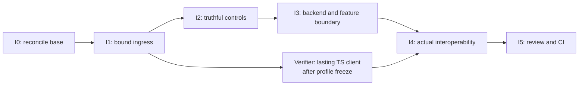

# Incoming ACP, outgoing providers and shared application features

Make a standard ACP client reach the selected provider through the existing Host. Keep the Codex CLI, MCP and provider execution paths faithful to their own contracts. This plan delivers R16–R22; it does not claim to finish the separate CLI command backlog.

## Canonical result

```text
plan path: docs/specs/2026-11-02-acp-shared-control/plans/2026-11-04-acp-interfaces-fleet-alignment.md
originating planner: plan-update
supersedes: docs/specs/2026-11-02-acp-shared-control/plans/2026-11-03-acp-interfaces.md
planning result: ready
governing planning basis:
  kind: reviewed-four-document-design
  Requirements: docs/specs/2026-11-02-acp-shared-control/requirements.md
  Specification: docs/specs/2026-11-02-acp-shared-control/specification.md
  Program Design: docs/specs/2026-11-02-acp-shared-control/program-design.md
    normative chunk: docs/specs/2026-11-02-acp-shared-control/interface-design.md
  Verification Design: docs/specs/2026-11-02-acp-shared-control/verification-design.md
  current four-document review/remediation result identities:
    Fleet refinement baseline: router://0ff962c5-7fa3-4c18-a5ca-1bbe8db09e89/push/01a1a6a4-d3f6-7d03-8926-c8f171b2cbd8
    N1 correction check: router://0ff962c5-7fa3-4c18-a5ca-1bbe8db09e89/push/01a1a6a6-bda6-7e91-a67a-dcd2eef40573
    parent-verified correction: 4f4dd7b23
    preserved complete interface review: router://0ff962c5-7fa3-4c18-a5ca-1bbe8db09e89/push/01a1a129-ae29-7790-aab1-64fab80c816e
  current applicability anchors:
    design branch: feat/acp-cli-actions
    design HEAD: 4f4dd7b234009aae724bdee5d834abde03d242bd
    released bridge: cbf56bad640ae981900c646ff2ae0b64aaaebd3b
    current main snapshot: 0f9af21f602f79ee5a07f679f5cf63c7c896bb0f
    Fleet design: 1702e42883668df1b41032d18af94ab737472b8f
    D1 Central: ef87b73d301819b1e5fda9907bce27e45c5fac72
    D1 Router: 18f1fd517f94fda9e140f9f755676ce00247054a
    Fleet library snapshot: 15714a5
    Fleet owner boundary: router://0ff962c5-7fa3-4c18-a5ca-1bbe8db09e89/push/01a1a69e-a290-71d3-963c-790e595bf82f
    native client source: 360319d8
    outgoing ACP schema: locked agent-client-protocol-schema 1.9.1, protocol v1
    scope: R16-R22 with R13/R18/R20/R22 Fleet preservation; legacy CLI obligations retained
delivery context:
  requested terminal: plan-only
  delivery grouping: single:acp-interfaces
  PR topology: one-pr
  repositories: agent-collaboration/agent-collaboration
```

The reviewed interface scope is ready to plan. Implementation waits for an explicit act-mode commission and I0's current-base/Fleet handoff check. This record grants neither. The first interface plan remains unchanged at its original path. A's completed M1 plan remains a separate historical repair basis. Tracking stays outside this immutable record.

## Changed from the first interface plan

| Change | What it invalidates or preserves |
| --- | --- |
| Use the released bridge/current main | Replaces I0's old pending337-conflict parent integration. A completed that work; B performs current source admission. |
| Add Fleet preservation F1–F4 | Replaces affected R22 proof scheduling; all V16–V21 outcomes/oracles and native/MCP/reverse/M1 preservation remain. |
| Serialize active D1 shared writers | D1 owns startup/mail/protocol/Cargo changes first; B adopts landed D1 or an explicit bounded handoff before shared-file edits. No blanket wait for future D2–D4. |
| Exclude unsettled remote bindings | B preserves fields recorded by Fleet's adopted owner; it selects no RemoteRequester, operation-ID equality, blanket Approver or new remote API. |
| Preserve delivery and proof strength | Same one PR/plan-only context. No new store, migration, task system, dropped observation or weaker oracle. No B product slice/proof has executed, so none is invalidated or reclassified. |

Unchanged slices carry forward below. F2 uses the existing controlled-provider terminal hold; no new instrumentation inside D1's reserved mail runtime.

## What each checkpoint gives us

| Checkpoint | Result someone can try | Completion gate | Forecast after I0 |
| --- | --- | --- | --- |
| I0 Base and Fleet admission | Current implementation base and existing owners | Adopt source, active Fleet boundary and shared-file handoff/landing order | D1 landing or bounded handoff; no calendar promise |
| I1 Bound client | `agent-collaboration acp --endpoint <provider>` carries a metadata-free ACP client to that provider | Real controlled Host lifecycle, identity isolation, stdio and conversation preservation | 0.5–1 active working day |
| I2 Truthful controls | Discover and change the real offered model/mode/effort, then close | Active catalogue read, actual setting effect, full response and failure cases | Another 1–1.5 days |
| I3 Extensible boundary | Standard peer, Host features and mail keep their existing owners | Registration/queue effects plus shared-Host custody/authority | Another 0.5–1 day |
| I4 Actual interoperability | Claude and Cursor work through the bound client, with native/MCP/reverse preservation | Declared real-provider journeys, exact callbacks, result timing and cleanup | Another 1–2 days |
| I5 Reviewable change | One coherent follow-up PR with honest capability coverage | Independent implementation/proof review and current-head repository CI | Another 0.5–1 day |

These are initial engineering forecasts, not measured durations or finish dates. They assume one product writer, an independently writing Verifier and available provider access. I0, account/permission waits and CI queue time are excluded. Re-estimate after the first integrated I1 result; the older M4 CLI milestone is not an inherent dependency of these interface slices.



I1–I3 share Host/profile/route owners and are serial. D1 is the active shared startup/mail/protocol writer: B adopts its landed version or receives an explicit bounded handoff before touching those owners. D2/D3/D4 are not blanket prerequisites. The TS driver can overlap I2 only in its separate observation files after I1's profile is fixed. One writer owns shared schemas and controlled fixtures. I4 uses frozen product and apparatus sources, with one allocation owner; it never overlaps product edits. Milestones are checkpoints inside one PR, not separate branches or an automatic stack split.

## Scope and source reality

Use explicit constructors and existing ports. Incoming profiles belong to the ACP shell; provider behavior belongs to the outgoing runtime; application features belong above execution. Keep MCP's richer generation/operation/authority inputs, native TurnStarted results and ACP v1 terminal replies distinct.

Current source has the needed runtime, supervisor, command/event ports, byte-preserving stdio bridge and pure Standard/Claude/Cursor behaviors. It lacks the selected bound profile, a profile-qualified initialize offer, active inspection injection and incoming setting/close handlers. Adding an `Acp` channel to external-provider discovery would break existing conversation selection; the reviewed design instead derives a separate bound facade and preserves execution channels.

I0 admits the actual execution base. A's released bridge/M1 integration is complete at cbf56bad6; main0f9af21f6 is the planning comparison. Fleet D1 remains an active separate lane. Read the adopted current source before B writes startup/shared application/protocol/store composition. If D1 is still in flight, obtain the Fleet Lead's explicit bounded shared-file handoff first; otherwise adopt its landed composition. Compare contributions from their merge base, never copy an older Fleet tree over later bridge code. Record adopted heads, reserved paths, writer and merge order in the execution trace.

D2's typed Fleet sender, delivery address, first-input replay and creator/Approver bindings are unadopted. B preserves an existing implemented feature but does not build or repair D2 to satisfy this plan. D3 identity cutover and D4 central automations remain separately owned. No new machine ID, old-ID alias, metadata migration, duplicate outbox, table-name assumption or local-owner substitution.

I0 closes with current source/ownership admission, not a claim that all Fleet deliverables are implemented. A changed adopted boundary returns to design and plan-update before dependent work. Never replay old runtime proof onto a new base by assumption.

Excluded: CLI menu changes, MCP-to-ACP universal translation, arbitrary mutable config IDs, remote ACP identity, ACP v2, task/delegation APIs, a new plugin/DI framework, another executor, store/schema migration, SQLite distribution, inbox/outbox policy, scheduling and future Host/proxy/app-server process decomposition. Existing G2–G4 outcomes stay open in the separate CLI roadmap. No install, production replacement, merge or release is authorized.

## Files and owners

| Write surface | Work allowed here |
| --- | --- |
| `crates/codex-acp-adapter/src/{acp_connection_router,connection_negotiation,acp_connection_dispatch}.rs` | Closed connection profile, ambiguity-aware raw IDs, route-support projection and profile-aware dispatch; keep existing Codex route behavior. |
| `crates/collaboration-runtime/src/{acp_channel_listener,provider_acp_session_route,private_socket_listener}.rs` | Bound listener construction/lifetime and incoming provider handlers; reuse socket guard, writer and connection owner. |
| `crates/collaboration-contracts/src/` | The one reviewed `ProviderSessionInspectionPort`, reusing existing protocol DTOs and future type; no universal execution port. |
| `crates/codex-router-host/src/{collaboration_runtime/startup_composition,provider_startup_composition,provider_session_command_port,external_provider_supervisor/provider_session_inspection}.rs` | Compose bound faces and active inspection from existing owners; preserve provider operation custody and general inspection fallback. |
| `crates/collaboration-client/src/acp_transport_connection.rs`, `crates/agent-collaboration/src/acp_stdio_bridge.rs` and a sibling bound-opener module if needed | Explicit provider-bound carrier opening and endpoint-kind selection; retain conversation transport selection and existing Codex path guard. |
| `crates/acp-client-runtime/`, `crates/acp-provider-adapters/` | Existing standard transport/behavior consumers and required regression coverage. No provider-specific frontend branch or speculative production backend. |
| Existing integration harnesses and sibling Rust `_test.rs` | Extend real listener/Host/runtime/stdio and interaction tests; unit bodies colocated, no temporary test files. |
| `verification/observations/incoming-acp/` | Lasting TS plan/driver/observations and colocated `.test.ts`; recursively discovered by existing package. Keep this one coherent observation family together. |
| `.agents/skills/verify-codex-router/`, existing TUI recipe/driver | Add the bound-profile journey and affected preservation qualification; retain the existing PTY/wterm renderer. |
| Existing docs/inventory; Cargo manifests only for direct dependencies/release version | Update actual capability dispositions and reader instructions. No unrelated module extraction, dependency upgrade or gate weakening. |

`collaboration-service` and `collaboration-mcp` retain their existing admission contracts; their relevant integration tests are preservation controls. A product edit there needs a demonstrated in-scope defect against that unchanged contract. Database implementations and proxy transport are read-only for this scope. Fleet-reserved mail/message/conversation admission, client message-error projection, MCP message tools, debug mail clock, central/cutover/message-board owners and fleet-library Cargo pins are not broad B write grants; shared-file integration uses I0's bounded handoff.

## I1 — A standard client reaches the intended provider

**Reads:** Requirements U8/U10/U11 and fixed boundaries; Specification E1/E3/E11/E12 and R16/R22; interface chunk **Selected incoming ACP profiles** and **Ordering, failure and lifecycle**; VD E/V16, R22/F1/F3 and interface Compatibility with Fleet work; actual listener/router/stdio/client selection and the I0-adopted Host startup.

**Vertical change:** bind an owner-private JSON-lines socket for each qualified provider face. Inject its endpoint/local owner as `Bound`; leave Router-aware profile separate. Install no lazy Codex route or Codex generation dependencies in a bound connection. Route create/list and later raw IDs only inside the bound endpoint. In the multiplexed profile, equal IDs become Ambiguous until an explicit qualified target resolves them. Add the separate derived-path opener and stdio selection without adding a discovery channel or modifying the line relay.

**Pre-change signal and focused proof:** a metadata-free initialize/create through the actual listener/Host fails or targets Codex on the old build. Permanent table cases cover missing owner, unavailable backend, colliding raw IDs, foreign target, duplicate request IDs, valid/escaped/missing paths and listener retirement. Expectations come from R16 and the selected profile, not from helper output. Hold/fail a bound accept path and observe that native Codex generation/holder work survives. Run the production conversation client create/prompt against controlled external endpoints before and after bound facades exist; exercise both stdio paths and byte forwarding.

**Gate:** G-Rust for changed packages, retained conversation/stdio suites, F1 source/constructor and F3 identity/role cases, plus real controlled Host wiring. This earns the controlled part of V16 and R22 preservation; actual-provider parts wait for I4. A helper-only router test is insufficient. Missing Codex route admission must not stop an otherwise qualified bound provider connection.

## I2 — Offers and setting results describe actual state

**Reads:** Specification E5/E10/E12 and R18/R19; interface **Capability construction**, **Inputs, outputs and completion**, **New settings and close handlers** and entity binding rows; VD V18/V19; existing inspection DTO/future, Host catalogue fallback, command setter and locked v1 response definitions.

**Vertical change:** add/inject the narrow active inspection port with its first route caller in this slice. Preserve the general inspector's Host-memory fallback while the active method returns Unavailable when no active observation exists. Derive initialization offers from profile, implemented route support and backend facts. Project original current IDs/kinds/choices during setup and changes. Implement incoming set_config/set_mode/close using existing operations and supported categories. Validate before effects; read actual owning state after a setting succeeds. Return full real config options where the schema requires them, truthful empty results where specified, and real errors/uncertainty where confirmation is missing.

**Pre-change signal and focused proof:** old fixed initialize/absent handler builds fail the real setup/update exchange. Use tables for each supported category/value kind and negative/missing backend fact; no mutable offer may come from schema presence alone. Hold the post-effect observation, retire the runtime and release it: known applied state is retained, no guessed confirmation, fallback, retry or second setting is allowed. Known-empty and unavailable must differ. Keep native/MCP fallback tests; do not demand equality with an unavailable active read. Exercise close through its owner without deleting stored history.

**Gate:** G-Rust and a real Host→command→actor→controlled-peer exchange, not a fake route response. V18 controlled cases pass here; V19's held terminal/caller-detach tests establish distinct native/MCP/ACP reply timing through existing owners. Verify selected skills/rich native content are not restricted to MCP's text DTO. Actual named-backend readback remains I4.

## I3 — Add a backend or application feature without another executor

**Reads:** Requirements U7/U11/U12; Specification E9/E11/E13 and R17/R20/R21/R22; interface **Crates, services and data ownership**, **Extending the system**, interaction/lifecycle rules; VD V17/V20/V21; runtime constructor accepting `Arc<dyn ProviderBehavior>`, existing Standard behavior, queue owner/profile methods and broker callback paths.

**Vertical change:** qualify a standards-only controlled ACP peer through the existing runtime/Host injection seam and bound frontend, then retain named Claude/Cursor composition. Do not introduce a third production provider kind just to run a fixture. A real new backend later changes the existing closed registration cases at its first consumer; no generic registry framework is prepared now. Exercise the existing application-owned queue through its actual owner, bound ACP extension and a separate typed application consumer. Keep richer MCP admission intact. Project exact permission/question offers through the existing broker and callback adapter; only representable, authorized interactions can settle.

**Pre-change signal and focused proof:** a frontend hardcoded to a provider dialect fails when Standard behavior is injected. A queue offer formed only from a provider-native intersection fails despite the Host supplier. Hold a real callback before the harmless guarded effect; reply with the exact actual offered ID, then observe that one effect. Wrong actor, invalid ID, late/duplicate reply or absent persistent-consent acknowledgement cannot grant. Unsupported forms remain pending with the existing authorized alternative path available. The queue oracle is actual queue/input/operation state, not its ACK or a new task mock.

**Gate:** G-Rust; real controlled wire/broker/queue tests earn V17/V20/V21 controlled scope. For F2 use the existing production Host/mail path and controlled ACP peer: attach the bound frontend, hold its matching provider terminal, and read mail receipt/hand-off versus operation/ACP completion separately. Close/fail the bound observer: mail runtime and admitted work stay owned, no second dispatch. Release the existing terminal gate. Add no pause or diagnostic inside D1's reserved mail runtime. F3 preserves actual stored roles and wrong-actor/no-effect through existing converters. Use the same listener and supervisor as I1/I2. Stand-ins are allowed only for the external ACP peer and a future feature consumer at the existing ports. They prove local causality and dependency direction; they never qualify Claude/Cursor or a future task system. New feature semantics, stronger public admission or new storage returns to design.

## I4 — Qualify actual providers and preserve existing clients

**Reads:** VD E V16–V21 and R22/F1–F4, required earlier A–D preservation; interface socket/result/interaction contracts; the project verification skill and its current Codex ACP, typed-callback and runtime allocation references; declared actual source/build/provider/tool tuple and normal configuration guards.

The paired Verifier builds the needed lasting standard-client TS driver before this run. Planned entry: `node verification/observations/incoming-acp/run.ts PLAN.json --check`, then the same command without `--check`. `--check` is apparatus validation only. Build/qualify the run-plan schema and driver through G-TS with sensitivity cases before any live action. It launches/uses the declared stdio carrier, retains complete request/update/callback/reply evidence and independent same-session readback. No Router metadata is sent in the standard profile. It must not synthesize a Host or agent reply to pass. Node is the required repository path; Bun compatibility is claimed only if its same gates are qualified.

Declare one bounded debug allocation at a time: exact signed normal artifacts, owned root, protected existing routers, endpoint/session/operation scope, permitted effects and prompt budget, immutable deadline, observers and cleanup owner. Actual create/load/resume/input/cancel and offered controls run separately for Claude and Cursor. Optional unavailable capabilities have the specified negative outcome, not an invented effect. Include actual provider permission callbacks and representable questions; no fabricated Human actor or persistent grant. Missing account/access is an unobserved row, never a pass.

On the same frozen tuple, qualify shared-owner native/MCP/ACP result timing and conversation/stdio preservation from VD R22. Run affected unchanged Codex CLI journeys on the shared PTY/wterm driver: both providers, fresh/resumed target, ordinary same-session reply, `$` skills, actual `/model` apply and callback/reopen behavior affected by these changes. Preserve adopted Fleet composition/authority in affected actual B interactions; mail custody is not turn completion and caller loss cannot trigger a resend. Retain known legacy CLI gaps explicitly. Native Codex and existing Router-aware reverse ACP remain separate preservation targets. Reuse A's M1 evidence only after exact dependency equivalence; changed routing/authority/projection earns its real interaction again.

The original CLI command remains `node scripts/verification/tui/capture/capture-run.ts --codex-acp-only --codex-acp-plan PLAN.json --check`, followed by the same command without `--check` for an admitted target. No fresh temporary socket path is given to the owner as a working endpoint after its allocation has closed.

**Gate:** complete raw exchanges/readbacks and original frames where applicable; actual setting/effect/callback/terminal facts; normal config guards and owned lifecycle settlement. A final clean frame, HTTP health, accepted RPC or controlled peer alone cannot close these rows. A live failure stops dependent input, preserves evidence and goes to bounded diagnosis before another declared action.

## I5 — Current-head quality and review

**Reads:** all R16–R22 trace rows and VD E, R22 preservation, current command inventory, the actual integrated diff, I0 source-applicability record and retained proof packets.

Run the complete affected package and apparatus gates below on frozen source. Compare before/after test discovery so no relocation/filter hides a case. Review dependencies/module cycles, socket/task custody, database-owner preservation, callback authority and unverified capability rows. Keep every unrelated known gap out of a success claim. Have the retained independent Reviewer inspect the implemented entry-to-effect paths and proof applicability, then resolve accepted findings through their semantic owners. Refresh the one follow-up PR's diff/body/checks/comments/threads/mergeability at its actual head; merging is separate. Before any later merge, satisfy the repository version/Cargo.lock release boundary. This plan does not publish tags or replace a production process.

## Proof map and commands

The project names product controlled/integration observations, actual-provider journeys and original-client PTY/wterm separately in VD and `.agents/skills/verify-codex-router/`. Keep those distinctions. Table/property checks cover general routing/offer/authority rules; actual examples qualify only the named backend/client tuple.

| VD E row | Earliest slice and deciding command/observation |
| --- | --- |
| V16 / R16 | I1: G-Rust listener/Host/stdio path; I4: incoming-acp driver on actual Claude and Cursor, no Router metadata |
| V17 / R17 | I3: G-Rust standard-behavior registration through real Host/runtime; I4 named-backend qualification |
| V18 / R18 | I2: G-Rust catalogue/setup/settings with held post-effect read and negative offers; I4 incoming-acp actual settings/readback |
| V19 / R19 | I2: G-Rust three-entry held-terminal/detach test; I4 shared-session actual native/MCP/ACP observations |
| V20 / R20 | I3: G-Rust real callback producer/broker/guarded effect and negative authority; I4 actual provider callbacks via TS driver and retained recipe |
| V21 / R21 | I3: G-Rust real queue owner via extension and typed application consumer; I4 incoming extension plus same-target queue readback |
| R22 | I1 conversation/stdio plus F1/F3; I5 dependency/cycle/discovery gates and I4 native/MCP/reverse/CLI observations |
| F1 / R22 | I0 source/writer/landing admission; I1 constructor wiring; I5 G-Rust/dependency/cycle checks. An old composition or adapter-owned custody/store fails. |
| F2 / R13/R19/R22 | I3 G-Rust real Host/mail with controlled ACP terminal hold, then I4 affected actual interaction/lifecycle. Separate owner records/terminal barrier are the oracle; mail ACK/socket close cannot pass. |
| F3 / R13/R20/R22 | I1/I3 G-Rust full SessionRef/stored-role/authorization cases; I4 actual caller/readback. Reuse D3 current-ID/old-ID tests only if implemented on base; otherwise explicitly unexercised. Never add a migration/type for coverage. |
| F4 / R13/R22 | I5 reuse existing D2 owner replay/role/first-input tests only if D2 is on the base. Otherwise record absent and inspect rich-contract preservation; no remote-create pass. Verify actual package/filters discover nonzero cases. |

G-Rust runs from the repository root. During slices, select only touched packages/tests; final scope includes the changed adapters/clients that the older roadmap's example omitted:

```sh
cargo fmt --all -- --check
cargo check --locked -p codex-acp-adapter -p collaboration-runtime -p collaboration-contracts -p collaboration-protocol -p collaboration-client -p agent-collaboration -p codex-router-host -p acp-client-runtime -p acp-provider-adapters
cargo nextest run --locked --profile ci -p codex-acp-adapter -p collaboration-runtime -p collaboration-contracts -p collaboration-protocol -p collaboration-client -p agent-collaboration -p codex-router-host -p acp-client-runtime -p acp-provider-adapters -p collaboration-service -p collaboration-mcp -p session-event-model
cargo clippy --locked -p codex-acp-adapter -p collaboration-runtime -p collaboration-contracts -p collaboration-protocol -p collaboration-client -p agent-collaboration -p codex-router-host -p acp-client-runtime -p acp-provider-adapters --all-targets -- -D warnings
cargo nextest run -p workspace-architecture-check --run-ignored only
```

Preserve nextest's process reservations, actual assertions and deadlines; do not turn CI profile failures into skipped gates, automatic retries or an architecture baseline blessing. Required repository CI still runs in addition to these scoped commands. Normal signed Cargo runner/build roots apply.

G-TS uses existing recursive discovery:

```sh
pnpm --dir verification install --frozen-lockfile
pnpm --dir verification run check
pnpm --dir verification run lint
pnpm --dir verification run format:check
pnpm --dir verification test
pnpm --dir scripts/verification/tui install --frozen-lockfile
pnpm --dir scripts/verification/tui run typecheck
pnpm --dir scripts/verification/tui run lint
pnpm --dir scripts/verification/tui run format:check
pnpm --dir scripts/verification/tui test
```

Record exact selected filters, discovered/executed/skipped counts, exits, source and failures in the trace. These are future execution gates, not results of writing this plan.

## Existing tests: keep, extend, do not erase

| Existing family | Disposition and reason |
| --- | --- |
| ACP adapter negotiation/frame/dispatch/session/permission/prompt settlement/detach integration suites | Keep. Extend profile-specific cases alongside the existing Codex cases; no blanket replacement with a bound-only harness. |
| `collaboration-client` conversation and ACP carrier cases; `agent-collaboration` `acp_bridge_command` and `provider_conversation_cli` | Keep. Extend discovery/path/stdio regression cases; expected original transport and byte preservation come from existing contracts plus R22. |
| Provider route content, Host supervisor/settings/catalogue, runtime auth/lifecycle/settings/interaction suites | Keep. Extend owning tests for the active-only method and incoming handlers; preserve general inspection fallback and uncertainty semantics. |
| Existing application admission and callback/queue integration suites | Keep. Add the new entry at the real owner; do not substitute a route mock for broker/actor/effect proof. |
| Verification/TUI plan, transport, oracle and scene cases | Keep. Repair only where a reviewed affected contract changes; build the new family with colocated `.test.ts`. Never remove an error/effect oracle merely to get green. |
| Colocation/discovery and architecture cycle controls | Keep unchanged. New Rust unit files use `_test.rs`; permanent integration scenarios stay in the established harness. |

Keep adopted Fleet mail/status/identity/interaction tests. Extend only the existing shared-Host harness needed for F2/F3 in B's allowed files after I0 handoff. Reuse D2/D3 cases only if implemented; never weaken a refusal or build a missing feature for a test.

No test removal is selected. A newly discovered obsolete assertion needs explicit dead-contract or equivalent replacement proof before changing this disposition.

## Stop or replan when the model changes

Return to the Lead if a real consumer needs a field the selected port cannot preserve, a backend cannot supply the advertised effect, callback identity/consent is lost, a protocol/schema change is required, a general inspector cannot be separated without moving ownership, or the actual base/Fleet adoption changes a named boundary. New D2 bindings, identity cutover, shared-writer collision or mail/storage ownership changes must fit the B contract before continuing; no convenience-port downcast. Do not solve those with a generic executor, extra store, raw-provider bypass, fake ACK or relaxed proof.

Access/dependency waits allow local controlled progress only at the existing external-peer/consumer seams. Record the assumption and missing actual integration; a stand-in never closes I4. Unexpected process or configuration effects stop live input and settle only owned resources. A proposed multi-PR split is a new owner decision before execution. Completion requires the retained scope's real observations, quality gates and independent review; this plan-only result does not claim them.
