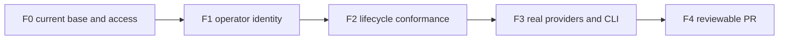

# First deliverable: ordinary MCP agent control

Let a local operator or hosted agent control a Claude or Cursor session through the existing MCP tools, without borrowing an identity or speaking ACP. Prove the actual lifecycle and keep the unchanged Codex CLI working. The owner has selected the facade; there is no tunnel phase. This plan targets one PR ready for Shravan to review and merge.

## Canonical result

```text
plan path: docs/specs/2026-11-02-acp-shared-control/plans/2026-11-05-mcp-facade-provider-profiles.md
originating planner: plan-update
supersedes: docs/specs/2026-11-02-acp-shared-control/plans/2026-11-05-mcp-facade-lifecycle.md
planning result: ready
governing planning basis:
  kind: reviewed-four-document-design
  Requirements: docs/specs/2026-11-02-acp-shared-control/requirements.md
  Specification: docs/specs/2026-11-02-acp-shared-control/specification.md
  Program Design: docs/specs/2026-11-02-acp-shared-control/program-design.md
    normative chunks: interface-design.md; mcp-facade.md
  Verification Design: docs/specs/2026-11-02-acp-shared-control/verification-design.md
  current four-document review/remediation result identities:
    facade baseline: router://0ff962c5-7fa3-4c18-a5ca-1bbe8db09e89/push/01a1a92f-84cc-74e1-8453-bada344238eb
    caller correction: router://0ff962c5-7fa3-4c18-a5ca-1bbe8db09e89/push/01a1a932-fffa-7470-9ccb-a43bbf21d232
    attribution-limit closure: router://0ff962c5-7fa3-4c18-a5ca-1bbe8db09e89/push/01a1a934-c922-7693-b9f7-f38df7382f80
    parent-verified design: a07e464c975e126eca58899739de87ae6e9a1428
    provider-profile correction review: router://0ff962c5-7fa3-4c18-a5ca-1bbe8db09e89/push/01a1aaa2-593f-7a03-8f7d-75db0a5c47b7
    verification-design correction: 37705a6e68a628bf1f7a48e59173c43b6ea5bfab
    verification-design correction check: router://0ff962c5-7fa3-4c18-a5ca-1bbe8db09e89/push/01a1aaa6-23a9-77b0-b118-104de1a03c13
    unchanged earlier CLI/Fleet coverage: 1077641ef
  current applicability anchors:
    planning branch: feat/acp-cli-actions
    planning HEAD: 37705a6e68a628bf1f7a48e59173c43b6ea5bfab
    implementation applicability: 345b100d104dfa0a8cc3e04988f30c4152b73eaf
    implementation tree: 6fdc4153c4c5546902cf7a14379b86cff222591d
    main snapshot: 0f9af21f602f79ee5a07f679f5cf63c7c896bb0f
    released bridge: cbf56bad640ae981900c646ff2ae0b64aaaebd3b
    owner facade decision: router://0ff962c5-7fa3-4c18-a5ca-1bbe8db09e89/push/01a1a921-5115-7221-b7be-384d03ef7f44
    work item: LUNA-490
    scope: first R23/V23 lifecycle deliverable; existing R1/R7/R8/R10/R12-R14/R18-R20/R22 preservation
delivery context:
  requested terminal: pr-ready-unmerged
  delivery grouping: single:mcp-facade-lifecycle
  PR topology: one-pr
  repositories: agent-collaboration/agent-collaboration
```

The new first-deliverable plan supersedes the old delivery order, not the original requirements. Old plan Markdown stays unchanged. The later bound-ACP I1–I5 and remaining full-facade mappings stay required future deliverables, with the predecessor as inspectable planning input; this first PR cannot claim them complete or execute their old plan-only record automatically. The latest owner instruction permits facade delivery through PRs; the owner merges. No merge, tag, release, install or production replacement is authorized here.

## Changed from the lifecycle plan

| Change | Invalidated work or proof | Preserved work |
| --- | --- | --- |
| Select actual provider proof profiles | F3's universal positive standard resume/close assumption and the VD F real-provider row | U13/R23, full controlled close/resume/load, F0–F2 obligations, F4 and one PR |
| Prove Cursor continuation through load after settled owned runtime lifetimes | F3 needs a distinct lasting two-lifetime journey and continuity sensitivities before input | Actual inference, exact identity/history, new reply/turn/operation, original CLI/wterm and cleanup remain mandatory |
| Bind the runtime tuple to integrated source | Changed source/artifacts/provider versions invalidate their dependent observations | Unchanged F1 and apparatus/fixture dependencies retain evidence; successful paid cases do not repeat for cosmetic freshness |

The correction enforces the selected backend's qualified controls. It adds no provider capability, Router lifecycle alias, public input, store or executor. Requirements, Specification and Program Design remain unchanged. No actual F3 proof is carried over from a controlled peer. The older plan Markdown stays immutable.

## Earlier lineage: changed from the session-tools plan

| Change | Affected work or proof |
| --- | --- |
| Facade is selected; tunnel excluded entirely | Adds U13/R23 and V23. Removes the pending facade/tunnel question and any later tunnel stream. No second raw-protocol control surface. |
| First PR is MCP lifecycle, not bound-listener implementation | Existing MCP tools can reach the Host now. The new bound ACP socket is not an inherent prerequisite for this first result. Earlier I1–I5 remain separately planned follow-on scope, not waived. |
| Ordinary operator identity reaches prompt/cancel | Reuse/generalize the existing actor codec, preserve SessionRef wire input, pass the application's Human/Session identity and existing Approver. Adds a concrete old-build failure and real operation readback. |
| Proof crosses the actual owners | Existing scripted-backend HTTP tests and catalogue-only live checks stay as narrower controls. V23 additionally needs actual Host/runtime causality, caller loss, real provider inference and original CLI full turns. |
| Existing authorship limit stays explicit | No new requester/content-sender equality guard or authentication promise; established Session-requester/HumanUser calls remain valid. |
| Delivery terminal is one PR ready and unmerged | Owner's facade/PR instruction replaces plan-only for this first deliverable. Broader task, storage, identity and production boundaries stay unchanged. |

## Deliverables and order

| Slice | Usable result | Depends on | Completion evidence | Initial active-work forecast |
| --- | --- | --- | --- | --- |
| F0 Admit source and proof target | Current source, truthful caller and owned debug allocation are ready | Reviewed design and owner instruction | Checked base/writer handoffs, tools, provider credentials/permission, declared identities and verification targets; no secrets printed | Environment-dependent; no date promise |
| F1 Operator control | Human operator can prompt/cancel through ordinary tools; existing session callers work | F0 | Permanent old-input RED, real MCP/application/Host-controlled GREEN, native Human refusal and composite partial-outcome preservation | 0.5–1 active working day |
| F2 Lasting lifecycle conformance | Repeatable ordinary MCP lifecycle/output/control driver | F1's actor contract; separate apparatus may overlap after freeze | Real Host/runtime controlled journey, complete inventory and wrong-build sensitivity; original tools preserved | 1–1.5 active working days |
| F3 Actual provider and original CLI proof | Both agents complete real MCP/CLI turns and their declared continuation profiles | F1/F2, lasting profile driver and frozen tuple | Exact target/history/epoch/turn/operation evidence, truthful unsupported outcomes, actual replies and settled owned lifetimes | 1–1.5 active working days plus access waits |
| F4 Reviewable PR | One coherent first facade PR | F3 and current-head quality | Independent implementation/proof review, required CI/comments/threads/mergeability and honest capability limits | 0.5–1 active working day |

These are initial forecasts, not measured durations or calendar commitments. One product writer and an independently writing Verifier are assumed. F1 and shared fixture/schema edits are serial. F2 apparatus may overlap only after its consumed actor/observation contract is fixed and its write files are separate. F3 runs against frozen source/artifacts and cannot overlap product edits. Re-estimate after F1's integrated result.



## F0 — Admit current source and the real target

**Reads:** U13/fixed boundaries; R23/caller paragraph; complete `mcp-facade.md`; VD F; existing actor, tool, application and observation owners; the project verification recipe; current main and Fleet shared-file owners.

Use an independent implementation worktree on current main, preserving this design branch and its reviewed documents. Do not use B's old product initializer instead of A's merged authentication/model corrections. Read both contributions before merging the governing docs. Check that each copied design identity is the reviewed one and that current code still matches its load-bearing source assumptions.

Before product writes, check the paired Implementer/Verifier and independent Reviewer routes, Node/pnpm/Rust tools, disk and the actual proof prerequisites. Read the canonical debug account/readiness state without refreshing or printing credentials; use the existing 1Password flow where necessary. Missing access/identity is a real preflight gap, not permission to invent a SessionRef or Human ID. Declare the real owner-resolved operator identity or an actual hosted requester and its independent Approver. No live provider input is permitted without a qualified, bounded debug allocation.

Recheck Fleet source/writer ownership. Storage D1 changes in shared Host/mail/protocol/MCP message/client files need landed composition or an explicit bounded handoff. The held access F4a lane later re-cuts onto B's published shape; it is not a reason to implement access bindings here. On a base where binding/cutover work has landed, preserve its existing authoritative contracts/tests. An old source pin is not a current writer handoff.

**Gate:** checked source/access/actor/tool/agent/evidence-target list, no unresolved prerequisite for the work starting. No product tests or runtime proof are earned by this admission. Later missing facade representations return to design rather than expanding this slice.

## F1 — Carry the actual operator identity

**Reads:** Program Design's `Callers and identity representation`; existing `conversation_create_actor.rs`, `conversation_client.rs`, `conversation_contract.rs`, provider conversion/composite consumers and MCP wrappers/schema; VD caller cases.

**Write scope:** `collaboration-client` actor codec and direct conversation consumers, `collaboration-mcp` request/schema/results where needed, their permanent sibling tests and existing HTTP/Host integration harnesses. `collaboration-protocol::ProviderIdentity` remains the application identity owner. No identity migration or new principal. All affected Rust unit tests use sibling `_test.rs`; preserve test discovery and established integration scenarios.

Generalize `ConversationCreateActor` to `ConversationActor` at its existing boundary. Preserve current SessionRef JSON plus typed existing Human/Session identity forms and a single conversion into `ProviderIdentity`. Use that boundary for prompt/cancel requester and existing creation; update consumers instead of adding an alias/second codec. The provider path retains requested-by, Approver, generation, operation IDs and failure outcomes. Native Codex remains Session-only and refuses Human input before dispatch. Provider create-and-prompt uses the same conversion and separate operation IDs; after a successful create, subsequent failure still names the known target.

Keep field names and established SessionRef calls, including Session requester with HumanUser content. No new sender/requester equality or authentication rule. The live operator driver uses truthful HumanUser content; a hosted-agent driver uses its own requester/sender. This repair preserves application authority instead of letting a driver borrow a session to get through the public schema.

**Pre-change failure:** a real MCP Human create can succeed but the corresponding Human prompt/cancel input cannot pass the current SessionRef-only boundary. Add permanent producer/consumer tests that fail there on the unchanged code, then retain the initial failure and prove the complete intended request reaches the existing application/Host. Test malformed typed identities, preserved SessionRef form, declared wrong roles, native Human no-effect refusal and provider composite failure after creation. Do not claim identity authentication from these tests.

**Gate:** G-Rust for changed packages, real MCP/application/Host-controlled cases and direct schema/result readback. This earns the V23 actor boundary and affected existing-call preservation; actual accounts/provider turns wait for F3. No new tool name or command engine is needed.

## F2 — Build the lasting conformance journey

**Reads:** VD F in full, MCP capability inventory, output/caller-loss chapters, `BoundedObservationRequest/Result`, actual HTTP/Host/runtime fixtures and existing `verify-codex-router` allocation/CLI recipes.

**Write scope:** lasting TypeScript under `verification/observations/mcp-control/` with colocated `.test.ts`; the project verification skill's new named journey; production-wired Rust scenarios in the existing MCP/Host harnesses. Product edits outside F1 need a demonstrated in-scope defect, the existing owning boundary and the reviewed contract. No task/message behavior changes or provider/transcript shortcuts.

Create a checked mapping inventory for all locked selected ACP operations, updates/callbacks and qualified extensions, naming the real ordinary MCP operation or unsupported/unqualified disposition. Tie positive claims to the existing schema, current capability facts and deciding observation. This is verification data, not a runtime registry. Removed/new methods, omitted reverse callbacks and guessed offers must fail coverage.

Build the needed driver before use. Planned entry: `node verification/observations/mcp-control/run.ts PLAN.json --check`, then the same command without `--check` only for the admitted allocation. This command is not present yet; F2 creates its source and documents it in the project recipe. `--check` validates the exact source/build/actor/target/effects/budget/deadline and launches no provider. Node is required; Bun support is claimed only after the same gates are qualified.

Run real MCP initialize/discovery/tools/call against production Host/application/supervisor/runtime with a controlled external ACP peer. Retain create/load/resume, prompt/output/terminal, exact cancellation and close facts. Use existing epoch/sequence bounded observation and real operation readback. A baseline before prompt and subsequent cursor reads establish reconstructed output; they do not claim the network stream was already attached or replay every intermediate delta. Keep resync, oversized-event and backend-loss markers explicit. `continuationGap:true` alone is not a failed continuation.

Hold causal provider boundaries for wrong target/role, pending versus terminal, stale control, caller loss and reconciliation. A cancelled/dropped observer must not redispatch or silently cancel admitted work; explicit cancellation has its own qualified target and settlement. Keep scripted-backend HTTP and catalogue tests as their narrower controls; they cannot substitute for the Host/runtime path. Preserve existing settings and exact interaction-tool authority tests, without pretending unimplemented generic config/media/setup is covered.

**Gate:** G-Rust/G-TS, real controlled production wiring, inventory coverage and sensitivity cases for falsely completed, wrong-session, missing/truncated output, fabricated cursor and duplicate dispatch. A helper-produced ready marker or fabricated provider result cannot pass. Recipe/driver absence is repaired here before F3, not deferred past live input.

## F3 — Real Claude and Cursor, then unchanged CLI

**Reads:** VD F [real-provider proof profiles](../verification-design.md#real-provider-proof-profiles), R1/R8/R10/R12/R23, actual project MCP and original-client wterm journeys, current provider advertisements/handlers, normal signed-runtime rules and the exact frozen tuple. Source handlers are prerequisites, not live proof.

**Write scope:** lasting TypeScript MCP verification driver and recipe at their existing boundary, with colocated tests for explicit full, unsupported-method and two-lifetime continuation profiles. Reuse current target/cursor/output/operation/identity oracles. Keep full-profile positive close/resume tests unchanged. No provider fallback, Router detach, alias, new executor or test removal. Original-client apparatus changes only for a demonstrated missing required observation.

Declare one isolated debug allocation at a time: source, normal signed artifacts, private root/evidence, actual endpoints, truthful caller/Approver, allowed effects and prompt budget, immutable deadline, observers, protected production processes and cleanup owner. No credentials are printed or copied into public proof. Do not change normal Codex trust/profile or restart production.

**F3a — Prepare the profiles before input.** Build and qualify the needed lasting continuation journey before any dependent real input. Keep the existing full-profile driver command; add an explicit declared continuation input in the same verification system, never silently changing a full case. Its no-effect validation refuses absent source/artifact/service/identity/effect/budget/deadline bindings and launches no target. Permanent table/sensitivity cases reject a fresh provider ID, changed endpoint/service/cwd, foreign or canned history, reused epoch/cursor, old terminal passed as new work, extra input, duplicate dispatch and unsupported methods counted as positive. Source-reading and stand-ins qualify only the oracle. A changed live offer stops for source-backed disposition.

**F3b — Claude.** Use genuine MCP as the declared caller/Approver to create a conversation and complete harmless real inference/output/terminal/readback. Close through the advertised native operation; resume the exact provider Session without replay and obtain a new correlated reply. Close, load actual earlier history on that same Session and obtain another reply, then close. Match actual operations and target throughout. A close ACK is not process cessation. Usable declared debug credentials and the actual live offer are prerequisites.

**F3c — Cursor.** Use its real load-capable profile. Complete MCP inference/output/terminal/readback. Standard resume and close stay unsupported: require their own exact operation/target and typed no-effect refusal, with no extra dispatch. These are never positive lifecycle observations. Quit the owned client and settle the first Host/runtime, all admitted work/children, consumers and service publication. Retain the generated provider ID, full target, stable service ID, cwd, launch selection, roles and actual history. Shutdown is allocation cleanup, not provider close.

Reopen only the stopped private context through existing `--resume-run-directory`, with identical prepared profile/native model, Router root, service directory and provider launch. Require the same logical service ID/endpoint/provider Session ID, a new observed epoch and actual binding before mutation. If recovery already attached the actor or identity/context differs, stop; invent no detach. Real `conversation_load` must settle terminal/applied/confirmed and replay the recorded history. Take a new baseline in the new epoch, submit exactly one new input, and require its own new turn, nonblank actual reply, output equality and matching terminal operation. A new Session or old replayed answer fails. Settle the second runtime under its separately declared owner/deadline; it cannot extend an unsettled first lifetime.

**F3d — Original client and preservation.** Settings and interaction regressions retain their actual supported profile/authority; absence remains unobserved, never successful empty output or broadened support.

On the same frozen tuple, drive a real unchanged Codex CLI through each provider's native socket for a normal prompt/reply turn. Retain exact session, turn and operation associations plus original PTY/wterm frames and whole-run errors. Cross-check the same provider session via read-only MCP inspection. Run the affected skills/model and native/reverse preservation controls with current source applicability. A stale screenshot, model-only picker or release receipt cannot close LUNA-490's real-turn evidence.

**Gate and dependencies:** F3a driver qualification precedes all dependent real input; provider lifetimes are serial, including Cursor's two lifetimes, and F3d's actual CLI proof completes before F4. Use `node verification/observations/mcp-control/run.ts PLAN.json --check` and the unchanged full-profile run for its supported profile. The continuation driver's exact entry is a needed F3a artifact documented in the project recipe before use, never a guessed existing command. Run G-TS and affected original-client package gates when their source changes. Require all VD profile observations and owned settlement; unsupported methods stay unsupported in inventory/PR. Actual output and matching terminal/readback, not ACK or exit, decide success. A failure stops dependent input; no uncertain mutation replay or successful paid rerun for freshness.

## F4 — Independent review and the PR

**Reads:** U13/R23 plus retained scope/non-goals, current diff, before/after test discovery, all F1–F3 raw evidence, current capability inventory and exact source/build/provider applicability.

Run current-head G-Rust/G-TS and required repository CI. Check for unintended dependency/cycle growth, extra stores/executors, credential disclosure, dropped operation/role fields and changed collaboration behavior. Preserve every test family; no automatic retry, weaker deadline, skipped failure or baseline blessing.

Have the retained independent Reviewer inspect the real implemented entry-to-effect paths and proof, with the paired Verifier's observations kept separate from acceptance. Correct accepted findings at their semantic owner. Open/update one PR with the actual final scope, limits, tests and remaining whole-facade/CLI obligations; inspect comments, review threads, checks and mergeability. Before marking user-facing code merge-ready, advance to the next unused workspace version and update Cargo.lock under the repository rule, coordinating the current release owner. No tag or release is created by this plan. Shravan merges the PR; do not merge it yourself.

## Proof map

| Obligation / VD row | Slice and deciding observation |
| --- | --- |
| R23/V23 inventory | F2 checked discovery/schema/protocol mapping; final review keeps every missing/unqualified profile explicit. |
| R23 caller representation; R13 authority | F1 real MCP Human requester failing before repair, then preserved exact ProviderIdentity and roles through Host; F3 real declared operator or hosted requester. |
| R12/R19/R23 lifecycle | F1/F2 full controlled lifecycle; F3 Claude native lifecycle and Cursor actual load/reopen continuation with explicit unsupported resume/close. Scripted backend or cleanup cannot qualify provider methods. |
| R8/R19/R23 output | F2 epoch/sequence and result/notification equality, exact turn/operation readback plus resync/loss cases; F3 actual output. |
| R7/R13/R19/R23 caller loss and cancel | F2 causal held boundary, detached waiter, explicit exact work cancellation, stale/foreign targets and no second dispatch; F3 affected actual lifecycle. |
| R18/R20/R23 settings/interactions preservation | F1/F2 unchanged schema/role/catalogue/broker tests through actual owners; F3 affected supported settings/interactions, with unavailable profile facts explicit. |
| R1/R8/R10/R12/R23 original CLI and continuation | F3a qualifies the lasting driver; F3b/F3c observe actual provider profiles; F3d earns unchanged CLI full turns with exact IDs/original frames and same-session MCP readback. |
| R11/R22 structure/Fleet preservation | F0 actual-base/writer admission; F4 source/module-cycle/test-discovery and existing message/board/store/identity regression scope. No fake qualification of absent Fleet features. |

Remaining full-facade rich input, arbitrary config categories, client MCP setup and optional/extension mappings are not closed by this first lifecycle proof. The complete inventory identifies their actual gap and owning follow-on design/proof. The original bound-ACP R16–R22 plan remains inspectable as future delivery input. Neither is a later tunnel phase.

## Commands and existing tests

Use the project layers: permanent controlled integration, actual-provider journeys and original-client PTY/wterm. New unit files are colocated; existing integration scenarios retain their established homes. Keep actor/schema, provider HTTP, carrier response-loss, Host lifecycle/authority/settings and observation/interaction suites. Extend the owning cases for the new caller representation and production-wired proof. No test removal is selected.

During slices run the narrow affected packages/cases. Final G-Rust and G-TS from the repository root:

```sh
cargo fmt --all -- --check
cargo check --locked -p collaboration-client -p collaboration-mcp -p collaboration-protocol -p collaboration-service -p collaboration-runtime -p codex-router-host -p acp-client-runtime -p agent-collaboration
cargo nextest run --locked --profile ci -p collaboration-client -p collaboration-mcp -p collaboration-protocol -p collaboration-service -p collaboration-runtime -p codex-router-host -p acp-client-runtime -p agent-collaboration -p codex-acp-adapter
cargo clippy --locked -p collaboration-client -p collaboration-mcp -p collaboration-protocol -p collaboration-service -p collaboration-runtime -p codex-router-host -p acp-client-runtime -p agent-collaboration --all-targets -- -D warnings
cargo nextest run -p workspace-architecture-check --run-ignored only
pnpm --dir verification install --frozen-lockfile
pnpm --dir verification run check
pnpm --dir verification run lint
pnpm --dir verification run format:check
pnpm --dir verification test
```

If original-client apparatus is changed, also run `scripts/verification/tui` package typecheck, lint, format:check and test using its frozen install. Its existing runtime engine and wterm renderer remain authoritative. Record actual filters/discovered/executed/skipped counts, exits, source and logs. These commands are planned execution gates, not proof from writing this document.

## Stop and route a real break

Before code depends on a new public input/operation, identity, persisted format, callback service, storage owner or cancellation guarantee not selected here, return its source-backed gap to the appropriate design owner. Do not make a fixture invent the answer. Current requester/content authorship is a named reported-data limit, not an assignment to add authentication. Missing actual credentials or caller identity holds dependent execution until the exact access is available; never borrow identities or switch services around denial.

Tasks, messaging changes, an ACP tunnel, broad provider registry, replication, process decomposition and production replacement remain excluded. Existing legacy CLI G2–G4 are not declared solved by this first PR. Preserve all user requirements while naming what this deliverable proves. A PR receipt, review agreement or green unrelated suite cannot replace the required real interaction.
