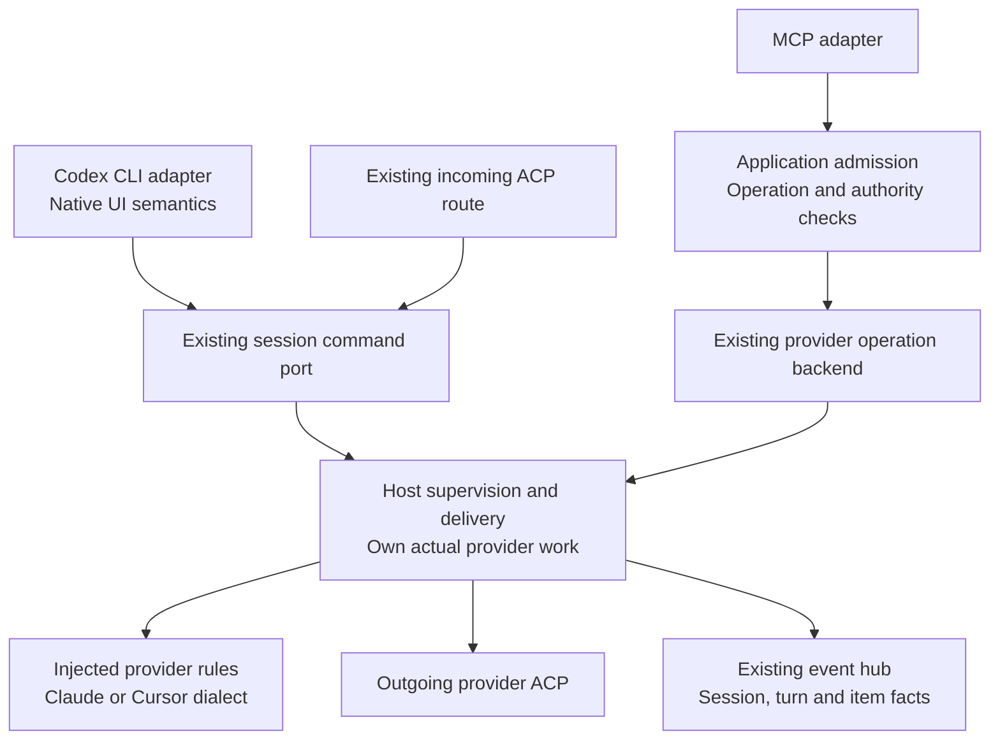
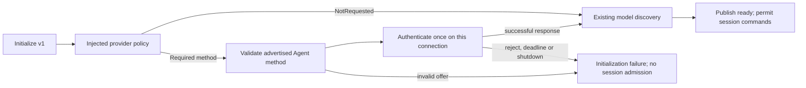
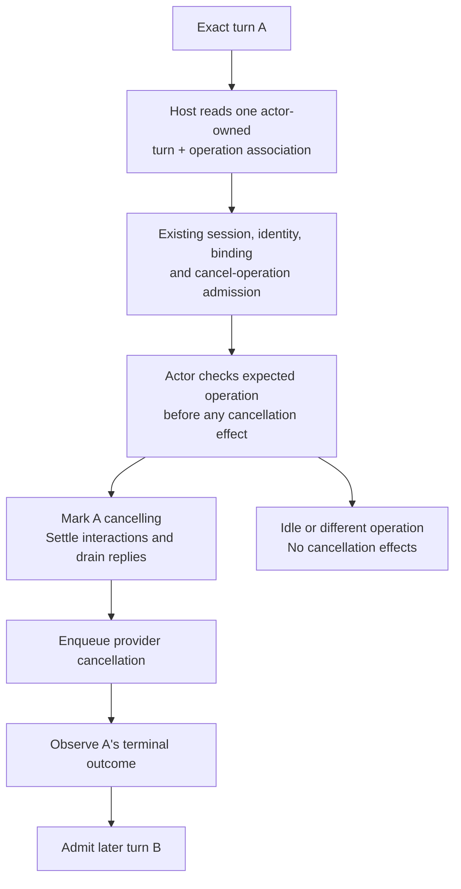

# One execution owner, several frontends

Start with [the integrated interface design](interface-design.html): incoming/outgoing ACP profiles, DI, the command/result matrix, module/service/data owners and the feature-extension boundary. It is a normative chunk of this Program Design and realizes the new R16–R22. The interface chunk also names the [Fleet compatibility boundary](interface-design.md#compatibility-with-fleet-work). This file retains the detailed R1–R15 realization and source-backed CLI/control constraints. The selected bound standard profile replaces the earlier unselected F1 ingress shape; it does not waive the legacy G2–G4 gaps.

The normative [MCP facade chunk](mcp-facade.md) realizes R23: ordinary tools over the existing agent-control owners, the capability mapping, output/cancellation semantics and first lifecycle proof. Raw ACP over MCP is excluded entirely. Tasks remain a separate hierarchical application concern; loose messages keep their existing meaning.

Keep provider execution in the existing Host runtime. Let the Codex adapter, MCP adapter and incoming ACP adapter translate their own protocols. Keep pure Claude/Cursor rules behind the existing provider trait. We do not need a new engine or another ACP server.

Incoming ACP means a client asks Router to control a session. Outgoing ACP means Router communicates with Claude or Cursor. These are different connections and responsibilities even though both speak ACP.

The unresolved part is how to expose stronger shared control without losing operation and authority fields. That alignment is a named design gate before expanding control; it does not require a speculative rewrite before fixing native default-save behavior.

## The boundary



This draws the current owner paths. It does not claim that the two command contracts are equivalent or that all frontends already share the same admission path. The next shared-control design must preserve the stronger contract rather than route MCP through a weaker convenience API.

| Responsibility | Current owner | Design rule |
| --- | --- | --- |
| Native command meaning, DTOs, errors, model-default no-op and optimistic row correlation | `collaboration-runtime` native facade | Keep it at the Codex boundary; none belongs in `ProviderBehavior`. |
| Incoming ACP routing and wire representation | Existing `AcpChannelListener`, `ProviderAcpSessionRoute`, shared connection shell | Extend this ingress. Keep incoming control separate from outgoing provider connections. |
| Rich operation admission | `ConversationOperations` in `collaboration-service` | Preserve operation/generation/identity/policy checks and existing-operation recovery. Do not bypass it when widening another frontend. |
| Effect custody and provider sessions | Host supervisor, delivery route, actors and operation store | One actual owner of admission outcome, work and settlement; no parallel frontend executor. |
| Pure provider differences | Existing `ProviderBehavior` in `acp-client-runtime`, implemented by provider adapters | Synchronous preparation/interpretation only. No native DTO, MCP schema, frontend selector or mutable cross-session state. |
| Observations and replay | Existing `SessionEventHub` and history projection | Derive views from real observations; do not create another session/history store. |
| Approval/question authority | Existing interaction broker | Preserve offered IDs, scopes, actor and settlement. Discovery/UI visibility is not permission. |

Frontend and provider variation are separate constructor choices at the Host composition root. Each frontend receives only the command/read/callback ports it needs. This is explicit injection, not a service locator or generic `execute(method, Value)` registry.

## Provider startup: authenticate before admission

Cursor's qualified ACP connection needs its documented authentication handshake before model discovery or session creation/loading. This is an outgoing-provider prerequisite for R1/R4, independent of the broader frontend-control alignment. The existing runtime currently initializes and reads connection models without sending `authenticate`.

Keep the policy in the existing injected `ProviderBehavior`; keep protocol I/O and process lifetime in `acp-client-runtime`. Add one required pure method, `initialization_authentication`, returning the closed `ProviderInitializationAuthentication` policy: `NotRequested` or `RequiredAgentMethod { method_id: &'static str }`. Cursor selects `cursor_login`; Claude and Standard explicitly retain `NotRequested`. There is no default trait implementation, new DI container, authentication store or frontend selector. The policy type belongs beside the existing provider behavior contract; provider adapters implement it without importing ACP wire types.

The connection owner validates the actual initialize response. A required ID must have exactly one matching advertised method and that method must be ACP v1 `AuthMethod::Agent`; an omitted discriminator is decoded by the SDK as Agent. Check the selected raw offer at the existing initialize decoder before permissive SDK decoding can discard a malformed matching row or erase an unknown discriminator: absent type or explicit `agent` is allowed, every other selected type is rejected. Missing, duplicate, Terminal or unrecognized method kinds fail initialization before model or session work. Do not choose the first method, run a Terminal command, or silently skip required authentication. Use the SDK's existing `AuthenticateRequest` and request/response transport.



The sequence uses the existing initialization deadline, shutdown signal and owned child/connection cleanup; it adds no retry loop or second timeout budget. Authentication precedes optional connection model discovery and the ready signal. Each new/replacement connection performs its own required handshake; individual session creation and settings changes do not repeat it. Failed authentication cannot publish successful admission, create a session or trigger a diagnostic prompt. Keep existing sanitized initialization/authentication failure reporting and auth-status notification semantics; an advertised method or external CLI login check is not an authenticated-session fact. Caller and approver authorization remain separate and unchanged.

This repairs the established handshake using the provider's existing authenticated launch context. It creates no OAuth/login UI, account switch, credential cache or new secret access. A successful handshake still proves no model execution. The actual Cursor method-kind validation is observed by the new runtime gate; the retained minimized reference that records only method IDs and a successful empty response cannot prove that kind on its own.

Source: [Cursor's request flow and authentication](https://cursor.com/docs/cli/acp#request-flow); locked ACP schema 1.9.1 `v1/agent.rs` (AuthenticateRequest and Agent/Terminal method variants); runtime `provider_initialize_request.rs` and `provider_connection_task.rs:259–315`. Existing session and operation storage are unchanged; this policy and readiness state live only for the owned provider connection.

## Current contracts we must preserve

`HostSessionCommandPort::create` currently generates an operation ID, chooses a default requested policy and uses the same actor as creator and approver. That is a convenience policy for its current consumers. `ConversationCreateRequest` already carries explicit operation ID, generation, creator, approver, policy and settings. `ProviderConversationBackend` already promises that dropping its future detaches the caller while admitted work stays owned.

Therefore, do not make MCP discard those fields to fit the convenience path. Reuse the existing typed operation requests and admission implementation where a frontend needs those guarantees. If dependency direction requires a consumer-owned contract for that admission path, settle its smallest shape with its first real caller before adding it. No universal replacement trait or package extraction is selected here.

The current native `turn/interrupt` decoder checks that a turn ID is present, then passes only session identity to cancel-current. The stronger target is lost. A compare-before-cancel check does not make the effect atomic. Exact targeting must be carried to the effect owner under an agreed contract before claiming exact-turn cancellation; preserve the client's separate empty-ID startup case deliberately.

## First shared operation: reuse the existing prompt paths

For M3.6's existing-prompt baseline, **keep the current interfaces**. They already converge on `ExternalProviderSupervisor::prompt_contents` and the provider actors. Sharing execution does not require making their admission inputs or reply timing identical. No new common prompt trait, public DTO or executor is selected for this baseline.

| Frontend | Existing admission/input path | Correct response boundary |
| --- | --- | --- |
| Codex native | `PromptSessionCommand` carries typed `ProviderSubmission` and InputId. The delivery route retains its ownership/load/settings/content checks, generates an operation ID once, and uses the stored session approver. | The command port returns the correlated actual turn handle after `TurnStarted`. This is start, not completion. |
| MCP | `ConversationOperations` retains existing-operation recovery, caller locality, endpoint availability and generation checks before `ProviderConversationBackend::prompt`. Its current public `MessageContent` input is text; its conversion must not become another frontend's universal content limit. | Return the actual existing/admitted operation snapshot. Use existing show/wait/reconcile and settlement; a fast result may already be terminal. |
| Incoming ACP | The existing provider route decodes the supported ACP content into the command port, retaining endpoint/session targeting and its existing actor/broker rules. For this M3.6 existing-prompt baseline only, retain the current multi-route behavior without adding a connection profile or media offer. The separate R16–R22 interface chunk selects the bound profile, Router-aware collision handling and projected offers for its later scope. | After obtaining the turn handle, `stream_prompt` waits for that turn's terminal event and the observer-ordering barrier before returning the ACP result. |

These are intentionally different entry contracts over one effect owner. The internal `ProviderPromptContentsRequest` already holds operation/input IDs, target, requester, approver and `ProviderTurnInput`, including richer submissions used by native/control paths. Keep it Host-internal: it is not a complete public generation, policy, rich-content exposure or result contract. In particular, do not route native selected skills/media through MCP's text conversion, drop MCP operation/authority fields to fit the convenience command, or expose the backend directly as a substitute for application admission.

Shared execution does not make every admission step identical. The native/control delivery route takes its per-session route lock, checks its route claim and stored record, and may load the session before submission. MCP does not take that route lock or perform that `MayLoad`: an unloaded runtime session reaches the shared not-submitted/missing-session path, and competing prompts still meet the existing approval-context/actor busy checks. Incoming ACP must also satisfy its own attached-observer precondition before it reaches the command port; this is not a blanket promise to auto-load any bare ACP prompt. Preserve these differences for this baseline rather than silently adding a load effect or a universal admission policy.

Unresolved settings and unsupported content are **shared lower guards**, not absent from MCP. The provider connection task refuses unresolved settings before forwarding a prompt to the actor, and the actor checks again before preparation/wire dispatch. The shared prompt dispatch and actor validate content capabilities; the actor validates selected skills. Earlier route checks can reject sooner, but bypassing that route does not establish a settings/content bypass. Qualification must observe these cases through each real caller, including the different result timing.

For the current MCP path, generation admission is in the application; `from_prompt_request` does not carry the generation into the internal request. The supervisor's runtime binding map is constructed once and is immutable for that supervisor instance; it also has a retirement guard. This source fact is not a reproduced replacement race or a general guarantee for a new caller. A future route that needs stronger binding conditions must preserve them at its actual admission/effect boundary rather than copy this internal type and assume they survived.

The tradeoff is deliberate: keep the current split contracts and prove their real convergence now, paying for explicit adapter-specific observations. Revisit an admission/interface change only when an additional caller cannot preserve a named field or invariant through the existing path. The separate interface chunk now selects the connection/capability profile for R16–R22; that expansion does not change this M3.6 internal baseline, and baseline selection does not close exact-turn targeting or authorize broader ACP exposure.

## Exact cancellation: keep the effects inside the actor

For exact targeting, **the session actor owns validation and every turn-cancellation effect**. The current client-side pre-cleanup is removed: it must not mark a token or sweep interactions before the actor accepts the target. In the actor's existing Cancel branch, compare the expected operation first, then mark that turn's token, await the existing interaction cleanup and response barrier, and enqueue the provider cancel notification. The actor already uses this ordering for output limits and terminal cleanup. Keep those paths and their orphan/retirement cleanup; no broker migration or extra cancellation coordinator is needed.



The native boundary must carry its target through the existing command port: explicit **current work** and **exact turn** cases replace the session-only cancel command. MCP retains its existing exact-operation request and authority fields. Standard incoming ACP selects current work; it does not acquire exact-operation recovery semantics. Migrate both callers, the Host implementation and test implementations together; do not retain an old convenience overload or add a universal control trait. Native startup's empty ID remains a separately qualified adapter case, not an empty exact-turn identity.

The runtime inspection also changes. Today `InspectActiveOperation` returns only an optional operation ID. Its replacement reply must distinguish **idle**, **tracked turn {turn ID, operation ID}** and **untracked turn {turn ID}**, obtained in one actor observation. The connection task must also stop returning the same `None` for a missing/unloaded session and actor idle: missing/unloaded is a not-found/unavailable failure, never Idle. The Host compares the requested native turn with this association and retains its operation through existing durable cancellation admission. The actor rechecks that operation at the effect. An independent hub turn lookup plus a later current-operation lookup can mix A and B; an untracked turn or missing identity must never become the runtime's cancel-current wildcard. This is a changed internal runtime reply, not a new cache, store or claim that the current API already supplies both IDs.

The real Host's broad cleanup filters broker history by requester session, not operation, but the **Supervisor already supplies a higher admission fence**. It records the cancellation as MayHaveDispatched/effect Unknown before runtime cleanup; non-cancel admission refuses same endpoint/provider/generation/target Unknown operations, including that live cancellation. The checked native/MCP/incoming prompt paths converge there. Thus a suspended older cancel cannot admit B through those checked Host paths: expect Busy. This is not an established current Host successor bug.

The selected actor change gives the existing lower runtime API its own effect-lifetime invariant instead of depending on every caller going through that higher fence. At that lower boundary, an outer A cleanup could outlive A's separate terminal cleanup; with cleanup inside the actor, A cannot finish and B cannot be admitted during the effect interval. This is a source-level countercase to test directly, not a reproduced public Host failure. Preserve the Supervisor fence as well. If A finishes before a queued exact cancel is handled, idle/mismatch handling has no cancellation effects; repeated A cleanup remains idempotent. Keep request-ID token branches and orphan/retirement cleanup.

The four callback producers spawn their waiters on the ACP connection; their response guards drop after the response is enqueued. That supports progress while the actor waits, but does not prove a provider received the bytes or that future callbacks were already included in a completed drain. Controlled real Host/broker proof must exercise permission, question, plan and elicitation while actor prompt observation is suspended, including late callback admission and orphan cleanup. Keep mailbox latency visible: a decision processed before the actor takes Cancel is not retrospectively undone.

The gain is one existing owner for the effect interval; the cost is waiting for that session actor before cancellation starts. A shared once-only cleanup future or operation-filtered broker schema adds state/contracts without a demonstrated need, so neither is selected. No extra actor timeout, lock, event pump or persistent map is implied.

### Native reply: wait for the target without holding the command queue

The native interrupt response is also used by **quit while a task runs**. Therefore running-target success waits for both the real cancel operation's **CancelRequested** settlement and the actual matching **TurnEnded with an Ended outcome**. Admission or notification enqueue alone cannot release quit. Keep the real stop reason: upstream releases pending interrupts on normal completion as well as abort, so success does not say cancellation caused that ending. A Lost outcome does not prove cessation. This reply concerns A; it neither waits for nor cancels a later B or the whole Host.

Split admission from observation at the existing command port. Its cancellation result becomes **Idle** or **Admitted {actual turn handle, settlement observation}**. The latter is an owned, read-only completion future backed by the existing Host `wait_for_settlement`; dropping it detaches the waiter, not the admitted operation. It carries no Host concrete type or native DTO. MCP keeps its richer durable-operation contract.

The native facade takes its existing atomic hub snapshot/live attachment before cancellation. Its ordered turn worker resolves and admits the request, then returns a **deferred response**. The existing connection `request_tasks` JoinSet owns settlement plus matching-terminal observation and sends the completed result through the existing response channel with the original request ID. The socket loop stays the only writer. This explicitly changes `HandledAppServerRequest`/its response envelope to immediate versus deferred; it does not add a pending-request registry or another executor. Spawning the entire interrupt outside admission would let later commands overtake it, while awaiting terminal inside the worker would block steering/settings, so neither is selected.

| Native case | Response and effect rule |
| --- | --- |
| Nonempty A, tracked A | Preserve operation A; wait for actual CancelRequested and A's observed ending before `{}`. |
| Nonempty A, observed B | No A cancellation effects. Translate a typed mismatch to pinned invalid-request `-32600` and `expected active turn id A but found B`. The CLI may send a separate B request, which must pass admission independently. |
| A matched, then idle/B before effect | Exact-operation failure; no B effect, no fallback to current cancellation and no unrelated later lookup to invent a mismatch target. |
| Nonempty exact target is idle or untracked | Applicable no-active/target-unavailable failure; never success or a wildcard. |
| Empty ID, tracked current work | Use the explicit current-work case and return its actual turn handle; native success waits for the same settlement and matching ending. |
| Empty ID, authorized observed idle | Narrow no-op `{}` after existing session/binding/actor checks; no mutation or invented abort. Missing/unloaded is not idle. |
| Lost/unknown, unavailable/unauthorized, or budget exhausted | Truthful failure, with actual state and effect custody preserved; no success inferred from elapsed time. |

Use one overall **30-second budget from admission start** for this native request, based on the existing Host operation-wait duration. Settlement and terminal observation share the remaining budget; they do not each restart it. On timeout, unrecoverable stream gap/closure, epoch invalidation or Lost, return unavailable/unknown and retain the admitted work. The existing connection-task teardown cancels only its observation on disconnect. This deadline is an initial operational bound to qualify on actual providers, not a readiness oracle or permission to disguise a deadlock by extending it.

Standard incoming ACP keeps notification semantics and does not acquire the native terminal-reply contract; its settlement observation follows that adapter's existing error/logging ownership. Native main interrupt, reachable quit, overview stop and temporary structured requests remain separately enumerated consumers. Side-close and safety-buffer retry are source-only preservation controls while fork and their driving notification remain unavailable; do not schedule runtime journeys through unsupported prerequisites. Actual-client qualification still belongs to M3.5/M3.6. No native retry policy is added to generic MCP cancellation.

## Steering: preserve the existing expected-turn condition

R7 also applies to steering. The current native command already carries `expectedTurnId`, and the Host port compares it with a hub snapshot. That condition is then lost: the delivery route awaits its lock, claim, store, settings and capabilities before calling the runtime; both internal steer commands carry session/input/content but no expected turn. The running actor injects against its then-current operation and reports input acceptance in its then-current turn, while the Host replies with the earlier requested ID.

This is a source-confirmed qualifier loss, not a reproduced runtime race. The connection-local command queue and delivery-route lock do not serialize an authorized MCP prompt through the separate Supervisor path. The cancellation-specific Unknown-operation fence is also insufficient here: steering makes no corresponding durable operation admission. A source countercase is A passing the snapshot check, A completing and settling while the steer is held, B starting through the Supervisor, then the old steer reaching B's actor.

The required realization must carry the existing exact condition to the actor and check it before any provider steering effect or accepted-input receipt. A second hub lookup before another await is insufficient. Native exact-turn requests, the incoming route's captured target and existing current-session runtime callers must retain their respective meanings; a missing condition is not permission to turn an exact request into current work. The typed runtime target/failure cutover remains M2 design work, not a selected new public schema or an implementation result here.

Native retry/fallback also needs its own qualification. At the pin, `turn/steer` recognizes **no active turn to steer** and a mismatch with **backticks around the IDs**, unlike interrupt. The client can retry once with B, or leave the steer loop for a separate new-turn request. Record those request identities independently. The facade's existing PromptRequired-to-prompt fallback cannot itself prove preservation of the exact-turn precondition. Idle, PromptRequired, StartedNewTurn, unsupported and uncertain outcomes must be mapped deliberately before M2 steering is admitted; do not fake injection, start another turn under a stale condition or copy the native retry policy into generic callers.

The deciding controlled proof must enter the real Host command port, hold immediately after its successful hub check, let A reach both actual terminal and durable settlement, start B through the authorized Supervisor path, then release the original steer. Observe provider wire/input acceptance, not just returned IDs: the exact A request cannot inject or create a receipt in B. Use an explicit held boundary in the permanent harness; if the port needs a test-only pause, name and add it there before claiming the case can be staged. A scripted command-port backend, sleep, route-only test or still-Unknown A operation could mask the gap. Normal same-turn, idle/missing, current-session and original-client retry cases remain separate. This evidence/proof obligation does not change M1's scoped plan.

## Entity homes and shapes

| Entities | Existing home / boundary shape | Retention |
| --- | --- | --- |
| E1 Session | Existing endpoint/session references in contracts/protocol; explicit conversion at adapters | Existing session record and event owner; no migration proposed. |
| E2/E3 Action/request | Frontend-specific decoder and connection request ID | Connection-local; not a durable operation. |
| E4 Input | Existing `InputId`, prompt/steer submission and actor receipt | Actor/event lifetime; native display correlation stays connection-local. |
| E5 Fact | Existing capability/settings/catalogue and SessionInfo owners | Preserve source/model/session/query scope; derive frontend display. |
| E6 Disposition | Closed native method/intent handling | Derived adapter policy; source catalogue is not runtime configuration. |
| E7 Turn | Existing observed turn events and retained item/history projection | Existing epoch/history lifetime; no new persistent log. |
| E8 Operation | Existing typed conversation requests, operation snapshots/store | Existing durable operation owner; keep unknown effect/reconciliation identities. |
| E9 Frontend | Existing native, MCP and ACP adapters with injected ports | Connection/adapter lifetime. |
| E10 Capability offer | Existing reports plus an operation/source/prerequisite map | Derive exposure from supplier, representation and admission; any new public schema is still a design gate. |

## First CLI changes

This document governs the new shared-control boundary and takes precedence where it explicitly changes an earlier decision. The earlier Program Design's named sections **Intent decoding and dispositions** (including its **Consumer-specific unsupported results** subsection), **Default-save compatibility**, **Configuration intent coverage**, **Submitted-input correlation**, **Information, callbacks and history**, **Inline review as a real provider task**, and **Provider-owned rename qualification** remain incorporated detailed How where this document summarizes them without changing them. This includes E6's closed disposition/no-op/unsupported enums, local actions having no runtime variant, invalid requests remaining decoding failures, and the catalogue remaining evidence rather than runtime configuration. The requirement trace below names those dependencies and gaps; an unlisted contradiction must be resolved by the Lead rather than guessed by an implementer. The [detailed design](../2026-10-31-codex-cli-acp-actions/program-design.html) remains one linked source for those rules, not a second competing architecture.

| Change | Owner and selected behavior |
| --- | --- |
| Model-only selection | Native settings decoder recognizes the catalogue-qualified family below. Apply the actual model and delegate effort to the provider; never write the old model's inherited effort. |
| Default-save | Native facade recognizes exactly two replace edits: nonempty NUL-free `model`, and null or nonempty NUL-free `model_reasoning_effort`; no other/duplicate keys, file target or expected version; reload true. Return the qualified typed no-op receipt without another setter or write. |
| Submitted input | Allocate `InputId` before dispatch; use it for the actor receipt; preserve the exact session/input-to-client correlation and original live content through receipt completion. No text deduplication. |
| History | Retain first item position plus latest/completion, and actual turn boundaries/outcomes. Accepted steers remain in their original observed turn; provider replay without attribution stays distinct. |
| Approvals | Share the canonical ACP tool-kind mapping between item and permission producers. Keep once-only native dialogs and persistent-choice fallback forms faithful to all offered IDs/scopes. |
| Review | Decode four native review targets at the facade; use one ordinary provider prompt and its actual turn handle. No separate review engine, hidden receipt or invented review-mode events. |
| Claude title | Qualify the published `0.99.1`/SDK `0.3.312` helper through the existing wrapper, original public agent objects and a narrow capability. Keep normal non-AIR traffic; use provider title formatting and canonical readback. No Router title store. |

Provider-package changes invalidate relevant older provider proof. The final integrated run uses one declared source/build/provider tuple, not a collage of earlier successful runs.

### Model selection without an inherited effort write

The regular Codex picker sends a model update before its separate effort update. Its first request carries the previous effort inside a complete Default-mode mask. When the target offers only **Use provider settings**, or does not offer that inherited effort, the native adapter must apply the model without writing the inherited value. This is actual model work, unlike the later harmless default-save acknowledgement. An inherited value the target does advertise keeps its existing behavior.

This is one explicit exception to complete-mask precedence at the native compatibility boundary. It replaces the first-refusal policy in the [earlier model design](../2026-10-28-codex-acp-providers/program-design.html#native) for this family only. That earlier policy deliberately produced a visible settings error; retaining it would contradict U3/R3. The same bytes receive the same declared translation from every native caller. The adapter does not infer hidden intent or claim native-core replacement semantics for this unsupported effort combination.

The existing `collaboration-runtime` decoder selects this rule only when **all** of these conditions hold:

- The source is `thread/settings/update`, with a nonempty, NUL-free top-level `model` naming an actual row in this exact session's catalogue. The reserved `provider-default` action is not an actual model.
- Top-level `effort` is omitted or null. A concrete top-level effort is a separate requested action.
- `collaborationMode` is a well-formed Default mask; its required model equals the top-level model. Its effort hint is omitted/null or a nonempty NUL-free string, including `provider`. Developer instructions are omitted/null.
- The selected row either has `ProviderModelReasoning::ProviderSettings`, which projects only the `provider` action, or is a qualified Select row with a non-null inherited hint absent from its offered values. A Select row with an offered hint or omitted/null hint stays on its existing path.
- Existing unsupported-field checks still pass: Plan, developer instructions, permission/cwd/summary and other unsupported non-null controls remain refused; any `serviceTier` presence, including null, remains refused.

Reuse `NativeProviderSettings` and `NativeEffortIntent::ProviderSettings` in their existing module. No new trait method, frontend field, DI mechanism, mutable request pairing or storage is required. The native decoder owns this derived E6 disposition; the injected provider rules and catalogue remain the authority for E5 model/effort facts.

| Target row and inherited hint, with every other condition above met | Model update treatment |
| --- | --- |
| ProviderSettings; permitted hint | Apply actual model; delegate effort, with no effort command. |
| Select; non-null hint absent from that row's values | Apply actual model; delegate effort, with no effort command. Do not substitute the row's default as a requested write. |
| Select; hint present in that row's values | Existing complete-mask behavior, including its actual effort write and fresh validation. |
| Select; omitted/null hint | Existing qualified default handling. |

Per-model choices can differ. The injected Claude annotation and Cursor metadata decoders validate each model's own choices/default; the Host projects those descriptors individually. They impose no common-effort-set invariant. The design therefore covers a Select target that lacks the old hint rather than assuming that case is unreachable on a selected provider version. This is a supported catalogue shape, not a claim that a real provider has reproduced the case.

```mermaid
sequenceDiagram
  participant cli as Unchanged Codex CLI
  participant native as Native settings decoder
  participant command as Existing command port and actor
  participant provider as Provider ACP
  cli->>native: Model B, top effort null, Default mask B / old hint
  Note over native: Exact-session row delegates effort or lacks the old hint
  native->>command: Existing explicit model B command
  command->>provider: Actual model setter with existing validation
  provider-->>command: Confirmed outcome and actual settings
  command-->>native: Existing result
  native-->>cli: Success after model application; truthful failure otherwise
  Note over native,provider: No adapter effort write or guessed default
  cli->>native: Separate provider-effort action
  native->>command: Existing independent model/delegation path
```

The changed edge is the decoder's choice of effort intent. Today an unknown-effort row reaches the unsupported guard and fails before effects; a Select row lacking the inherited hint can apply the model before the effort write is refused. Under this rule the existing model command runs with delegated effort in both qualified cases. Keep actual authority, fresh catalogue validation, expected-model checks, uncertain-setting guards, provider confirmation and event/readback ownership unchanged. A failed or uncertain model application keeps its truthful result; a no-op acknowledgement while waiting for the next RPC is invalid.

The second effort action remains independent. Cursor cannot reuse cached model confirmations, so two valid requests may legitimately reassert the model twice; there is no exactly-one-model-write promise across that pair. A ProviderSettings pair makes no effort write. A later explicit offered Select effort may make its real effort write; the first model-only update must not write an unavailable inherited value. The subsequent default-save batch causes zero additional provider setting effects. Do not synthesize a current effort of `provider`: returned and displayed effort still comes from actual provider-confirmed settings. Sparse effort, create/resume and TurnContext semantics are unchanged.

| Outside this family | Preserved handling |
| --- | --- |
| ProviderSettings row with a non-provider effort selected by existing precedence, including explicit top-level effort plus a matching numeric mask | Refuse the advertised unsupported action before any model/effort write. Conflicting top/mask effort still follows existing precedence. |
| Numeric mask without a matching explicit top-level model | Existing mask precedence and refusal/validation; no model-only delegation. |
| Conflicting top/mask models, unknown model, wrong field types, empty/NUL hint | No recognition by this rule; preserve the existing precedence, invalid-parameter or unsupported result. |
| Select row with an offered or omitted/null hint, or a concrete top-level effort | Existing complete-mask/default and explicit effort behavior, including truthful existing partial-effect/failure handling for an invalid explicit effort. No rollback is added. |
| Plan, developer instructions, serviceTier or other unsupported controls | Existing refusal and no effects. |
| Actual model setter failure or uncertain outcome | Existing truthful failure/custody; no fabricated application, retry or rollback. |

The tradeoff is a small native compatibility exception paid by adapter maintainers, rather than a known stray error paid by the CLI user. A client change, hidden model, coalescer or blanket success adds cost or violates the fixed outcome without solving this boundary. Revisit this rule if a qualified deliberate-effort producer enters the complete family, or a promised consumer needs complete-mask replacement priority for those identical bytes. Top-level null alone never establishes the rule.

Source: native `360319d8` `tui/src/app/thread_settings.rs:22–32,75–92`, `app/event_dispatch.rs:2110–2133,2308–2333`, `chatwidget/settings.rs:298–317` and `chatwidget/model_popups.rs:291–332,582–590`; complete-mask priority in `core/src/session/step_settings.rs:218–221,258–265`. The existing decoder/application and model projection are `crates/collaboration-runtime/src/native_provider_settings.rs` and `app_server_model_catalog.rs`, checked at repair source `bdef71cff`. Per-model descriptor decoding is `crates/acp-provider-adapters/src/model_reasoning_metadata.rs`; individual projection is `crates/codex-router-host/src/provider_model_catalog.rs:46–81`. Regular numeric picker choices also emit the first model update; qualification by the actual row and offered hint is therefore essential. An offered Select value and the explicit subsequent effort request must not be swallowed.

## Information: preserve the scope of each fact

The remaining effective-settings gap is a representation problem at the native boundary. Known model/effort values, the frontend's actual approval routing, Router's lack of an outer Codex sandbox, and the provider's effective filesystem/network restrictions are separate facts. Injected provider rules may interpret provider facts; they cannot turn one scope into another.

| Fact | Current authority and native representation | Remaining limit |
| --- | --- | --- |
| Current model, effort and provider mode | Existing session/catalogue/settings owners; retain their actual model/session scope | A provider mode is not automatically native Plan/Default. |
| Who can answer this pending approval | Existing broker, pending approver and connection actor | The forwarder is interactive only with a broker and matching approver; other viewers get a read-only summary. Do not hardcode interactive User behavior for every resumed session. |
| No outer Codex sandbox constructed by this Router path | Existing launch/spawn path | Native Disabled represents a concrete no-outer-sandbox stance and projects unrestricted filesystem/enabled network. This is a possible facade policy, not evidence of the provider's effective restrictions. No new facade-policy selection is made here. |
| Provider filesystem/network enforcement is unknown | Current launch/requested settings and capability reports do not establish it; operation settings mark their mapping Unverified | Required native start/settings sandbox fields have no Unknown variant. ExternalSandbox asserts actual external isolation and a definite network policy. Optional profile identity removes provenance, not policy. A custom profile description changes text but retains concrete policy and selectable behavior. |

The native `/status` label can say **No Sandbox** for a particular concrete Disabled/broker combination; it still cannot mean unknown provider enforcement. A complete effective-provider projection therefore remains G3. This does not say the bridge cannot run: it says the current enum, a label or requested access is insufficient to close that particular truth claim. Known frontend broker behavior may still be represented independently when its actual conditions hold.

Settings updates change client config/cache and later explicit permission selections. Do not overstate that finding: normal turns can preserve permissions rather than automatically echoing every displayed sandbox as an execution override. Scope and actual consumer behavior remain part of each mapping.

### Context has three different consumers

| Native surface | Behavior at the pin | Design consequence |
| --- | --- | --- |
| Composer context indicator | Complete usage with null capacity shows used tokens rather than a percentage; local `set_token_info(None)` clears/pends it | Actual complete breakdowns are required. Do not make zero components or use unrelated query totals to manufacture a reset. |
| `/status` | With usage present, null capacity omits capacity; with no usage, it falls back to client config | Initial unknown and model-change invalidation remain separate from a valid later usage update. |
| Configurable status-line context item | Uses reported capacity, then falls back to client config even when the usage record's capacity is null | Null capacity alone does not fix this surface. Keep the established per-invocation model-only footer when capacity is not qualified; it does not fix `/status`, global config or reset semantics. |

The token-update notification requires full total/last usage records; it is not a nullable clear command. Provider-advertised context selection, authoritative capacity, context occupancy and query spend remain distinct under the incorporated information contract. G3 still needs a complete native unknown/reset realization. No provider cache, guessed capacity or fabricated usage event is selected.

## Startup: the CLI owns result application

The bridge owns bound catalogue snapshots and reply ordering. The CLI owns which asynchronous result replaces its visible skill list. At the pin, both the background startup read and active activation/watcher refresh use **the same `cwds` and `forceReload: true`** (`force_reload` in the Rust type). The reload flag cannot distinguish those origins or acknowledge activation. The result carries no application generation, and the startup event checks cwd before replacing the list.

One source-supported interleaving is below. It is a causal countercase, not an observed reproduction or a claim about the supplied screenshot.

```mermaid
sequenceDiagram
  participant wire as Native connection
  participant background as Startup task
  participant ui as CLI application
  wire-->>background: Earlier catalogue R0 received
  Note over background: Completion task is delayed
  ui->>wire: Active skills refresh
  wire-->>ui: Newer catalogue R1
  Note over ui: R1 applied inline
  background->>ui: Queue SkillsListLoaded R0
  Note over ui: Same cwd passes; R0 replaces R1
```

A late wire response is another sufficient way to expose stale application; it is not necessary. Even ordered response delivery does not order the separate task's application event. Separately, a global `skills/changed` can trigger the active-thread command before activation and add **No active thread is available**. Sending it after the start RPC response does not acknowledge UI activation. Removing only the synthetic notification leaves genuine watcher notifications and the stale-result case.

The missing guarantee belongs at result application: an existing qualified client contract must reject superseded/background results and handle invalidation before active-thread readiness. No such guard or supported acknowledgement was found at the pin. This names the required boundary; it does not authorize client changes, a new wire handshake, a private-ID readiness heuristic, a timer, permanently suppressed refresh or a false empty catalogue. Deferring reads also needs a bounded never-bound/Unknown/ambiguous/cwd-mismatch outcome and must keep the binding loop free. G4 remains open until a complete allowed realization is selected.

### Proof uses the real bridge with one held response

The current target launches resume only, binds `--remote` to the real endpoint socket and has no response-hold control. Its bare socket preflight fixture is not a native server; the observer's controlled peer is not the complete CLI server. ACP-side provider fixtures do not control the bridge's inline native skills reply. Keep these evidence limits.

For a deterministic original-client countercase, extend the existing verification transport with a **single-response hold**, using the existing TypeScript `ws` dependency and wterm capture. The real bridge still computes and serves every response. The control forwards message payloads unchanged, retains one already-computed startup skills response in bounded run memory, and releases it only after the newer active catalogue is visibly witnessed. Holding the request instead would compute fresh data later and would not stage this case.

This verification-only control has one owner, the existing capture run. Its transport home is `verification/observations`; the existing Codex ACP target schema owns the closed direct-versus-held-route declaration. Its closed lifecycle is **armed → holding {captured request ID, original payload} → released → closed**, with failure/target invalidation closing both sides and discarding the hold. It supplies no RPC results, catalogue entries, session identity or provider effect. The launcher declares separate control and real bridge sockets inside the owned allocation; preflight still verifies the real service/epoch/endpoint and binds the control route to it. An arbitrary socket override or fake bridge is insufficient. Producer identification may be pinned for this test; it is never a production readiness rule. A changed producer that is never captured fails the run rather than silently falling back to an uncontrolled pass. Cleanup follows the allocation/connection lifetime.

The planned fresh target, whole-run frame ledger, control declaration and checkpoint-driven release are required changes, not existing capabilities. The new seam earns its cost by making the old client behavior fail under a causal gate; it adds no renderer, provider implementation or production transport. Until built and exercised, G4 has source counterevidence and a proposed proof seam, not a reproduced race or a passing repair.

## Incoming ACP: what exists and what does not

The map below uses schema `agent-client-protocol-schema 1.9.1`, ACP v1, and the current provider route. A schema method is not proof that this ingress implements it. Each endpoint/provider still needs its own qualification.

| Family | Pinned ACP shape | Current provider ingress / next boundary |
| --- | --- | --- |
| Initialize and capability negotiation | `initialize`, client/agent capabilities | Existing shared connection shell. Exposure must reflect actual route and supplier, not all methods in the schema. |
| Create | Standard `session/new` | Existing handler through the convenience command port. Rich caller-selected operation/approver/policy semantics are not thereby exposed. |
| List/load/resume | Standard, capability-dependent `session/list`, `session/load`, `session/resume` | Existing handlers and hub observations. Preserve endpoint targeting, cwd and replay/no-replay distinctions. |
| Prompt and streamed updates | Standard `session/prompt`, `session/update` | Existing prompt/event path. Preserve input/turn identity and actual terminal result. |
| Cancellation | Standard notification `session/cancel` | Existing session cancel-current route; it is not exact-operation recovery or a durable cancellation receipt. |
| Modes and config options | Standard `session/set_mode`, `session/set_config_option` | Present in schema, absent from this provider-route dispatch. Reuse actual settings semantics when deliberately exposing them. |
| Close/delete | Standard capability-dependent `session/close`, `session/delete` | Present in schema, absent from current provider-route dispatch. Do not infer support from provider or native names. |
| Fork | Feature-gated unstable schema operation | Not a selected stable universal capability or current provider-route handler. |
| Tool permission | Standard `session/request_permission` callback | Existing broker-backed producer; richer choice/persistence metadata must remain intact. |
| Questions | Negotiated `elicitation/create` extension/profile behavior | Existing broker-backed form route; not every ACP client supports it. |
| Steering and queued input | `_session/steering`, `_session/queue/{add,list,cancel}` | Existing Router extensions. Queue is Host-supplied, not proof of provider-native queue support. |
| Operation show/wait/reconcile and exact cancellation | Rich existing Router/MCP operation contract | No equivalent complete standard ACP operation contract is established here. Design and negotiate extensions before claiming parity. |
| Provider title and other special controls | Qualified provider extension | Translate only supported operations. Outgoing Claude title support does not automatically expose incoming ACP rename. |
| Codex default-save, UI echoes and native-only features | Codex adapter semantics | Do not promote them into shared provider capabilities. |

## Capability and authority rules

Exposure answers three questions in order: who supplies the operation, can this frontend represent it, and may this caller perform it on this target now? Keep those questions separate.

- Provider image support plus frontend media representation permits an offered media action; actual admission still decides the call.
- Host queue support remains usable even if the provider lacks native queueing.
- A qualified provider title control is specific to that provider/session/runtime; it is not a global rename bit.
- Native model-default acknowledgement is adapter bookkeeping, not a provider effect.

## Design gates

| Gate | What must be settled | What waits |
| --- | --- | --- |
| G1 Shared admission and targeting | Current prompt/cancellation contracts are selected. R7 steering still needs its exact actor-target realization. The linked interface chunk now selects the local bound ACP v1 exposure and capability/caller contract; stronger operation extensions/remote/v2 are not selected. | M2 steering and actual shared-owner/control qualification retain their own proof gates. They do not force a universal rewrite or waive existing outcomes. |
| G2 CLI error/recovery | Provider operation or existing gate/recovery for Cursor rename, `!` and `/stop`; truthful recovery for busy/refused review and failed Claude rename/readback; or an explicit owner change to U3's scope | Claiming clean handling for any of these cases. Their current negative RPCs can exit the CLI; documenting that fact is not closure, and a fake effect is not a repair. |
| G3 Information truth | Known frontend broker/outer-sandbox stance is distinct from unknown provider enforcement; required native policy has no Unknown value. Context surfaces also differ, including status-line config fallback. Complete scope/unknown/reset realization remains unselected. | Complete settings/context correctness. A label, ExternalSandbox, zero usage or a native model guess is not unknown provider information. |
| G4 Startup ordering | Same-parameter producers and cwd-only result application have no checked activation/application guard. A complete allowed realization is still needed; one-response test control and fresh/whole-run target support are planned, not built. | Clean fresh-start and stale-result claims. Response send order, one suppressed notification, indefinite read deferral or a final picker frame is insufficient. |
| G5 New provider tuple | Actual wrapper/import/plain-traffic/control qualification for the selected Claude upgrade | Claude title release and any proof relying on the new tuple. |

These gates narrow what can be claimed; they do not silently cancel a requirement or authorize a new client/store/supervisor.

## Requirement-to-realization trace

This is reviewer detail over the owners above. Every obligation has one row. A gap cell means the realization is not selected, not that the requirement is optional.

| Obligation / needs / entities | Owner and shape/home | Interface and state | Failure and deciding proof |
| --- | --- | --- | --- |
| R1; U1; E1–E3 | Native/incoming adapters, existing endpoint/session envelope in `collaboration-runtime` | Existing command/event ports; bound endpoint and session | Real per-provider reply plus native/reverse controls; no cross-provider inference. |
| R2; U2; E2/E3/E6 | Native classifier and pinned `surface-catalogue.json` evidence | Incorporated Intent decoding and dispositions supplies closed E6 enums; derived, not a runtime registry | Missing/new member or unclassified caller fails census and transport coverage; full cutover scheduled M4.5. |
| R3; U2/U3; E2/E3/E6 | Native facade; typed result/error at its wire boundary | Incorporated dispositions/config rules plus the closed Model selection family above; existing derived settings intent | Actual model effect with zero inherited-effort write; explicit-effort and malformed/unsupported countercases remain distinct. No blanket success. G2 for unrelated recovery. |
| R4; U3; E2/E3/E6 | Existing native config handler and typed no-op receipt | Incorporated Default-save compatibility; stateless exact two-edit match | Mixed/file/version/unrelated writes fail recognition; actual model/default journey with no extra setter/write. |
| R5; U4; E1/E5 | Existing capability/settings/catalogue/SessionInfo owners; native fact DTO projection | Actual source/model/session validity; Model selection delegates unknown effort and reports actual settings | Saved provider effort is preserved without invented defaults; provider/current/readback/display comparisons. G3/G4 remain open for complete settings/context/startup. |
| R6; U5; E3/E4 | Native connection correlation and actor receipt; existing InputId | Incorporated Submitted-input correlation; install before dispatch, retain through receipt pair | Wrong/equal-text/cross-session/media and events-before-response tests plus one styled original client row. |
| R7; U1/U4; E1/E3/E4/E7/E8 | Existing actor/delivery and interaction broker; typed target and offered option | Canonical producer kind, review/title commands and G1 exact targeting | Denial/stale target cannot act on later work; producer-to-provider/native tests. G2 for caller-fatal failures. |
| R8; U4/U6; E1/E7 | Existing hub retained item and history projection | Incorporated information/history rules; observed start/end and first placement | Late item/steer remains in original turn; failed/interrupted state survives read/resume/reopen; unattributed replay separate. |
| R9; U3/U4; E2/E5/E6 | Native applicability/result consumer owner; per-action disposition | Incorporated Intent decoding and dispositions, its unsupported-result rules, and visible G2/G3/G4 gaps | Actual absence/error/UI path; empty ACK, guessed facts or documented CLI exit cannot count as clean compatibility. |
| R10; U6; E1–E8 | Existing TS scenes/oracles and original Rust PTY/wterm; verification-only native-response control in the existing transport home | Shared capture, declared direct/held route and same-session observations; fresh target, single response/visible release and allocation lifetime | Named wrong behavior must fail; whole-run errors, stale catalogue, row count, actual effect and settled lifecycle. New control/target/ledger support is not yet implemented. |
| R11; U7; E6/E9 | Host composition, provider trait and package owners | Existing injected rules/ports; native and MCP DTOs remain at adapters | Package graph, colocated discovery, formatting/lints and cycle ratchet; no new engine/store/transport. |
| R12; U8; E1/E4/E7/E9 | Existing Host execution/delivery and three frontend adapters | First shared operation section selects existing prompt paths with separate native/MCP/ACP response boundaries | M3.6 qualifies one session/distinct inputs and actual owner across entrypoints. Similar output or a start/submission treated as completion fails. |
| R13; U8; E1/E8/E9 | Existing application admission and provider operation backend/store | First shared operation section retains the rich MCP request and application admission; internal Host input is not exported | M3.6 checks stale/unauthorized, caller detach and actual settlement. G1 remains for new caller alignment/exact targeting, not an assumed universal API. |
| R14; U8; E5/E9/E10 | Existing capability reports and frontend exposure rules | Supplier/prerequisite map plus the selected interface-profile projection; provider fact distinct from Host service and authorization | Scoped capability/authority countercases at the bound profile; G1 retained for stronger unselected operation/remote/v2 shapes. |
| R15; U9; E2/E6/E9 | Lead-authored delivery plan and existing work board | Milestone/workstream dependencies, selected order and explicit gates | Review maps every retained obligation to a closing check; no estimate or status label substitutes for evidence. |

## Why this shape

Keep the existing split ports and one execution owner. This preserves current behavior and stronger MCP semantics while allowing the next caller to drive a small contract alignment. Routing everything through the CLI convenience port would lose information. Building a universal engine or a second ACP server would duplicate ownership before proving a need. The cost of the selected direction is explicit adapter translation and targeted shared-boundary proof; adapter maintainers own it.

## Decisive source map

All project paths are relative to this Router repository at source checkpoint `388d069f0`; the cancellation paths were rechecked at `c87f77a23` (documentation changes only between those product-source checkpoints).

- `crates/acp-client-runtime/src/provider_behavior.rs`: pure provider rules.
- `crates/collaboration-contracts/src/session_command_port.rs`: current session convenience commands.
- `crates/codex-router-host/src/provider_session_command_port.rs:83`: create policy; `:301` cancel-current effect.
- `crates/collaboration-contracts/src/provider_conversation_backend.rs`: typed operations and caller-detach custody.
- `crates/collaboration-protocol/src/provider_conversation_contract.rs:463`: rich requests, identities and outcomes.
- `crates/collaboration-service/src/collaboration_application/conversation_operations.rs:96`: admission before backend invocation.
- `crates/collaboration-mcp/src/local_collaboration.rs:47`: MCP application path.
- `crates/codex-router-host/src/collaboration_runtime/startup_composition.rs:237`: shared supervisor; `:574` existing ACP listener; `:601` injected command/event ports.
- `crates/collaboration-runtime/src/provider_acp_session_route.rs`: actual incoming dispatch and unmatched-method refusal.
- `crates/acp-client-runtime/src/provider_capability_report.rs`: provider facts mixed with Host queue/elicitation.
- `crates/collaboration-runtime/src/router_session_app_server_methods.rs:524`: native turn ID checked then omitted from cancel command.
- `crates/codex-router-host/src/provider_acp_delivery_route/provider_content_commands.rs:45–169`: rich native/control input, ownership/load/settings checks, operation allocation and stored approver.
- `crates/codex-router-host/src/external_provider_supervisor/provider_prompt_contents.rs:15–78`: internal rich input and public text conversion; `provider_conversation_backend.rs:347–359` retains that existing MCP route.
- `crates/codex-router-host/src/external_provider_supervisor.rs:59–78,140–198,222–254`: immutable per-instance runtime bindings and retirement check.
- `crates/collaboration-runtime/src/provider_acp_event_projection.rs:350–405`: terminal event/barrier before ACP response; its unknown-stop fallback is an existing compatibility mapping to qualify, not evidence of a known end reason.
- `crates/acp-client-runtime/src/agent_session_client/provider_approval_dispatch.rs:13–61`, `provider_prompt_dispatch.rs:11–67`, `provider_connection_task.rs:557–588`, and `provider_session_actor.rs:168–218`: shared approval-context, settings, session-presence, skill and content guards below the supervisor.
- `crates/acp-client-runtime/src/agent_session_client/approval_turn_cancellation.rs:65–151`, `provider_connection_task.rs:579–592` and `crates/acp-client-runtime/src/provider_session_actor.rs:305–315,344–391,420–422`: outer cleanup, captured actor context, existing actor-owned cleanup, guarded provider notification and current operation-only inspection.
- `provider_connection_task.rs:608–619`: session activity distinguishes NotLoaded, while active-operation inspection conflates missing and idle today. `crates/codex-router-host/src/provider_session_command_port.rs:498–520` supplies the existing operation-settlement waiter.
- `crates/codex-router-host/src/external_provider_supervisor.rs:256–365`, `provider_conversation_backend.rs:412–448`, `provider_prompt_contents.rs:82–128`, `provider_delivery_submission.rs:24–67` and `crates/collaboration-runtime/src/provider_operation_store.rs:178–252`: cancellation becomes Unknown before runtime cleanup; both prompt entry paths use the same non-cancel admission fence.
- `crates/collaboration-runtime/src/router_session_app_server.rs:189–242,404–433,451–454` and `crates/collaboration-contracts/src/session_event_hub.rs:19–23,53–58`: current response envelope, ordered worker, connection-owned tasks/teardown and atomic snapshot/live attachment.
- `crates/codex-router-host/src/acp_interaction_port.rs:84–280,327–403`: exact request-ID token handling versus requester-wide cleanup. The four callback producers under `agent_session_client` register a response guard before connection-spawned work and drop it after response enqueue.
- Locked ACP `2.2.0`, `src/jsonrpc/incoming_actor.rs:524–568`, `jsonrpc/task_actor.rs:55–65`, `session.rs:1183–1225`: global handlers, concurrent callback tasks and unbounded session-update forwarding. This is source evidence for callback progress, not a runtime pass.
- Native pin `360319d8`, `codex-rs/tui/src/app/thread_routing.rs:658–736`, `app.rs:811–830`, `app_server_session.rs:1511–1534` and `app-server/src/request_processors/turn_processor.rs:1622–1685`: exact request/retry, empty startup ID and different admission/abort reply boundaries.
- At that same native pin, `tui/src/app/event_dispatch.rs:1029–1056`, `thread_events.rs:209–228` and `app-server/src/bespoke_event_handling.rs:191–207,1258–1276,1623–1637`: quit's response barrier, actual event-driven state and both normal/aborted endings releasing interrupts. The turn-processor comment alone is incomplete evidence of reply semantics.
- Native information paths: `app-server-protocol/src/protocol/v2/thread.rs:188–217,304–324,1952–1956,1992–2027`, `v2/permissions.rs:428–435,541–648`, `protocol/src/models.rs:280–295,426–439,677–707`, `tui/src/status/card.rs:676–707`, `chatwidget.rs:1132–1168`, `chatwidget/status_controls.rs:411–415` and `app/thread_routing.rs:866–889`: concrete policy, optional provenance, usage/reset/display distinctions and permission-preserve behavior. These are exact `360319d8` Git objects.
- Native startup paths at that pin: `tui/src/app/background_requests.rs:255–265,914–931`, `chatwidget/session_flow.rs:239`, `chatwidget/protocol.rs:235–237`, `app/thread_routing.rs:475–498,738–753`, `app/event_dispatch.rs:198–202,1729–1735` and `chatwidget/skills.rs:139–142,176–182`: identical read parameters, local activation gate and unversioned result replacement.
- Router information/startup paths rechecked at `b8cbf607b`: `crates/codex-router-host/src/provider_operation_settlement.rs:55–66`, `crates/collaboration-runtime/src/app_server_event_forwarding.rs:373–400`, `router_session_app_server.rs:238–262,333–338,391–404`, and `native_skill_binding.rs:173–192`: unverified effective mapping, actual approver routing, notification producers and inline unknown/unbound reads.
- Existing proof seams: `scripts/verification/tui/codex-acp/codex-acp-target.ts:55–78,113–131`, `codex-acp-scenes.ts:25–54`, `verification/observations/unix-websocket-observer.ts`, `acp-journey-transport.test.ts:108–125` and `verification/package.json`: resume-only exact socket binding, frame oracles, existing Unix WebSocket transport/dependency and limited controlled observer peer.
- R7 steering at unchanged product source: `crates/codex-router-host/src/provider_session_command_port.rs:216–253`, `provider_acp_delivery_route/provider_content_commands.rs:167–239`, `external_provider_runtime.rs:419–429`, `crates/acp-client-runtime/src/agent_session_client/provider_client_operations.rs:369–418`, `provider_connection_task.rs:593–606`, and `provider_session_actor.rs:398–415,436–458,523–566`: snapshot condition, intervening awaits and current-session effect. `crates/collaboration-runtime/src/provider_acp_session_route.rs:573–610` captures an incoming target; `router_session_app_server_methods.rs:487–522` includes the native server fallback.
- Native steering at `360319d8`: `tui/src/app.rs:786–808`, `app/user_turn_submission.rs:30–94` and `app-server/src/request_processors/turn_processor.rs:1063–1122`: exact precondition, distinct backtick mismatch grammar and client-owned retry/new-turn path. Cancellation's message grammar is not interchangeable.
- Locked schema `1.9.1`, `src/v1/agent.rs:4751–4787,4888–4980`: standard/unstable method definitions. Method presence is source evidence only.
