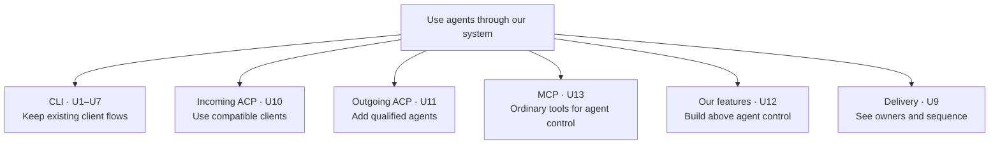

# What we are building

Use the existing Codex CLI with Claude and Cursor, while keeping agent control reusable by MCP and ACP clients. A frontend change must not require another provider implementation. A provider feature must remain available to a frontend that can represent and authorize it.

This design preserves the earlier CLI requirements and adds shared control. The November 4 owner decision selects an ordinary MCP control facade over the existing capabilities. ACP messages carried through MCP are excluded entirely, including as later work. Facade delivery proceeds through PRs within LUNA-490; the owner merges. A current reviewed design and admitted implementation plan still govern each product change; this document does not authorize production replacement.

The November 3 clarification makes the interface work explicit: incoming CLI/MCP/ACP, outgoing ACP, injectable provider differences, and room for our own agent features. Tasks and the storage/distribution strategy for schedules, approvals and questions remain outside this design.

## The capabilities people get

- **CLI:** use the unchanged Codex CLI with a qualified agent; U1–U7.
- **Incoming ACP:** connect an ordinary ACP client to a selected agent endpoint; U10.
- **Outgoing ACP:** add a qualified agent without changing every client adapter; U11.
- **MCP:** use ordinary tools for the same qualified agent controls, completing the existing surface while keeping its stronger operation/recovery semantics; U13, also serving U8.
- **Our own features:** build application features over agent control rather than a particular wire protocol; U12.
- **Understandable delivery:** inspect the module, service, data and milestone maps; U9.

## People and outcomes

| Need | Who needs it and what they should get | Source |
| --- | --- | --- |
| U1 Existing CLI | People connect the unchanged Codex CLI to Claude or Cursor; the existing Codex-to-Codex path keeps working. | Owner: “only for claude and cursor to bridge to codex cli.” |
| U2 Deliberate command handling | Every command, input action, callback and information read has a recorded handling decision. | Owner: “full enumeration and abstraction … handling it with the di system.” |
| U3 No stray CLI errors | Avoid stray errors across the CLI command surface: convert supported actions and handle illegal/unavailable native actions deliberately, including safe absorption where the consumer contract permits it. Model selection is the first concrete repair, not the whole outcome. Actual effects and failures still need truthful handling. | Owner: “shouldnt be giving errors to cli with the shim”; “convert or swallow illegal client actions.” The later Haiku/Grok clarification identifies one example, not a narrowing of that outcome. |
| U4 Correct provider information | Models, effort, skills, context and settings describe their actual owner and scope; missing information is not guessed. | Owner asked for an inventory and the right information, including provider extensions. |
| U5 One submitted input | Selecting a skill and sending a message produces one correlated visible user row; separate submissions remain separate. | Owner's duplicate-row screenshots on Claude and Grok. |
| U6 Automatic proof | The verification system catches visible errors, duplicate rows and wrong effects through the actual CLI and provider. | Owner required a verifier, wterm and TypeScript drivers runnable with Node or Bun. |
| U7 Small, organized changes | Existing ownership and package boundaries remain clear. Tests are colocated; no extra engine, settings store or DI framework is added. | Owner's hygiene and overengineering corrections; repository rules. |
| U8 Reusable agent control | CLI, MCP and incoming ACP can expose different subsets while sharing actual session execution, authority and outcomes. Frontend and provider variation remain independent. | Owner-requested architecture handoff from the Daemon Lead; the owner then requested this new design and milestone plan. |
| U9 Understandable delivery | The owner can see milestones, ordered workstreams, dependencies, completion checks and a timing forecast. | Owner's November 2 request; “focus on human understandability.” |
| U10 Incoming ACP clients | An ordinary compatible ACP client can create, inspect/attach and control a session using the selected protocol profile, without having to imitate Codex CLI or understand Router-only metadata. | Owner: “scope … how acp incoming will work and outgoing … different inputs cli/mcp/acp.” |
| U11 Outgoing provider DI | Adding an ACP agent changes its registration and qualified provider rules, not the incoming CLI/MCP/ACP implementations. Models such as Grok are choices inside a backend, not another frontend or automatically another agent backend. | Owner asked for “DI and different modules … different input and output providers,” with T3/Orca as prior art. |
| U12 Application features | Our own aggregate-agent features have a clear place above session control, while provider operations remain actual provider operations. | Owner: “build our own aggregate agent systems”; tasks come eventually and are not implemented here. |
| U13 MCP agent-control facade | An ordinary MCP caller, including the local operator or a hosted session acting as itself, can discover and use the selected backend's qualified controls, outputs and interactions without speaking ACP, borrowing another session's identity or sending raw ACP messages. Reuse existing tools and preserve their callers; make complete coverage and actual-provider proof explicit. | Owner's November 4 decision: facade only, ordinary MCP tools over existing agent-collaboration/ACP capabilities; no tunnel stream. |

These are required outcomes, not a ranking of product importance. The delivery order is a technical proposal.

U1–U13 are authorized owner outcomes. Their priorities are required, assigned by the owner; sequencing is the Lead's technical choice. U13 clarifies the MCP outcome rather than replacing U8 or widening message semantics. No new product UI is specified: existing CLI screens are preserved, and ACP/MCP clients render their own views.

## What remains fixed

- Keep the unchanged Codex CLI, its `$` skill flow and its existing slash commands. No CLI fork or menu extension is authorized.
- Use actual provider operations or qualified extensions for provider effects. Prefer an existing hide/applicability gate when the effect is unavailable. Do not create Router-owned substitutes, including a conversation-name store.
- An intentional model-default-save no-op is allowed. A prompt, approval, cancellation, rename or other real effect must not be acknowledged as performed when it was not.
- Preserve operation identity, binding generation, creator, approver, policy and uncertain outcomes where the caller's contract carries them. Capability discovery is not authorization.
- Extend the existing incoming ACP listener. Incoming ACP control and outgoing provider ACP are different roles; neither requires a second server.
- Use existing Host custody, event ownership and storage. Studio migration, task/delegation semantics, a new supervisor and the future Host/proxy/app-server process split are outside this delivery.
- Tasks mean hierarchical delegated work whose Lead owns the result; messages remain loosely coupled communication. Neither a delivered message nor an ended turn creates or completes a task. No executable task hierarchy or task-storage change is delivered here.
- Existing board/message/automation tools retain their behavior. An MCP facade represents actual agent control; it is not an arbitrary ACP-method tunnel or a replacement collaboration API.
- The owner merges PRs. Do not merge, release, install or replace production as part of design work. Debug auth-file residue remains the owner's accepted non-blocker.

## Open decisions are visible, not waived

Some pinned CLI actions have no qualified provider operation and no existing client hide/recovery gate. Cursor rename, `!` shell input and `/stop` can therefore reach a caller-fatal error. Selected mappings also have fatal negative paths: busy/refused review admission, and failed Claude rename or unavailable readback. Their presence is a gap against U3, not permission to treat the failures as recoverable or to acknowledge a fake effect. Startup skill ordering, complete effective-settings projection and initial context unknown/reset behavior also lack a selected complete realization.

The milestone plan must isolate those gates. It must not turn this document into approval to add a Router feature, change the client or remove an outcome. Independently specified CLI fixes should not depend on completing every later full-control exposure.

## Source continuity

The [earlier requirements](../2026-10-31-codex-cli-acp-actions/requirements.html) supply U1–U7 and remain inspectable. Their needs are carried above, not dropped. The architecture discussion is recorded on the existing work thread; the Daemon Lead supplied evidence and consumer needs, with no authorship transfer. The [command inventory](../2026-10-31-codex-cli-acp-actions/command-inventory.html) and pinned source catalogue remain detailed evidence, not an executable registry or a claim that all commands pass.
