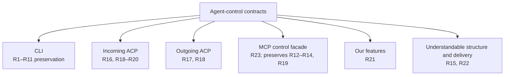
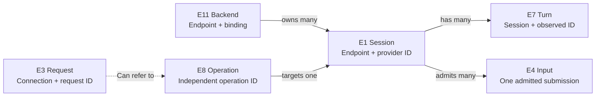
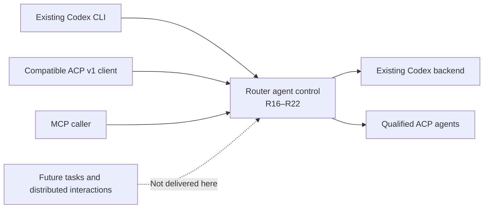

# What must be true

The same provider session can be used through different frontends without duplicating provider logic or losing the stronger frontend's authority and recovery guarantees. The Codex adapter still handles Codex-specific UI behavior.

This contract preserves [Requirements U1–U9](requirements.html). It is proposed; open realization gates remain listed rather than being silently accepted as limitations.

The interface clarification adds U10–U12 and R16–R22. The November 4 facade decision adds U13 and R23. Existing obligations retain their identities and remain required; the new interface scope neither implements nor waives their open CLI cases.

## The things we must keep distinct

| Entity | Identity and meaning |
| --- | --- |
| E1 Provider session | Endpoint plus provider session ID. Equal IDs on different endpoints are different sessions. The session owns inputs, turns and facts. |
| E2 Client action | One frontend invocation in its context. Selecting a model and saving a native default are different actions. |
| E3 Protocol request | One connection plus its request ID. It is not a durable operation identity. |
| E4 Submitted input | One admitted input in a session. Its input identity differs from the client's display correlation. Repeated equal text does not make inputs equal. |
| E5 Information fact | A value with its source, scope and validity. Missing, known-empty, stale and malformed are different. |
| E6 Compatibility disposition | The selected handling of an action: local, actual operation/read, intentional harmless no-op or unavailable. It is not proof of an effect. |
| E7 Conversation turn | A session plus an observed turn ID. Items retain their original association; an update does not move an item to a newer turn. |
| E8 Agent operation | One admitted, inspectable operation identified independently of its caller connection. Admission, possible dispatch, settlement and uncertain effect are distinct. |
| E9 Frontend | A client-facing protocol and its negotiated representation. Choosing a frontend does not choose a provider implementation. |
| E10 Capability offer | An operation's actual supplier, scope and prerequisites together with what this frontend can expose. An offer grants no permission. |

E1–E7 retain their earlier meanings. E8–E10 make the shared-control discussion explicit; they do not imply a new store.

| Additional entity | Identity, relationship and observable states |
| --- | --- |
| E11 Agent backend | One registered endpoint and its current binding. One backend can offer many models and own many E1 sessions; model names do not identify a backend. Available, unavailable or retired, with the binding generation retained. U8/U11. |
| E12 Connection profile | One declared client connection contract: protocol major, selected endpoint/routing policy, caller binding and negotiated representation. A reconnect is a new connection even when it attaches the same session. Uninitialized, negotiated, closed. It grants no authority beyond its caller binding. U10/U11. |
| E13 Application feature | One named application-supplied capability over agent control. It may coordinate several sessions but cannot present its work as an unobserved provider effect. Offered or unavailable for a caller/target; its internal task lifecycle is outside this scope. U12. |

E1 session identity is endpoint plus provider session ID; E3 request identity is connection plus request ID; E8 operation identity is independent of both. E7 belongs to exactly one session and E4 to exactly one admitted input. E5 facts retain their source/scope/validity; E6 dispositions are derived policy, not effect receipts. E9 frontend and E11 backend vary independently. E10 offers reference their actual supplier and E12 representation. Their existing observable states and invariants remain as defined by R1–R15; the interface contracts below add no second identity or state owner.

E2 actions produce requests; E9 frontends negotiate E12 connection profiles. E10 offers describe provider or E13 application-feature suppliers; E5 facts justify their availability. E6 is the selected compatibility disposition, not an alternative session/operation identity.

## Observable obligations

References: C1 is pinned Codex `360319d8`; C2 is the selected provider's actual qualified contract; C3 is the owner's boundary in Requirements; C4 is the existing typed operation/authority contract; C5 is the repository's proof and hygiene rules.

| Obligation | Need | Required result and deciding check |
| --- | --- | --- |
| R1 Existing client | U1 | Claude and Cursor work through the unchanged CLI. Check an actual same-session reply for each and separate native/reverse preservation controls. C1–C3. |
| R2 Complete enumeration | U2 | Every pinned request, notification, callback, slash variant and key action has a unique row or cross-link with handling and proof state. Missing/new members fail coverage. C1. |
| R3 Truthful handling | U2/U3 | Convert or deliberately absorb native actions where the qualified consumer contract permits it, avoiding stray compatibility errors. Actual effects use qualified operations; native housekeeping uses only an explicit no-op. Invalid, unknown and unavailable actions do not become blanket success. Check effect/no-effect and the actual client consumer. C1–C3. |
| R4 Clean default-save | U3 | After real model selection, the extra recognized native model/effort-default batch yields no red save error, no global config write and no second provider setter. Mixed, file-targeted, versioned and unrelated writes do not match. C1/C3. |
| R5 Correct facts | U4 | Model, effort, skills, context and effective settings come from their actual scope. Preserve all advertised model choices. Check known, empty, missing, model-changed and stale-session cases through the display and returned data. C1/C2. |
| R6 One visible input | U5 | A correlated submitted skill/text/media input renders once. Wrong correlation, another session and another equal-text submission cannot be merged. C1/C3. |
| R7 Exact control and callbacks | U1/U4 | Supported operations and callback decisions reach the intended session/input/turn and exact offered choice once. Stale targets, denial and cancellation cannot authorize a later unrelated effect. C2/C4. |
| R8 Lifecycle and history | U4/U6 | Known completed/failed/interrupted outcomes and original item placement agree across live view, read, resume and reopen. Unattributed replay remains explicit. C2/C4. |
| R9 Compatible absence | U3/U4 | Use actual applicability gates where they exist; check the real error/result consumer elsewhere. Unavailable is not a fake empty catalogue or an accomplished effect. Cursor rename, shell/stop, busy/refused review and failed Claude rename/readback have caller-fatal paths at the pin; merely documenting them does not meet U3. Resolving or explicitly narrowing that outcome needs the actual contract or owner decision. C1–C3. |
| R10 Visible automatic proof | U6 | Actual CLI/provider journeys detect early errors, duplicate rows and wrong information, with sensitivity checks against the named wrong behavior. A picker or acknowledgement alone cannot pass. C1/C2/C5. |
| R11 Small implementation | U7 | Provider rules remain injectable and independent of native/MCP DTOs. Keep existing transport/storage/custody; colocated tests and package checks detect structural violations. C5. |
| R12 Shared execution | U8 | Different frontends use the same existing execution/session owner. Preserve distinct frontend representation and provider features; no lowest-common-denominator provider API. Qualify a representative same-session operation across entrypoints. C2/C4. |
| R13 Preserve authority and custody | U8 | A richer operation request keeps its operation ID, generation, creator/requester, approver, policy and typed uncertain outcome. Caller loss is not automatically cancellation or completion. Check admission, detach, observation and settlement separately. C4. |
| R14 Honest capability exposure | U8 | Distinguish provider-supplied media/title control, Host-supplied queue/question routing and frontend bookkeeping. Check prerequisites and effect-side authorization; a flat provider intersection cannot hide Host services or authorize operations. C2/C4. |
| R15 Reviewable sequence | U9 | Each milestone names its ordered workstreams, dependency edges, completion evidence and forecast/gates. A milestone is not done because its author or helper says it is. C3/C5. |
| R16 Standard incoming ACP profile | U10/U8; E1/E3/E9/E11/E12 | A provider-bound ACP v1 endpoint selects its backend and declared local caller without requiring Router metadata from a standard client. New/list/load/resume/prompt/cancel and supported configuration/mode/close operations use the declared profile. Unsupported optional operations are withheld or truthfully refused; no data deletion is implied by close. Check a client that sends no Router metadata and two backends returning equal raw IDs. C2/C3/C4. |
| R17 Independent provider addition | U11/U7; E9/E10/E11 | An ACP backend joins through registration and injected provider rules. Standard protocol behavior is reusable; special auth/model/skill/callback behavior is explicitly qualified. Availability reports a failed prerequisite rather than advertising a working endpoint. No frontend may branch on that backend's name to execute its work. C2/C3/C5. |
| R18 Scoped capabilities and facts | U4/U8/U10/U11; E1/E5/E10/E11/E12 | Every exposed capability names its supplier and actual scope. Advertise only what the backend/session and this client can represent; admission still decides authority. Omitted, unknown, known-empty and malformed facts remain distinct. Parsing a content type does not advertise it. A change of backend/model/session invalidates only facts whose scope changed. C1/C2/C4. |
| R19 Protocol-specific results and custody | U8/U10; E3/E4/E7/E8/E12 | Native prompt returns its actual turn-start handle; ACP v1 returns the matching terminal stop reason after prior updates; MCP returns its actual operation snapshot and keeps show/wait/reconcile. Dropped callers do not silently resend or convert unknown effects to success. Wire request IDs never masquerade as durable operation IDs. ACP v2 is a separate unimplemented profile, not this v1 contract. C1/C2/C4. |
| R20 Faithful interactions | U4/U8/U10; E1/E7/E8/E10/E12 | Callbacks reach the exact pending approver and offered choice once. Questions require a negotiated representation. Persistent approval is never acknowledged by inventing missing consent metadata. Clients unable to represent a choice retain an explicit unavailable/pending result and another existing authorized answer path; no automatic grant or fake completion. Storage distribution is unchanged. C2/C4. |
| R21 Application feature composition | U12/U7/U8; E8/E9/E10/E11/E13 | Application features consume session operations/observations/interactions and declare their own supplier. MCP tools or negotiated ACP extensions may expose them. They cannot bypass admission, require every provider to implement them, mutate raw session storage directly, or add arbitrary menus to unchanged Codex CLI. C3/C4/C5. |
| R22 Structural and preservation boundary | U1/U6/U7/U9/U11; E1–E13 | The design names each module/service/data owner, incoming/outgoing contract and delivery gate. Existing Codex native/reverse behavior and M1 no-op/normalization remain preservation controls. No new engine, service locator, settings database, replication or task subsystem is introduced. Test and verification discovery remain colocated and complete. C3/C5. |
| R23 Ordinary MCP agent-control facade | U13/U8/U2/U6/U7; E1–E13 | An ordinary MCP caller uses the selected backend's qualified agent controls through typed tools, without ACP payloads or a second session/operation identity. Enumerate every selected ACP operation, update/callback and qualified extension with its MCP representation or an explicit unsupported/unqualified disposition. Create/attach/input/output/configuration/interaction/cancel/close meanings retain their actual target, authority and known/unknown effect. Tool discovery alone does not promise that every backend supports a method. A cancelled MCP wait detaches the waiter; explicit work cancellation has its own qualified target and observed settlement. Retained output continuation preserves epoch/sequence and reports resync or truncation explicitly. No public raw ACP tunnel is delivered or planned. Existing collaboration tools and their callers retain behavior. C2/C3/C4/C5. |

The MCP facade's callers are a local operator represented by the existing Human identity, or a hosted session acting as itself through its existing SessionRef. On the current private-local base these identities are reported, not authenticated by their request fields. The existing access/admission owner remains authoritative; a declared-role check does not prove identity authenticity. A caller must not need to borrow another session's identity to prompt or cancel. Separately adopted Fleet session attribution continues to bind session callers through its own address/owner; this facade creates no new principal, bearer or identity-binding policy.

## Interface scenarios and their references

| Scenario / problem / outcome | Contract and failure | Proof obligation |
| --- | --- | --- |
| P16 A standard client has no Router actor/endpoint metadata; O16 connect to the chosen agent. | C16 The owner-private provider-bound endpoint supplies its already-declared backend/caller. Missing owner resolution fails endpoint publication. A session belonging to another endpoint cannot be attached. | V16: zero Router metadata in the client input; real create/attach/prompt/cancel and supported settings/close; equal raw IDs on two endpoints never cross. R16. |
| P17 A new agent otherwise spreads conditions across frontends; O17 add it once. | C17 Registration supplies its runtime/rules and prerequisite report. A standards-only rule set is permitted only for its qualified baseline; extensions are not inferred. | V17: add a controlled standards-only registration and qualify actual Claude/Cursor through the same frontend code; no provider-name frontend branches. R17/R22. |
| P18 Advertised features and actual facts differ; O18 truthful offers. | C18 Backend/session supplier, frontend representation and caller authorization are distinct. No false media/title/effort support or empty-success substitute. | V18: known/empty/unknown/malformed and backend/model/capability-change cases; hidden unsupported choices and preserved Host-supplied choices. R18. |
| P19 Similar method names have different completion semantics; O19 retain each protocol's result. | C19 Starting, admitted, completed, rejected and unknown are distinguishable; each caller gets its defined result boundary. | V19: hold terminal observation and drop a caller; native start/MCP snapshot can return while ACP v1 waits. No redispatch. R19. |
| P20 A generic callback can erase choice meaning; O20 one exact authorized answer. | C20 Wrong actors, late answers and missing persistent consent cannot produce a provider grant. An unsupported question UI does not complete the question. | V20: actual producer through broker/frontend/reply, wrong actor, duplicate/late response, persistent choice without acknowledgement, unsupported form. R20. |
| P21 A new product feature can become protocol-specific; O21 reuse session control. | C21 Feature ownership is explicit and its effect still passes the same admission. A tool ACK is not a completed provider effect. | V21: existing queue operation through MCP/ACP as applicable, and a controlled consumer of the same operation/event ports; no task engine or new public task API. R21. |
| P23 Existing MCP controls are mistaken for either complete ACP parity or no agent control at all; O23 ordinary tools with complete, truthful coverage. | C23 MCP represents actual supported agent control over the same sessions and operation outcomes; it does not expose raw ACP message forwarding. Provider features, Host services and client callbacks keep distinct suppliers. | V23: real MCP control journey through the actual shared owner, exact operation/session readback, output continuation, wrong actor/target and caller-loss/no-redispatch cases; actual Claude/Cursor turns and unchanged CLI preservation. Parser, catalogue, receipt or scripted application success alone cannot pass. R23. |

C16's initial profile reuses the owner identity of the existing private native provider endpoint. Remote ACP identity/authentication, new principals and ACP v2 need separate designs. Each V16–V21 uses the exact qualified protocol major, endpoint/session and target; all require truthful failures and zero unintended effects. Existing V/R1–R15 coverage stays in its current home and is not waived by this interface design.

## Important examples

- Model selection is provider work. The following native save-default action is compatibility bookkeeping and promises no cross-reconnect persistence.
- `$` selection retains the actual provider skill identity. Its admitted receipt reconciles with the richer optimistic client row; it does not duplicate it.
- Inline review is one ordinary provider task with the selected target. It does not promise Codex's isolated review engine or review-mode lifecycle.
- Rename needs an actual provider title control and canonical readback. A Router-only display name does not satisfy it.
- ACP `session/cancel` targets session work; an exact operation or turn cancellation has a stronger identity contract. Their names do not make those guarantees interchangeable.
- Router queuing is not contingent on native provider queue support. Image input still needs provider support and a frontend that can represent it.

## Explicit realization gates

The design cannot claim clean unavailable-control behavior for the pinned CLI while both provider support and a client gate/recovery contract are absent. It cannot claim general startup readiness from a sent response or request-ID spelling, effective security policy from requested access, or context occupancy from unrelated token totals. These remain required outcomes with named design work, not waived requirements.
