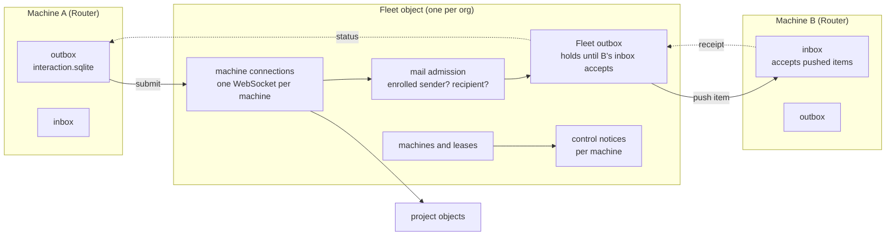

# Program Design: D1, central layout and mail

How D1 realizes [R1–R6](../specification/central-layout.md) and [R7–R15](../specification/mail.md). Evidence: the Worker inventory in `tmp/d1-inventory/` (source-verified at `fb3cf6b5`, library `v0.4.0` `b9da4b5`). **Scope (owner, 2026-11-02): one PR covering D1 and D1b.** Every table in the Fleet store gets the full storage rule (prefix, UUIDv7, timestamps, typed columns, JSON only with a stated reason); project tables are out of scope. Machines have one id, the UUIDv7 installation peer id (owner: “yes v7 id only for machines”); session addresses move to it in D3.

## What you will be able to do

Two machines enrolled with staging (or Tokio) central. B is off. On A, an agent sends a message to an agent on B. B comes on. The agent on B receives it once. From A, `message show` reports accepted by Fleet → in B's inbox → delivered (or unknown). Central holds one Fleet store and one store per project, and nothing per machine.

## Components after D1



| Component | Owns | Changes in D1 |
| --- | --- | --- |
| Fleet object (`collaboration-central-core` Fleet runtime, hosted by `-tokio` and `-cloudflare`) | machine connections, enrollment, leases, Fleet directory, Fleet outbox, status back to senders, control notices | **rewrite composition**: absorbs today's Registry and per-machine Connection; Mailbox deleted. Sockets attach to Fleet, not `Connection(service)` (`native_objects.rs:464`, `platform.rs:112`) |
| Mail admission (in Fleet) | checks the submitting machine is enrolled and is who the socket says; checks the recipient is enrolled | **keep checks** of `mail_submit_admission.rs:46–118`; the sink becomes Fleet's outbox, not the recipient Mailbox |
| Fleet outbox (library `fleet-sync-delivery`) | Messages in transit through central | **rewrite in the library**: outbox items keep content until the next holder accepts, remember the submitting machine, carry timestamps, and are pushed to the recipient |
| Machine inbox (library, on each Router) | accepting a pushed item and sending a receipt | **rewrite in the library**: a pushed-acceptance path with receipts. Today the only network path is a fetch cycle (`inbox_receive.rs:21`) and the local shortcut sends no receipts (`inbox_storage.rs:306`) |
| Router mail runtime (`collaboration-service` `mail_delivery_runtime*`) | local inbox and outbox, hand-off to sessions | **rewrite remote receive**; delete MailWaiting → fetch and the 5-minute receive poll (`machine_session.rs:404`); keep local admission and the hand-off to sessions |
| Project objects (`copy_*`) | project content | **keep**; reached from Fleet instead of from per-machine Connection |

## Stores after D1

Central: **one Fleet store** (`fleet.db` on Tokio; one `FLEET` Durable Object on Cloudflare) and **one store per project** (unchanged). Deleted: Registry, every `connection-<service>`, every `mailbox-<service>`, and their Cloudflare bindings (`cloudflare.config.ts:21–43`, `object_keys.rs:4`, `object_location.rs:3`). Staging starts empty (U3), so the Fleet schema is created fresh; nothing is migrated.


## Every table: UUIDv7 primary key and timestamps

Owner rule (2026-11-03: “all pk should be uuidv7”; `AGENTS.md` Identifiers): **every table this work creates or changes has a UUIDv7 primary key and `created_at` / `updated_at`**. A table whose primary key is already a UUIDv7 (an item id, a project id, a machine peer id) keeps it: that already meets the rule, and a second id would only add a second identity. A table keyed by anything else (an integer, a composite such as operation + step, a version number, a cursor, a non-UUIDv7 text value) gains a UUIDv7 `id` primary key and its old key becomes a `UNIQUE` constraint; counters such as lease epochs, report sequences and feed positions stay as ordinary columns. This applies in the Fleet store and to the delivery, lease, session and journal library tables in every store, including the machine inbox and outbox; existing rows on machines get a generated UUIDv7 id and `created_at` from the best recorded time during the additive migration. An exception needs a really good reason, written next to the table (owner: “unless there's a really good reason if they should not then don't, but good reason”). Not ours to change: tables owned by a third party, such as Cloudflare's own `__cf_kv`.

## Fleet store tables

### Reshaped or new (full rule: prefix, UUIDv7, timestamps, typed columns, CHECK only for booleans)

| Table | Columns | Replaces | Why |
| --- | --- | --- | --- |
| `machine_enrollments` | `machine_id` UUIDv7 PK (the installation peer id), `service_id` UNIQUE (the session-address id; see the machine-id decision), `machine_label`, `access_client_id` UNIQUE, `credential_hash` UNIQUE, `state`, `expires_at`, `last_seen_at`, `last_enrollment_operation_id`, `last_revocation_operation_id`, `created_at`, `updated_at` | Registry `machine_enrollments` (`registry_migrations/0001_machine_enrollments.sql`) | moves into Fleet; adds timestamps |
| `machine_control_notices` | `notice_id` UUIDv7 PK, `machine_id` FK, `position` (per machine), `kind` (`fleet_feed_advanced`, `board_archiving`, `lease_granted`, `lease_superseded`; validated in Rust), `board_id`, `project_id`, `epoch`, `feed_through` (each set only for its kind), `created_at`, `expires_at`; UNIQUE(`machine_id`, `position`) | `machine_notices` (one store per machine, `position` globally unique, `session_migrations/0001_machine_notices.sql`) | one Fleet hosts every machine, so position is per machine. `MailWaiting` is gone: Fleet pushes items |
| `machine_control_progress` | `machine_id` PK, `last_position`, `pruned_through`, `updated_at` | `machine_notice_state` (a singleton row named `machine`, `machine_notice_store.rs:29–52`) | one row per machine instead of one per store |
| `machine_forward_requests` | PK (`forward_frame_id` UUIDv7, `side`). `side` is `origin` or `holder`: the origin's waiting record and the holder's delivered record for the same request exist **at the same time** and neither overwrites the other. Columns: `request_frame_id`, `origin_machine_id`, `origin_session_id` (with the machine, the full session key), `connection_id`, `expected_holder_machine_id`, `project_id`, `phase` (`routing`, `awaiting_holder`, `delivered`), `deadline_at`, `created_at`, `updated_at`. At most 16 waiting `origin` rows per origin machine (today's per-store cap, `session_scope/forwards.rs:34`) | `pending_forwards` (origin side) and `delivered_forwards` (holder side), each `forward_frame` + `record` JSON, in per-machine Connection stores (`session_migrations/0002_forward_correlations.sql`; `forward_store.rs:16–43`; `session_scope/forwards.rs:44–151`; `forward_delivery.rs:125–150`) | one Fleet hosts both ends of a forward; late replies from the wrong holder are still rejected by `expected_holder_machine_id` |

### Delivery library tables in the Fleet store (library rewrite; `_fleet_sync_` prefix kept, L10)

| Table | Change | Why |
| --- | --- | --- |
| `_fleet_sync_outbox_items` | typed columns: `item_id` UUIDv7 PK, `digest`, `submitter_machine_id`, `recipient_machine_id`, `status_kind`, `status_version`, `status_detail` (refusal reason, acceptance or cancel outcome, typed per kind), `last_report_seq`, `valid_until`, `submit_attempted` (boolean), `cancel_outcome`, `cancel_target_item_id`, `acceptance_bound`, `settlement_bytes`, `capacity_slot` (boolean), `created_at` (from the id), `admitted_at`, `handed_off_at`, `payload` (dropped after hand-off), `payload_bytes`. Every field except `payload` stays usable after the content is dropped | today `record` JSON + `payload`, no times, no submitter (`0001_delivery_custody.sql:17`, `outbox_record.rs:7–23`). The fields it gains back from `record` are behavior: deadline (`outbox_rules.rs:84–92`), definitely-unsent cancellation (`outbox_admission.rs:129`), cancel identity and reserved settlement space (`:213–263`), and report replay without status going backwards (Mailbox `last_report_seq`, `mailbox_rules.rs:315–388`) |
| `_fleet_sync_status_owed`, `_fleet_sync_status_events`, `_fleet_sync_status_state` | add `machine_id` (the submitter the status goes back to); `status_state` one row per machine, not a singleton; typed columns | today one sender per store (`status_stream.rs:99`) |
| `_fleet_sync_outbox_cancel_links` | add `created_at`; cancellation itself is carried by `cancel_outcome` and `cancel_target_item_id` on the outbox item | cancel keeps working through Fleet |

### Moved and converted to typed columns (D1b, same PR)

Each table below moves into the Fleet store under its new name and its JSON `record` column is replaced by typed columns: one column per field of its record type, nested values as their own columns or a child table, plus `created_at` and `updated_at`. JSON stays only where a field is free-form by nature, with the reason written next to the table. The exact columns of each table are listed on `d1.html` for the owner before that table's queries are rewritten.

| Today | After |
| --- | --- |
| `workspaces`, `boards`, `project_directory`, `workspace_adrs`, `repository_attachments`, `archive_reports`, `creation_decisions`, `feed_readers`, `admin_imports` | `fleet_workspaces`, `fleet_boards`, `fleet_project_directory`, `fleet_workspace_adrs`, `fleet_repository_attachments`, `fleet_archive_reports`, `fleet_creation_decisions`, `fleet_feed_readers`, `fleet_admin_imports` |
| `fleet_feed`, `fleet_feed_state`, `fleet_request_decisions`, `fleet_decision_receipts` | same names (already `fleet_`), typed columns |
| `claim_reservations`, `claim_settlement_receipts` | `lease_claim_reservations`, `lease_claim_settlement_receipts` (they still protect a claim from racing an archive) |
| `registry_lease_incarnation` | `lease_incarnation`, the one monotonic incarnation counter (see Lease versions) |
| library lease tables `_fleet_sync_databases`, `_fleet_sync_leases`, `_fleet_sync_epoch_floor`, … (11) | names kept (L10); typed columns in the library; keyed per project, they don't need their own store |
| library session tables `_fleet_sync_sessions`, `_fleet_sync_notices`, `_fleet_sync_attach_sequences` | names kept; typed columns in the library; already keyed per machine peer |
| journal and migration bookkeeping (`_fleet_sync_operations`, `_fleet_sync_steps`, `_fleet_sync_schema`, `_fleet_sync_migrations`, `central_schema_migrations`, `central_schema_migration_failures`) | `central_schema_migrations` and `central_schema_migration_failures` (codex-router's own corpus) gain `applied_at` and `failed_at`. The journal tables `_fleet_sync_operations`, `_fleet_sync_steps`, `_fleet_sync_schema` and `_fleet_sync_migrations` gain `created_at` and `updated_at` in the journal library (`durable-steps`), so **every** store gets them: the Fleet, project objects and every machine (owner, 2026-11-03: “yes they should get timestamp columns”). This is an additive column migration in each store. Task input stays the task's own serialized form, which the library never queries by field |

### Deleted from central

| Table | Why it can go |
| --- | --- |
| `registry_lease_acknowledgements`, `lease_incarnation_fence` | handshake between two separately durable stores: Fleet acknowledging Registry's lease projection, and Fleet gating a stale publisher. With lease authority and the directory committed in one transaction, nothing is delivered or acknowledged between them. `registry_lease_incarnation` is **not** deleted: it is renamed `lease_incarnation` and kept as the one durable, monotonic source of the incarnation in every lease version machines see (see Lease versions below) |
| `registry_notice_marks` | deleted **only together with** admitting the old and new holder's control notices inside the lease-change transaction itself (`registry_notice_admission.rs:75–145`), and removing the old repair scan that needed the mark |
| `_fleet_sync_mail_items`, `_fleet_sync_mail_controls`, `_fleet_sync_mail_state`, `_fleet_sync_mail_cancel_links`, `_fleet_sync_delivery_receipts` | the per-machine Mailbox is gone |
| central copies of `_fleet_sync_inbox_items`, `_fleet_sync_inbox_state`, `_fleet_sync_inbox_cancel_links`, `_fleet_sync_reports`, `_fleet_sync_outbox_status` | Fleet has no inbox; these were installed with the full delivery corpus and unused by its role |

## Machine store changes (`interaction.sqlite`, library tables)

| Table | Change |
| --- | --- |
| `_fleet_sync_outbox_items` (machine) | same typed columns and timestamps as Fleet's; `relay` is the Fleet |
| `_fleet_sync_inbox_items` | typed columns: `item_id` UUIDv7 PK, `digest`, `sender` and `recipient_address` (the consumer's own values, serialized: see the JSON reason below), `relay_machine_id` (the Fleet), `progress` (`pending`, `attempting`, `held`, `delivered`, `refused`, `unknown`; validated in Rust), `attempt`, `report_seq`, `created_at` (from the id), `accepted_at`, `delivered_at`, `payload`, `payload_bytes`; accepts pushed items (see Mail protocol) |
| all inbox and outbox rows | removed 60 days after `created_at`; ids older than 60 days refused (R14) |

Router app tables (`router_pushes` and the rest) are renamed in D3, not D1.

**JSON with a stated reason: consumer-defined delivery values.** The delivery library is generic over the consumer's sender, address, acceptance and status-route types (`DeliveryTypes`, `fleet-sync-protocol/src/delivery_item.rs:4–26`); codex-router binds them to `MailSender` and `SessionRef` (`board-sync-protocol/src/board_delivery.rs:25–29`). The library cannot know their fields, so it stores those values in the consumer's own serialized form and never queries them by field. Everything the library itself owns (ids, digest, status kind and version, report sequence, machine ids, progress, attempt, deadline, cancel state, settlement bytes, timestamps) is a typed column. The typed session target the Router queries lives in codex-router's own push table (`router_pushes`, renamed in D3).

## Flows

```mermaid
sequenceDiagram
  participant A as A outbox
  participant F as Fleet (admission + outbox)
  participant B as B inbox
  A->>F: submit item over A's socket
  F->>F: check A enrolled, B enrolled; admit to Fleet outbox (one transaction)
  F-->>A: accepted by Fleet
  A->>A: drop content, keep record
  alt B connected
    F->>B: push item over B's socket
  else B offline
    Note over F: item waits; pushed after B's next welcome
  end
  B->>B: accept into inbox (one transaction)
  B-->>F: receipt: in inbox
  F->>F: drop content, keep record
  F-->>A: status: in recipient's inbox
  B->>B: hand off to session (best effort)
  B-->>F: report: delivered / refused / unknown
  F-->>A: status
```

**Who may answer for an item.** Fleet accepts a receipt or report for an item only from that item's recipient machine: the socket's authenticated machine must equal the item's `recipient_machine_id`, as Mailbox checks the authenticated machine today (`mailbox_requests.rs:97–113`, `mailbox_rules.rs:310`). There is no separate session check: authority is the enrolled machine (owner rule), and B's inbox routes to the session from the item's address. The report sequence is checked against `last_report_seq` so a replay never moves status backwards (`mailbox_rules.rs:315–388`). The outcome and the status owed to the sender commit in **one transaction** before Fleet answers B. A commits a status before acknowledging it.

**Failure cases (each has a proof row):**

| Case | What happens |
| --- | --- |
| A restarts before Fleet's answer | A resubmits the same id; Fleet replays the current status |
| Fleet restarts after admitting | the item is still in Fleet's outbox and is pushed on B's next welcome |
| B restarts after accepting, before the receipt reaches Fleet | Fleet pushes again; B recognises the id and answers the receipt again |
| Fleet crashes after B's receipt, before publishing status to A | the receipt and the status owed committed together; the status is published after restart |
| A offline when status is ready | status waits, owed to A, and is published after A's next welcome |
| Machine C sends a receipt or report for B's item | refused; nothing changes |
| Hand-off to the session fails or its result is lost | “unknown”, no retry |
| Same id with different content | refused as a conflict |
| Two machines forward to one holder; a reply arrives late or from the wrong holder | each origin's waiting record is separate; a wrong-holder reply is rejected; an expired forward is cleared at its deadline |

**One journal, one dispatcher, one alarm.** Today each old object registers only its own task kinds (`shared_task_registry.rs:15–71`), and an engine that claims a task kind it doesn't know fails it as `unknown_kind` (library `operation_drive.rs:88–90`). The Fleet object registers **every** surviving task kind with one engine over its one journal: enrollment and lease workflows, control-notice delivery and expiry, forward deadlines, session upkeep, status publication, mail push and 60-day removal. One alarm arbiter wakes it for the earliest due item (Tokio slot timer `native_objects.rs:301`; Cloudflare `AlarmOwner` `shared_object_store.rs:63`). Proof includes a restart with several task kinds due.


**Lease-change hook (library contract).** `fleet-sync-lease` owns its lease-change transactions internally (`change_completion.rs:168, 290`; registration and retirement tasks likewise), and today central admits notices in a later, separate transaction (`registry_lease_store.rs:148–165`). D1 adds one consumer hook to the lease library, called **inside** every transaction that changes a project's lease record (grant and change completion, registration, renewal, import, retirement and other lifecycle changes), after all of that transaction's rows are consistent. It receives the full committed before and after lease snapshots (holder, epoch, expiry, lifecycle, revision), the same pattern the delivery library uses for its receive and outcome hooks. The Fleet's hook **always** refreshes the directory projection and the version machines see; it appends the old and new holders' control notices **only when the epoch or the holder changed** (today's predicate, `registry_notice_admission.rs:22–27`), so an ordinary renewal (`renew_rules.rs:97–107`) moves the directory forward with no ownership notices. A replay or a no-op writes nothing. The later-transaction notice admission and its repair scan are deleted.

## Lease numbers and the staging wipe

**What a lease is.** One machine at a time may write a project: it holds that project's lease. Central tells machines who holds each lease, stamped with a number that only goes up (`epoch`, `incarnation`, `change`). Each Router remembers the highest number it has seen and ignores anything lower, so stale or delayed messages can't undo a newer one (`writer_observation.rs:28–43`; `central_project_reads.rs:280–289`).

**Normal running.** The version stays integer counters (owner, 2026-11-02: “ok integer version is fine”); a lease is identified by its project's UUIDv7 id plus its epoch. Central keeps the counter in its own store (`lease_incarnation`, today's `registry_lease_incarnation`, renamed) and advances it in the same transaction as the lease change, so a central restart never reuses a number.

**The staging wipe.** The new, empty central starts counting from 1, while every Router still remembers higher numbers from the old central. Without a fix, every Router would ignore the new central's leases as stale, and no machine could write its projects. A wiped central keeps the same URL and configured ids (`fleet_enrollment_file.rs:20–28`, `delivery_config.rs:1–9`, `machine_enrollment.rs:140–141`), so a Router can't tell it is new.

**The rule:** on every successful enrollment, a Router forgets what it learned from central (lease numbers, its cached Fleet directory, project read copies) and starts fresh. It records that the forgetting finished before it talks to central again; if it crashes halfway, it finishes on restart. Its own project content, unsent messages, approvals, history and machine identity are never touched. Re-enrolling with an unchanged central just costs one refresh.

**Proof:** wipe staging, keep the same URL and ids, re-enroll a Router that still remembers old numbers: it accepts the new central's lease and writes its project. Kill it while it is forgetting: on restart it finishes before reading from central.

## Fleet and project objects

Today a project object accepts reads and writes only from a per-machine Connection, and lease control only from the Registry (`copy_calls.rs:80–84, 106`; `copy_write_calls.rs:172`). The call graph allows project → Fleet but not Fleet → project (`call_graph.rs:162–168`). D1 replaces both callers with the Fleet:

| Call | Direction | Allowed caller and provenance | Failure |
| --- | --- | --- | --- |
| Project read | Fleet → project, synchronous | caller is the Fleet; the call carries the authenticated machine id of the socket it serves | the error goes back to that machine's request only |
| Project write | Fleet → project, synchronous | caller is the Fleet; carries the machine id and the writer's lease epoch; the project object checks the epoch fence as today | refused write returns to the writer; nothing else waits |
| Lease and fence control | Fleet → project, synchronous | caller is the Fleet's lease authority (today's Registry duty) | the lease workflow retries through its journal |
| Project summary for the directory | project → Fleet, **asynchronous only** | the project object's existing durable follow-up (`copy_directory_summary.rs:23`) delivers it; the Fleet never waits on it | retried by the project object's journal |

**Call graph after D1:** Fleet ranks above project objects; the only synchronous edge is Fleet → project; project → Fleet exists only as a durable asynchronous delivery, so there is no cycle. **Containment:** the Fleet never holds its transaction open across a project call, and no mail operation waits on a project call, so a failed project object affects only requests for that project (R3).

## Mail protocol

New and changed calls, all over the machine's one WebSocket. Existing names are kept where the meaning is unchanged.

| Call | From → to | Request | Answers | Commits before answering |
| --- | --- | --- | --- | --- |
| Submit (existing `mail_submit`, new sink) | A → Fleet | the frozen item: id, digest, sender, recipient machine and session address, body | `accepted {status, version}` · `replayed {current status, version}` (same id, same digest) · `refused {conflict \| sender not enrolled \| recipient not enrolled \| too old \| no capacity}` | Fleet: outbox item admitted (or nothing, if refused) |
| **Push** (new server call) | Fleet → B | the item, as submitted. In the same inbox transaction B runs today's receive hook (push projection, `mail_delivery_runtime.rs:363`, as `inbox_receive.rs:161` does now) and admits the delivery attempt | `accepted {accepted_at}` · `replayed {current inbox status}` (B already has it) · `conflict {existing digest}` · `refused {too old \| not this machine \| no capacity}` | B: inbox item stored |
| Push result | Fleet, on B's answer | n/a | n/a | Fleet: on `accepted`/`replayed`, drop the content, set status “in recipient's inbox”, owe that status to the submitter, all in one transaction |
| **Report** (changed) | B → Fleet | item id, report sequence, and one outcome: `held` (not final: the session is not running; released when it runs, `held_readiness.rs:30`), `delivered`, `refused` with a reason, or `unknown` | `ack {report_seq}` · `replayed {report_seq}` (sequence already applied) · `refused {not the recipient}` | Fleet: status advanced and owed to the submitter, together. `held` can be followed by `delivered`, `refused` or `unknown`; nothing moves backwards |
| Status (existing `PublishStatus`, plus catch-up on welcome) | Fleet → A | item id, status, version | `applied` | A: status stored |

Fleet keeps what it needs after the content is dropped on the outbox item itself: `recipient_machine_id` for the report check, `submitter_machine_id` for status, `last_report_seq`, the status and its version (see the table above). The session address is only needed by B and travels in the content.

## Library changes (`agent-fleet-sync`, new tag)

1. Outbox items: typed columns (including the retained delivery state above), timestamps, submitter, content dropped only after the next holder's receipt.
2. Inbox: accept a pushed item with a receipt; refuse ids older than 60 days.
3. Status: scoped per submitting machine; report sequence kept on the outbox item.
4. 60-day removal for outbox and inbox rows.
5. Remove the Mailbox role (mail items, controls, fetch cycle) once codex-router no longer uses it.
6. Lease-change hook: a consumer callback inside every lease-change transaction (see “Lease-change hook”).

## Not in D1

Fleet sending its own messages and remote create (D2); renaming Router app tables, JSON files, and moving session addresses to the machine id (D3); wakes and notifications (D4a); schedules (D4b). Until D3, `machine_enrollments` keeps `service_id` because every session address still carries it. Project tables are out of scope.

## Trace: obligations to owners and proof seams

| R | Owner | Interface or state | Proof seam |
| --- | --- | --- | --- |
| R1 | Tokio and Cloudflare hosts | object keys and bindings: Fleet plus projects only | central store listing |
| R2 | Fleet runtime | machine socket attaches to the Fleet | socket count on Fleet; reconnect |
| R3 | Fleet ↔ project boundary | the four calls in “Fleet and project objects” | project fault injection with mail and a second project running |
| R4 | both hosts | same core runtime | every proof on both backends |
| R5 | Router enrollment | forget central-derived state on enroll | wipe and re-enroll |
| R6 | Fleet schema | prefixed tables | schema listing |
| R7 | Fleet outbox, B inbox | Submit, Push | offline then online delivery |
| R8 | Router mail runtime | local inbox admission | same-machine send |
| R9 | each holder | drop content after the next holder's commit | crash matrix |
| R10 | Fleet outbox, B inbox | `replayed` and `conflict` answers | resubmit and conflict cases |
| R11 | Fleet status, Router `message show` | Push result, Report, Status | status read at each held stage |
| R12 | Fleet push | push at admission when B is connected | online timing |
| R13 | library tables | UUIDv7 ids, timestamps | row readback; v4 refusal |
| R14 | Fleet and Router removal work | 60-day removal, too-old refusal | injected clock |
| R15 | Fleet admission | Submit `refused {sender not enrolled}` | unenrolled submit |
