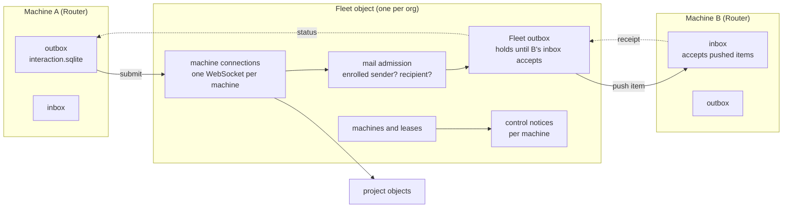

# Program Design: D1, central layout and mail

How D1 realizes [R1–R6](../specification/central-layout.md) and [R7–R15](../specification/mail.md). Evidence: the Worker inventory in `tmp/d1-inventory/` (source-verified at `fb3cf6b5`, library `v0.4.0` `b9da4b5`). **Scope assumes option A (pending the owner):** every table D1 creates or reshapes gets the full storage rule; tables D1 only moves get a prefix rename; project content tables are untouched.

## What you will be able to do

Two machines enrolled with staging (or Tokio) central. B is off. On A, an agent sends a message to an agent on B. B comes on. The agent on B receives it once. From A, `message show` reports accepted by Fleet → in B's inbox → delivered (or unknown). Central holds one Fleet store and one store per project, and nothing per machine.

## Components after D1



| Component | Owns | Changes in D1 |
| --- | --- | --- |
| Fleet object (`collaboration-central-core` Fleet runtime, hosted by `-tokio` and `-cloudflare`) | machine connections, enrollment, leases, Fleet directory, Fleet outbox, status back to senders, control notices | **rewrite composition**: absorbs today's Registry and per-machine Connection; Mailbox deleted. Sockets attach to Fleet, not `Connection(service)` (`native_objects.rs:464`, `platform.rs:112`) |
| Mail admission (in Fleet) | checks the submitting machine is enrolled and is who the socket says; checks the recipient is enrolled | **keep checks** of `mail_submit_admission.rs:46–118`; the sink becomes Fleet's outbox, not the recipient Mailbox |
| Fleet outbox (library `fleet-sync-delivery`) | Messages in transit through central | **rewrite in the library**: outbox items keep content until the next holder accepts, remember the submitting machine, carry timestamps, and are pushed to the recipient |
| Machine inbox (library, on each Router) | accepting a pushed item and sending a receipt | **rewrite in the library**: a pushed-acceptance path with receipts. Today the only network path is a fetch cycle (`inbox_receive.rs:21`) and the local shortcut sends no receipts (`inbox_storage.rs:306`) |
| Router mail runtime (`collaboration-service` `mail_delivery_runtime*`) | local inbox and outbox, hand-off to sessions | **rewrite remote receive**; delete MailWaiting → fetch and the 5-minute receive poll (`machine_session.rs:404`); keep local admission and the hand-off to sessions |
| Project objects (`copy_*`) | project content | **keep**; reached from Fleet instead of from per-machine Connection |

## Stores after D1

Central: **one Fleet store** (`fleet.db` on Tokio; one `FLEET` Durable Object on Cloudflare) and **one store per project** (unchanged). Deleted: Registry, every `connection-<service>`, every `mailbox-<service>`, and their Cloudflare bindings (`cloudflare.config.ts:21–43`, `object_keys.rs:4`, `object_location.rs:3`). Staging starts empty (U3), so the Fleet schema is created fresh; nothing is migrated.

## Fleet store tables

### Reshaped or new (full rule: prefix, UUIDv7, timestamps, typed columns, CHECK only for booleans)

| Table | Columns | Replaces | Why |
| --- | --- | --- | --- |
| `machine_enrollments` | `machine_id` UUIDv7 PK (the installation peer id), `service_id` UNIQUE (the session-address id; see the machine-id decision), `machine_label`, `access_client_id` UNIQUE, `credential_hash` UNIQUE, `state`, `expires_at`, `last_seen_at`, `last_enrollment_operation_id`, `last_revocation_operation_id`, `created_at`, `updated_at` | Registry `machine_enrollments` (`registry_migrations/0001_machine_enrollments.sql`) | moves into Fleet; adds timestamps |
| `machine_control_notices` | `notice_id` UUIDv7 PK, `machine_id` FK, `position` (per machine), `kind` (`fleet_feed_advanced`, `board_archiving`, `lease_granted`, `lease_superseded`; validated in Rust), `board_id`, `project_id`, `epoch`, `feed_through` (each set only for its kind), `created_at`, `expires_at`; UNIQUE(`machine_id`, `position`) | `machine_notices` (one store per machine, `position` globally unique, `session_migrations/0001_machine_notices.sql`) | one Fleet hosts every machine, so position is per machine. `MailWaiting` is gone: Fleet pushes items |
| `machine_control_progress` | `machine_id` PK, `last_position`, `pruned_through`, `updated_at` | `machine_notice_state` (a singleton row named `machine`, `machine_notice_store.rs:29–52`) | one row per machine instead of one per store |
| `machine_forward_requests` | `forward_frame_id` UUIDv7 PK, `origin_machine_id`, `holder_machine_id`, `project_id`, `state` (pending, delivered), typed fields of today's forward record, `created_at`, `updated_at` | `pending_forwards`, `delivered_forwards` (`forward_frame`, `record` JSON; `session_migrations/0002_forward_correlations.sql`) | both lived in per-machine Connection stores; one table with a state column, scoped by machine. The exact fields come from today's forward record type, read in the plan's first slice |

### Delivery library tables in the Fleet store (library rewrite; `_fleet_sync_` prefix kept, L10)

| Table | Change | Why |
| --- | --- | --- |
| `_fleet_sync_outbox_items` | typed columns: `item_id` UUIDv7 PK, `digest`, `submitter_machine_id`, `recipient_machine_id`, `status`, `status_version`, `created_at` (from the id), `admitted_at`, `handed_off_at`, `payload` (dropped after hand-off), `payload_bytes`, `capacity_slot` | today `record` JSON + `payload`, no times, no submitter (`0001_delivery_custody.sql:17`, `outbox_record.rs:7–25`) |
| `_fleet_sync_status_owed`, `_fleet_sync_status_events`, `_fleet_sync_status_state` | add `machine_id` (the submitter the status goes back to); `status_state` one row per machine, not a singleton; typed columns | today one sender per store (`status_stream.rs:99`) |
| `_fleet_sync_outbox_cancel_links` | add `created_at` | cancel keeps working through Fleet |

### Moved, prefix rename only (full rule later, scope option A)

| Today | After |
| --- | --- |
| `workspaces`, `boards`, `project_directory`, `workspace_adrs`, `repository_attachments`, `archive_reports`, `creation_decisions`, `feed_readers`, `admin_imports` | `fleet_workspaces`, `fleet_boards`, `fleet_project_directory`, `fleet_workspace_adrs`, `fleet_repository_attachments`, `fleet_archive_reports`, `fleet_creation_decisions`, `fleet_feed_readers`, `fleet_admin_imports` |
| `fleet_feed`, `fleet_feed_state`, `fleet_request_decisions`, `fleet_decision_receipts` | unchanged (already `fleet_`) |
| `claim_reservations`, `claim_settlement_receipts` | `lease_claim_reservations`, `lease_claim_settlement_receipts` (they still protect a claim from racing an archive) |
| library lease tables `_fleet_sync_databases`, `_fleet_sync_leases`, `_fleet_sync_epoch_floor`, … (11) | unchanged; keyed per project, they don't need their own store |
| library session tables `_fleet_sync_sessions`, `_fleet_sync_notices`, `_fleet_sync_attach_sequences` | unchanged; already keyed per machine peer |
| journal and migration bookkeeping (`_fleet_sync_operations`, `_fleet_sync_steps`, `_fleet_sync_schema`, `_fleet_sync_migrations`, `central_schema_migrations`, `central_schema_migration_failures`) | unchanged |

### Deleted from central

| Table | Why it can go |
| --- | --- |
| `registry_lease_incarnation`, `registry_lease_acknowledgements`, `lease_incarnation_fence` | handshake between two separately durable stores; with Registry and Fleet in one transaction there is nothing to acknowledge. The version machines see is still published |
| `registry_notice_marks` | replaced by admitting the control notice in the same transaction as the lease change |
| `_fleet_sync_mail_items`, `_fleet_sync_mail_controls`, `_fleet_sync_mail_state`, `_fleet_sync_mail_cancel_links`, `_fleet_sync_delivery_receipts` | the per-machine Mailbox is gone |
| central copies of `_fleet_sync_inbox_items`, `_fleet_sync_inbox_state`, `_fleet_sync_inbox_cancel_links`, `_fleet_sync_reports`, `_fleet_sync_outbox_status` | Fleet has no inbox; these were installed with the full delivery corpus and unused by its role |

## Machine store changes (`interaction.sqlite`, library tables)

| Table | Change |
| --- | --- |
| `_fleet_sync_outbox_items` (machine) | same typed columns and timestamps as Fleet's; `relay` is the Fleet |
| `_fleet_sync_inbox_items` | typed columns; `created_at`, `accepted_at`, `delivered_at`; accepts pushed items |
| all inbox and outbox rows | removed 60 days after `created_at`; ids older than 60 days refused (R14) |

Router app tables (`router_pushes` and the rest) are renamed in D3, not D1.

## Flows

```mermaid
sequenceDiagram
  participant A as A outbox
  participant F as Fleet (admission + outbox)
  participant B as B inbox
  A->>F: submit item over A's socket
  F->>F: check A enrolled, B enrolled; admit to Fleet outbox (one transaction)
  F-->>A: accepted by Fleet
  A->>A: drop content, keep record
  alt B connected
    F->>B: push item over B's socket
  else B offline
    Note over F: item waits; pushed after B's next welcome
  end
  B->>B: accept into inbox (one transaction)
  B-->>F: receipt: in inbox
  F->>F: drop content, keep record
  F-->>A: status: in recipient's inbox
  B->>B: hand off to session (best effort)
  B-->>F: report: delivered / refused / unknown
  F-->>A: status
```

**Failure cases (each has a proof row):** A restarts before Fleet's answer → A resubmits the same id, Fleet replays the current status. Fleet restarts after admitting → the item is still in its outbox and is pushed on B's next welcome. B restarts after accepting but before the receipt reaches Fleet → Fleet pushes again, B recognises the id and answers with the receipt again. Hand-off to the session fails or its result is lost → “unknown”, no retry. Same id with different content → refused as a conflict.

**Timed work:** the Fleet object's one alarm drives pushing waiting items, status publication and the 60-day removal. Each machine's Router drives its own removal.

## Library changes (`agent-fleet-sync`, new tag)

1. Outbox items: typed columns, timestamps, submitter, content dropped only after the next holder's receipt.
2. Inbox: accept a pushed item with a receipt; refuse ids older than 60 days.
3. Status: scoped per submitting machine.
4. 60-day removal for outbox and inbox rows.
5. Remove the Mailbox role (mail items, controls, fetch cycle) once codex-router no longer uses it.

## Not in D1

Fleet sending its own messages and remote create (D2); renaming Router app tables, JSON files, the machine-id change (D3); wakes and notifications (D4a); schedules (D4b); JSON-to-columns cleanup of the prefix-renamed tables (option A's follow-up).

## Open, decided in the plan from code

- The exact fields of today's forward record type (for `machine_forward_requests`).
- How the version machines see for a lease is published once the two-store handshake is gone (Worker section 6: "machine-visible version contract still needs disposition").
