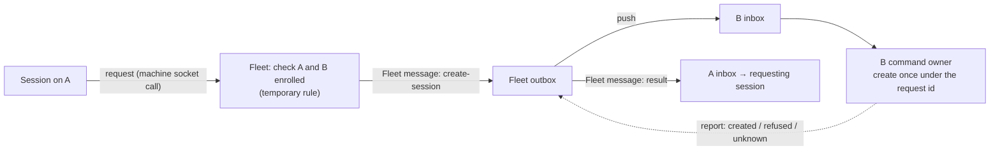

# Program Design: D2, Fleet sends and remote create

How D2 realizes [R16–R22](../specification/remote-sessions.md) on top of D1's Fleet object and Mail protocol ([D1](d1-central-layout-and-mail.md)). Evidence: `tmp/d2-inventory/01-fleet-sends.md`, `02-remote-create.md` (Worker, source-verified at `fb3cf6b5`). Every table rule from D1 applies (UUIDv7 primary key, timestamps, typed columns).

## What you will be able to do

From a session on A: `agent-collaboration conversation create --machine <B> --endpoint codex-local --cwd /path/on/B --access workspace-write [--model …] [--effort …] [--text "first input"]`. You get a request id at once, then “B has your request”, then a message in your session from the Fleet: the new session's address, or “B said no, because …”, or “not sure”. You can message the new session like any other.

## The shape: A asks, the Fleet sends, B creates

The request is a call to the Fleet over A's socket, not mail, because only the Fleet may originate a Fleet message (R21). The command and the result are both Fleet messages on D1's mail path. **No new table:** the Fleet outbox item of the command already keeps its id, content hash, status and report outcome for 60 days, so it is the request record.

## Components and changes

| Component | Change |
| --- | --- |
| `collaboration-mail-protocol` | `MailSender::Fleet` (no fields; the Fleet is one per organization). `MessageBody` accepts a Fleet sender. New body `CreateSession { requester: SessionRef, endpoint, working_directory, access, model?, effort?, mode?, first_input? }`; the request id is the item id |
| Delivery address (`BoardDeliveryTypes::Address`) | becomes `Session(SessionRef) \| Machine` so a command can be addressed to a machine without inventing a session. Stored serialized, as D1's consumer-value reason allows |
| Fleet request handler (central core, new) | authenticates A's socket machine, checks A and B enrolled (**temporary rule; code comment says so and links R17**), freezes the command, admits a Fleet-origin outbox item with sender `Fleet` and recipient `Machine` on B. Answers `accepted {request_id}`, `replayed {current status}` or `refused {sender not enrolled \| target not enrolled \| conflict \| too old}` |
| Fleet status query (new call) | `remote create status {request_id}` from the requesting machine: the command item's status, and its result once reported |
| Fleet completion observer (new) | on B's report for a create-session item, sends the requesting session a Fleet message with the result, once (the report sequence makes replays no-ops) |
| B command owner (Router, new) | `MailConsumer` routes a `CreateSession` body to the command owner (today's `Wake` body uses the same branch pattern, `remote_wake`). It admits a local create with **operation id = request id** through the existing owner: Codex ACP create, or the external-provider create (`conversation_operations.rs:99`, supervisor `prepare_operation`). If the operation already exists, it answers from its record; after `MayHaveDispatched` it reports `unknown` and never dispatches again |
| Creator and approver on B | creator is B's local Router identity with the remote requester recorded as `requested_by`; approver is B's local owner, so the new session's tool approvals appear on B exactly as for a local create (R22; routed approvals are later work) |
| First input | after `created`, B prompts the new session once under a new UUIDv7 operation id; the result carries `first input: accepted \| not delivered \| not requested` |
| Report outcome | the create result rides D1's Report as `delivered` with a typed acceptance `CreateSessionResult { created {session, settings applied, partial settings}, refused {reason}, unknown }`, the same way the wake reply rides today (`CarrierAcceptance::Wake`) |
| Recipient projection | `PushOrigin::Fleet`; push lines label the sender “Fleet” (`received_mail_push.rs`) |
| CLI and MCP | `conversation create --machine`; `conversation_create` gains `machine`; `conversation remote-status --request-id` |

## Failure cases

| Case | What happens |
| --- | --- |
| B offline | command waits in Fleet's outbox; A sees “waiting for B”; pushed after B's welcome |
| A or B not enrolled | refused at the Fleet request; nothing stored |
| Same request id, different content | refused as a conflict at the Fleet; and at B's inbox by digest |
| B receives the command twice | B's inbox recognises the id; the command owner answers from the recorded operation |
| B crashes after starting the session, before recording the result | on restart the operation is `MayHaveDispatched`; B reports `unknown`; no second session |
| Create succeeds, first input fails | result `created` with “first input not delivered” |
| A offline when the result is ready | the result message waits in Fleet's outbox for A |
| A machine submits an item with sender `Fleet` | refused at Fleet admission (R21) |

## Trace

| R | Owner | Interface | Proof seam |
| --- | --- | --- | --- |
| R16 | Fleet request handler | request call | request and refusal |
| R17 | Fleet request handler | enrollment check | code comment and test name |
| R18 | Fleet status query, completion observer | status call, result message | stage reads and one result |
| R19 | B command owner, B inbox | operation id = request id | duplicate push; crash after start |
| R20 | B command owner | first-input prompt | first input accepted / refused |
| R21 | mail protocol, Fleet admission | `MailSender::Fleet` | sender shown at recipient; spoof refused |
| R22 | B creator/approver binding | approver = B's owner | approval appears on B |

## Not in D2

Workspace membership and permissions; Fleet messages produced by automations (D4a, D4b).
