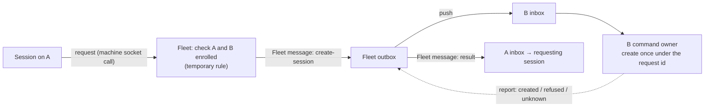

# Program Design: D2, Fleet sends and remote create

How D2 realizes [R16–R22](../specification/remote-sessions.md) on top of D1's Fleet object and Mail protocol ([D1](d1-central-layout-and-mail.md)). Evidence: `tmp/d2-inventory/01-fleet-sends.md`, `02-remote-create.md` (Worker, source-verified at `fb3cf6b5`). Every table rule from D1 applies (UUIDv7 primary key, timestamps, typed columns).

**Revision r2 (2026-11-05), re-anchored on merged D1** (codex-router `614c03b75`, agent-fleet-sync main `30371bf38`). It answers review `tmp/d2-review/2026-11-04-d2-review.md` F1 and F2. D1's rules added during delivery apply: every shared write checks the sender's enrollment, and D2's request handler and command admission use the same gate. The organization model (B2, owner 2026-11-05) applies: one Fleet per organization, with ownership being presence in that Fleet's directory, never replicated project state.

## What you will be able to do

From a session on A: `agent-collaboration conversation create --machine <B> --endpoint codex-local --cwd /path/on/B --access workspace-write [--model …] [--effort …] [--text "first input"]`. You get a request id at once, then “B has your request”, then a message in your session from the Fleet: the new session's address, or “B said no, because …”, or “not sure”. You can message the new session like any other.

## The shape: A asks, the Fleet sends, B creates



The request is a call to the Fleet over A's socket, not mail, because only the Fleet may originate a Fleet message (R21). The command and the result are both Fleet messages on D1's mail path. The Fleet drops a command's content once B accepts it, and the requester lives only in that content, so D2 keeps two small records (below): one in the Fleet, one on B.


## Tables (for the owner before code)

| Table | Store | Columns | Why it is needed |
| --- | --- | --- | --- |
| `fleet_remote_creates` | Fleet | `id` UUIDv7 PK (= request id, minted by A before its first call and reused on every retry), `command_digest`, `requester_machine_id`, `requester_endpoint`, `requester_session_id`, `target_machine_id`, `command_item_id`, `result_item_id` (UUIDv7, **null until the terminal outcome first materializes**: B's report, or the command's removal at 60 days; set and admitted in that same transaction, then reused on every replay), `created_at`, `updated_at` | the requester must survive the command's content being dropped; the same id with a different digest is refused here. The result id is minted when the result exists, not at admission, so the result gets D1's full 60-day retention from its own creation (review F2); storing it in the same transaction means a retried report or removal finds it and never sends a second result |
| `mail_create_commands` | each machine (`interaction.sqlite`) | `id` UUIDv7 PK (= request id), `command_digest`, `create_operation_id` (= request id), `prompt_operation_id` (UUIDv7, external providers only; null for Codex), `requester_machine_id`, `requester_session_id` (provenance only, never an actor), `create_outcome` (`pending`, `created`, `refused`, `unknown`), `new_session_*`, `settings_outcome` (`all applied`, `partial`), `prompt_outcome` (`not requested`, `not attempted`, `dispatching`, `accepted`, `failed`, `unknown`; `dispatching` is committed before the prompt call, and becomes `unknown` on restart), `created_at`, `updated_at` | binds the command to the one local create and the one prompt it may cause; a replay answers from this row; an operation the command did not create is never adopted |

When the Fleet applies B's report for a create command, it admits the result message (`result_item_id`) in the **same transaction** as the report, so a crash between the two cannot lose the result.

## Components and changes

| Component | Change |
| --- | --- |
| `collaboration-mail-protocol` | `MailSender::Fleet` (no fields; the Fleet is one per organization). `MessageBody` accepts a Fleet sender. New body `CreateSession { requester: SessionRef, endpoint, working_directory, access, model?, effort?, mode?, first_input? }`; the request id is the item id |
| Typed Fleet submitter (library `fleet-sync-protocol`, `fleet-sync-delivery`; review F1) | `Submitter` gains `Fleet(FleetId)` beside `Machine(PeerId)` and `Project(DatabaseId)` (`submitter.rs:13`). `FleetId` is the Fleet's own identity, the same one its signed organization stamp names. Its stored round trip is a third `kind` in the stored submitter decoder (`fleet-sync-delivery` `submitter.rs`), surviving payload release and reopen like the other two. **Internal Fleet admission** is a separate entry from machine submit. Only the Fleet's own handlers (the request handler, completion observer and removal) call it, inside a Fleet transaction, and it asserts `Submitter::Fleet` directly. Machine submit never reaches it. **Binding versus admission (r3, review F1 residual).** The sender bindings *resolve identity* for every custody path, including incoming Push and retained-row validation, so neither may reject a real Fleet sender. Central's `FleetSenderBinding` resolves `MailSender::Fleet` to `Submitter::Fleet(own FleetId)`. The Router's `MachineSenderBinding` resolves `MailSender::Fleet` to `Submitter::Fleet(the FleetId pinned at this machine's enrollment)`, so a command or result pushed by its enrolled Fleet is accepted and its retained rows decode. **The prohibition sits at the producer and admission boundary instead:** the Router's local outbox admission (machine submit) refuses any item whose sender is `MailSender::Fleet`, and Central's machine-submit path refuses a machine-originated `MailSender::Fleet` before custody. Only Central's internal Fleet admission accepts it. So a machine can't originate Fleet mail at either hop (R21), and Fleet mail it receives still flows. **Statuses of Fleet-origin items** have no machine or project reader: their publication target is the Fleet itself, consumed by the completion observer in the same transaction, which is how the requester learns the outcome. Machine and Project ownership keep their existing paths unchanged |
| Delivery address (`BoardDeliveryTypes::Address`, review F6) | `DeliveryAddress = Session(SessionRef) \| Machine { machine: PeerId }`, serialized **untagged**. `Session` keeps D1's exact bare `SessionRef` bytes (`board_delivery.rs:25`), so every retained inbox and outbox row and journal payload decodes unchanged with **no conversion code** (owner, no one-time switch-over code). `Machine` has the distinct required field `machine`, and both shapes deny unknown fields, so a value can decode as only one. **Allowed combinations** (anything else is refused at admission by both sender bindings): any machine or project sender with an ordinary body to a `Session`; `Fleet` with `CreateSession` to a `Machine`; `Fleet` with `RemoteCreateResult` to a `Session`. A `Machine` address with a non-Fleet sender, or a `CreateSession` body from anyone but the Fleet, is refused, so a session can't bypass the request handler's enrollment and offline checks. **Validation:** a `Machine` address must name an enrolled peer in the same organization's Fleet directory (D1 revocation gate). `Session` keeps D1's endpoint/service check (`board_consumer.rs:78`). **Receive branch:** `received_mail_push.rs:47` matches the address before projecting to a `SessionRef`. `Machine` goes to the command owner (only for a Fleet `CreateSession`) and `Session` takes the existing projection unchanged |
| Fleet request handler (central core, new) | takes the request id A minted. A retry reuses it, and it answers `Replayed` **only if** the stored, authenticated `requester_*`, `target_machine_id` and `command_digest` all equal the new request's (r3, review F10). The digest is the canonical hash of the whole `RemoteCreateRequest` minus its id, so a changed requester, target or command under the same id is `Conflict`, and D1's envelope conflict check stays, authenticates A's socket machine, checks A and B enrolled (**temporary rule; code comment says so and links R17**) and that B is connected now (**temporary rule: refuse when offline; code comment says so and links R18**), freezes the command, admits a Fleet-origin outbox item with sender `Fleet` and recipient `Machine` on B. Answers `accepted {request_id}`, `replayed {current status}` or `refused {sender not enrolled \| target not enrolled \| target offline (temporary) \| conflict \| too old}` |
| Fleet status query (new call) | `remote create status {request_id}` from the requesting machine: the command item's status, and its result once reported |
| Fleet completion observer (new) | on B's report for a create-session item: if `result_item_id` is null, mints a UUIDv7 now, stores it and admits the result message (internal Fleet admission, `Submitter::Fleet`, addressed to the requester from `fleet_remote_creates`), all in the report's transaction. If it's already set, it's a replay, so nothing new is admitted. The command's removal at 60 days does the same with an `expired` result |
| B command owner (Router, new) | `MailConsumer` routes a `CreateSession` body to the command owner (today's `Wake` body uses the same branch pattern, `remote_wake`). It admits a local create with **operation id = request id** through the existing owner: Codex ACP create, or the external-provider create (`conversation_operations.rs:99`, supervisor `prepare_operation`). **Ownership before adoption (r5, review F7 residual).** The provider operation lives in `provider-operations.sqlite` and the command row in `interaction.sqlite`; nothing records which command admitted an operation, so the command owner never adopts a provider operation it can't prove it admitted. It reads `mail_create_commands` for the request id first, in its own transaction, and decides by that row: **completed row** (`created`, `refused` or `unknown`) with the same `command_digest`: a replay, answered from the row; the provider is not called. **No row, or a different digest:** it records a `pending` row, then admits the create by operation id = request id and reads **the admission result itself**, never an earlier lookup. A fresh admission proceeds. An `Existing` answer is unrelated: refused before any create or prompt effect with `CreateRefusal::ProviderRefused { code: "operation_conflict" }`, the row recorded `refused`, and the existing operation left untouched. **`pending` row on restart:** if the provider has an operation with that id, in any state including Terminal, the result is `Unknown` (R19): its target isn't adopted, nothing is re-created and no first input is sent, because a pending row can't tell this command's own admission from an unrelated create that took the id in between. If the provider has no operation, the owner admits again and applies the same rule to that admission's actual answer: fresh proceeds, `Existing` is `Unknown` |
| Creator and approver on B (review F4) | **No new actor variant passes through a caller-facing parser.** B's command owner calls the existing create owners in process, as a trusted internal entry: it isn't reachable from the socket, CLI or MCP, so no caller can supply a remote identity. **Approver, interim (owner 2026-10-31, approvals routing step 2):** a remote create uses the target machine's named Chief of Staff session as the approver. **Its runtime source (r3, review F12):** a single target-local setting `remote_create_approver: Option<SessionRef>`, owned by the Router's approval-settings owner and stored in `interaction.sqlite` as the `approval_remote_create_approver` table (one row: UUIDv7 key, `session_*` columns, `created_at`/`updated_at`), where approval state already lives per the owner's approvals PR 1. It's set only by the local owner through `agent-collaboration approvals remote-approver set --session <SessionRef>` (and `clear`), which validates that the session is on **this** machine's endpoints and exists. It's never inferred from a title. The command owner reads it at create time through that owner's read handle, composed into the command owner at Host startup. If it's absent or no longer valid, the command is refused before any effect with `CreateRefusal::NoRemoteApprover`. That SessionRef is a local session on B, so it passes both existing gates unchanged: Codex's `codex_create_actors` (`conversation_create_actor.rs:54`, which rejects Human actors) and the provider local-actor gate (`conversation_operations.rs:244`). The new session's tool approvals appear on B exactly as for a local create (R22); the protected approval system is unchanged. **Creator:** the same B-local Chief of Staff SessionRef is the actor both create paths store (`ApprovalRoute`, `RouterModelChoice`). The remote requester is recorded as provenance in `mail_create_commands.requester_*` on B and in `fleet_remote_creates` at the Fleet, never as an actor. Removal condition: approvals routed through central (owner's step 3) replaces the interim approver with the requester |
| First input (review F5) | Sent only when the create outcome is `created` with all requested settings applied. **Durable dispatch decision, per create owner.** Codex ACP prompts aren't inspectable, and the client rejects a prompt operation id (`conversation_client.rs:170`), so for Codex the command owner records `prompt_outcome = dispatching` in `mail_create_commands`, in its own committed transaction **before** calling the existing Codex prompt (no operation id). After the call returns, it records the outcome by the existing operation-effect classification (r3, review F11): a **known pre-effect refusal** (the call refused before any delivery) is `failed`; any **possible or unknown effect**, including a lost answer, a transport error after send, or a timeout, is `unknown`. Only a confirmed acceptance is `accepted`. On restart, a row still at `dispatching` becomes `unknown`. In every `unknown` case the prompt is **never sent again** (R20). External providers keep their existing route: the prompt operation id is allocated once and stored, with the supervisor's pre-dispatch marker (`external_provider_supervisor.rs:334`) as the dispatch record; replay inspects that operation. Outcomes: `accepted`, `failed`, `unknown` (may have arrived), `not attempted` (create pending or settings partial), `not requested` |
| Report outcome | the create result rides D1's Report as `delivered` with a typed acceptance `CreateSessionResult { created {session, settings applied, partial settings}, refused {reason}, unknown }`, the same way the wake reply rides today (`CarrierAcceptance::Wake`) |
| Recipient projection | `PushOrigin::Fleet`; push lines label the sender “Fleet” (`received_mail_push.rs`) |
| CLI and MCP | `conversation create --machine`; `conversation_create` gains `machine`; `conversation remote-status --request-id` |

## Closed shapes (review F7)

Each type is closed: every variant and field is listed, and an unknown variant is a decode refusal (Serde `deny_unknown_fields`, D1's validated-constructor rule).

```rust
// A → Fleet, over A's machine socket (not mail). Request id = UUIDv7 minted by A, reused on retry.
struct RemoteCreateRequest {
    request_id: RequestId,           // = fleet_remote_creates.id = command item id
    requester: SessionRef,           // the session on A asking; the requester, never the sender
    target_machine: PeerId,          // B
    command: CreateSessionCommand,
}
struct CreateSessionCommand {         // frozen at admission; digest = canonical hash of this
    endpoint: EndpointId, working_directory: AbsolutePath, access: AccessMode,
    model: Option<ModelId>, effort: Option<Effort>, mode: Option<SessionMode>,
    first_input: Option<FirstInput>,
}
enum RemoteCreateAdmission {          // Fleet's answer to the request call
    Accepted { request_id: RequestId },
    Replayed { request_id: RequestId, status: RemoteCreateStatus },
    Refused { reason: RemoteCreateRefusal },
}
enum RemoteCreateRefusal {
    SenderNotEnrolled, TargetNotEnrolled, TargetOffline /* temporary, R18 */,
    Conflict /* same id, different digest */, TooOld,
}
// The Fleet message on B's inbox: sender MailSender::Fleet, Submitter::Fleet, recipient Machine(B).
// Body MessageBody::CreateSession { request_id, requester, command }.

// B → Fleet: D1's Report, delivered with a typed acceptance (as Wake rides today).
enum CreateSessionResult {
    Created { session: SessionRef, settings: SettingsOutcome, first_input: FirstInputOutcome },
    Refused { reason: CreateRefusal },   // the create owner's typed refusal, unchanged
    Unknown,                             // MayHaveDispatched after a crash: never re-created
}
enum SettingsOutcome { AllApplied, Partial { not_applied: Vec<SettingName> } }
enum FirstInputOutcome { NotRequested, NotAttempted, Accepted, Failed { reason: PromptFailure }, Unknown }

// A → Fleet status query, and the result message to A.
enum RemoteCreateStatus {
    Admitted, AtTarget, Completed { result: CreateSessionResult }, Expired,
}
// Result message: sender Fleet, recipient the requester session, body
// MessageBody::RemoteCreateResult { request_id, outcome: RemoteCreateOutcome }.
enum RemoteCreateOutcome { Completed(CreateSessionResult), Expired }
```

**Correlation:** one `request_id` names the call, the command item, `fleet_remote_creates.id`, `mail_create_commands.id`, B's create operation id and the result message's `request_id` field. The result item has its own id (minted when the result materializes, F2) and carries `request_id` to correlate.

**Entities to owners and stores:**

| Entity | Owner | Schema home | Store |
|---|---|---|---|
| Remote create request | Fleet request handler (central core) | `fleet_remote_creates` | Fleet store |
| Create command message | D1 Fleet outbox via internal Fleet admission | `_fleet_sync_outbox_items`, `Submitter::Fleet` | Fleet store |
| Command receipt and local create | B command owner (Router) | `mail_create_commands` | B `interaction.sqlite` |
| Create result | Fleet completion observer | `fleet_remote_creates.result_item_id` plus outbox item | Fleet store, then A's inbox |
| Status | Fleet status query | read of `fleet_remote_creates` plus custody | Fleet store |


### Contract mapping and bounds (r3, review F7 residual)

There's no common create-refusal type in the merged Router, so D2 defines closed, bounded types in `collaboration-mail-protocol` (new module `remote_create.rs`) and maps each real contract into them in the B command owner (`collaboration-service`, new module `mail_create_command.rs`).

```rust
enum CreateRefusal {                 // closed; detail text is bounded
    NoRemoteApprover,
    EndpointUnavailable,             // endpoint not configured or not running on B
    InvalidWorkingDirectory,         // not absolute, missing, or outside the allowed roots
    InvalidSettings,                 // an unknown model, effort or mode for that endpoint
    ProviderRefused { code: BoundedCode /* ≤64 B, [a-z0-9_.-] */, detail: BoundedText /* ≤1024 B */ },
}
enum PromptFailure { Refused { code: BoundedCode, detail: BoundedText } } // known pre-effect only
enum SettingName { Model, Effort, Mode, Access }
```

| Real contract on B | Maps to |
|---|---|
| Codex create success | `Created { settings: AllApplied }` |
| Codex `CreatedWithoutSettings`, or an applied permission or access that differs from the request | `Created { settings: Partial { not_applied } }`, with the differing names |
| `ConversationClientError` typed native error before any create effect | the matching `CreateRefusal` variant, else `ProviderRefused { code: <typed error kind>, detail }` |
| External provider `ConversationOperationFailure` with effect `NotStarted` | `CreateRefusal::ProviderRefused { code, detail }` |
| Any failure whose effect is possible or unknown (either owner) | `CreateSessionResult::Unknown`, never re-created |
| `Existing` admission answer for a command with no prior row, or a different digest | `CreateRefusal::ProviderRefused { code: "operation_conflict" }`, before any effect |
| `Existing` provider operation (any state) for a command whose row is `pending` | `CreateSessionResult::Unknown`: no adoption, no re-create, no first input |
| Prompt refused before delivery (typed, either owner) | `FirstInputOutcome::Failed { reason: PromptFailure::Refused }` |
| Prompt with a possible effect, a lost answer or a timeout | `FirstInputOutcome::Unknown` |

**Bodies and bounds.** `BoardDeliveryBody` (`board_delivery.rs`) gains `CreateSession(CreateSessionBody)` and `RemoteCreateResult(RemoteCreateResultBody)`. `max_acceptance_bytes_for` gives `CreateSession` **64 KiB**. That covers the worst-case result: a `SessionRef` of at most 4,096 UTF-8 bytes with JSON escaping, four setting names, and two bounded texts. The library freezes the bound at admission (`delivery_sizes.rs:102`) and enforces it on Report (`outbox_relay.rs:337`), so a full result always fits. `RemoteCreateResult` is delivered to a session with the ordinary 64-byte acceptance. `validate_sender` accepts both new bodies only from `MailSender::Fleet`.

**Entity bindings.** E10 → `RemoteCreateRequest` (`collaboration-mail-protocol::remote_create`) → `fleet_remote_creates` (Fleet store; decoded by the Fleet request handler, central core `remote_create_admission.rs`). The command → `CreateSessionBody` in `_fleet_sync_outbox_items` (library custody). The local receipt → `mail_create_commands` (`interaction.sqlite`; decoded by `mail_create_command.rs`, validated constructors, CHECK only on booleans). The result → `RemoteCreateResultBody`, Fleet store then A's inbox.

## Failure cases

| Case | What happens |
| --- | --- |
| B offline when asked | **Temporary rule, a workaround until remote start is redesigned (owner, 2026-11-03):** refused at once with `refused {target offline}`; nothing stored, nothing queued. The code that refuses carries a comment saying it is temporary and pointing at this row and R18 |
| A or B not enrolled | refused at the Fleet request; nothing stored |
| Same request id, different content | refused as a conflict at the Fleet; and at B's inbox by digest |
| B receives the command twice | B's inbox recognises the id; the command owner answers from the recorded operation |
| B crashes after starting the session, before recording the result | on restart the operation is `MayHaveDispatched`; B reports `unknown`; no second session |
| Create succeeds, first input fails | result `created` with “first input not delivered” |
| A offline when the result is ready | the result message waits in Fleet's outbox for A |
| A machine submits an item with sender `Fleet` | refused at Fleet admission (R21) |
| B never takes the command | it waits within D1's 60-day retention. When the removal reaches an undelivered command, the Fleet mints the result id then and admits “expired” in the same transaction, so the expired result itself has a full 60 days for an offline A to collect it |
| Fleet applies the report, then crashes before sending the result | cannot happen: the report and the result message are admitted together |
| B crashes after the prompt is sent, before the result is reported | the stored prompt id is reused; the prompt outcome is `unknown` if B cannot tell; no second prompt |

## Trace

| R | Owner | Interface | Proof seam |
| --- | --- | --- | --- |
| R16 | Fleet request handler | request call | request and refusal |
| R17 | Fleet request handler | enrollment check | code comment and test name |
| R18 | Fleet status query, completion observer | status call, result message | stage reads and one result |
| R19 | B command owner, B inbox | operation id = request id | duplicate push; crash after start |
| R20 | B command owner | first-input prompt | first input accepted / refused |
| R21 | mail protocol, Fleet admission | `MailSender::Fleet` | sender shown at recipient; spoof refused |
| R22 | B creator/approver binding; approval-settings owner | approver = B's named remote-create approver (`approval_remote_create_approver`) | approval appears on B; absent → `NoRemoteApprover` |

## Not in D2

Workspace membership and permissions; Fleet messages produced by automations (D4a, D4b).
