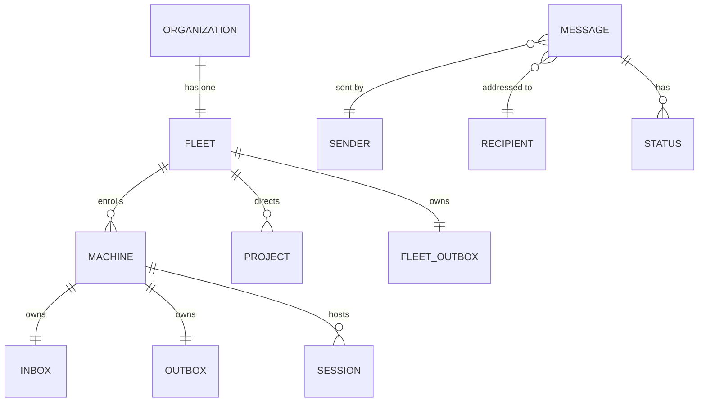

# Specification: entities

The nouns every obligation is written over. No type, table or wire shape is named here; Program Design binds them.

| ID | Term | Identity rule | Relationships | Invariants | Observable states | Basis |
| --- | --- | --- | --- | --- | --- | --- |
| E1 | Organization | One deployment of central is one organization | has exactly one Fleet (E2) | never more than one per deployment | n/a | U1 |
| E2 | Fleet | The one central participant of an organization | enrolls Machines (E3); directs Projects (E5); owns one Fleet outbox (E7); holds automation definitions (E11) | has no inbox | n/a | U1, U4, U8 |
| E3 | Machine | One Router installation, identified by its UUIDv7 machine id; two installations on one computer are two Machines | enrolled in one Fleet; owns one Inbox (E6) and one Outbox (E7); hosts Sessions (E4) | its id never changes once minted | enrolled → disenrolled | U4, U7, U10 |
| E4 | Session | One agent conversation, identified by its machine and the id its tool (Codex, Claude, …) gives it | hosted by exactly one Machine | its tool id is kept exactly as given | n/a | U7, U10 |
| E5 | Project | One board project, identified by its UUIDv7 project id | directed by the Fleet; its content lives in its own project object | content travels as a unit, separately from the Fleet | n/a | U1 |
| E6 | Inbox | One per Machine | holds Messages accepted for that Machine's Sessions | a Message is in a given Inbox at most once | n/a | U4 |
| E7 | Outbox | One per Machine, plus one for the Fleet | holds Messages until the next holder has accepted them | a Message is in a given Outbox at most once | n/a | U4 |
| E8 | Message | A UUIDv7 id plus its exact content. The same id with the same content is the same Message, however many times it is submitted. The same id with different content is a conflict and is refused. Its creation time is the time in its id | one Sender (a Session, the owner, a Project, or the Fleet); one Recipient (a Session, or a Machine for a create-session request); passes through Outboxes and one Inbox | created time never changes; removed 60 days after creation; never accepted when older than 60 days | waiting in sender's outbox → accepted by Fleet → in recipient's inbox → delivered to the session · or refused · or removed at 60 days | U4, U7, U8, U9 |
| E9 | Status | One step in one Message's progress, reported back towards its sender | about exactly one Message | only moves forward; a Status never causes another Message | accepted by Fleet, in recipient's inbox, delivered, refused | U4 |
| E10 | Create-session request | A Message whose Recipient is a Machine, asking it to start a Session | sent by a Session on an enrolled Machine; answered with one outcome | the target never starts two Sessions for one request | request arrived → created (with the new Session) · refused (with a reason) · not sure | U10 |
| E11 | Automation definition | A UUIDv7 id. A wake or a schedule: when, to whom, what | held by the Fleet only; fires Messages | definition only, no firing history; not tied to a Project | detailed in D4a/D4b | U14, U15, U16 |
| E12 | Notification | A Message whose content lists new activity a subscriber follows | produced by a subscription's wake (E11) | detailed in D4a | detailed in D4a | U5, U16 |

**Not an entity:** the WebSocket between a Machine and the Fleet. It carries Messages and Statuses but owns no truth.
