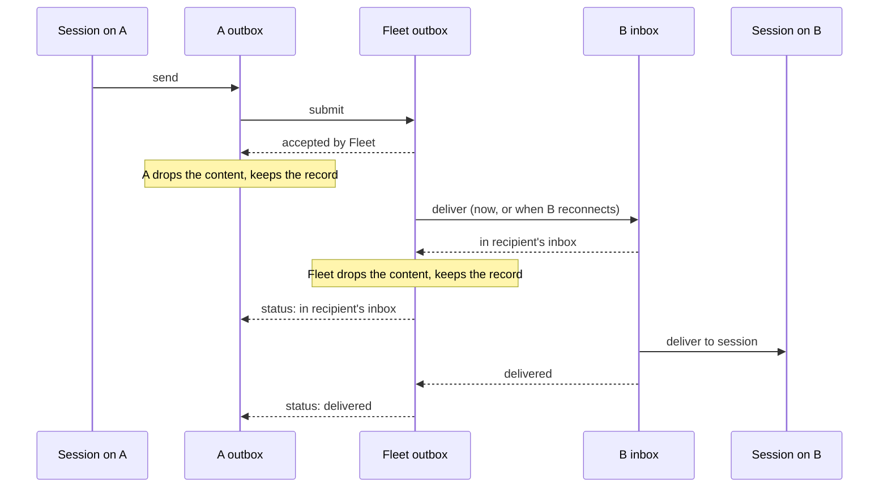

# Specification: mail

What must be observably true about Messages. Entities: [E3](entities.md#e3), [E4](entities.md#e4), [E6](entities.md#e6), [E7](entities.md#e7), [E8](entities.md#e8), [E9](entities.md#e9).

| ID | Obligation | Failure expectation | Proof obligation | Basis |
| --- | --- | --- | --- | --- |
| R7 | A Message from a Session on Machine A to a Session on Machine B goes A's outbox → Fleet's outbox → B's inbox → the Session. The Fleet routes it on arrival straight into its outbox; there is no Fleet inbox | If B is offline, the Message waits in Fleet's outbox and is delivered when B reconnects | A sends to B while B is offline; B comes online; B's inbox holds the Message once, and the Session receives it or the sender sees “unknown” | U4 |
| R8 | A Message between two Sessions on the same Machine goes straight into that Machine's inbox and on to the Session. An outbox holds a Message only while it waits for another holder; a same-Machine hop would be an extra durable step | n/a | A Message between two local Sessions is in the Machine's inbox once, with its id and timestamps | U4 (“inbox to outbox is extra durable step make no sense”) |
| R9 | Each holder keeps a Message's content until the next holder has durably accepted it, then drops the content. It keeps the Message's record (id, content hash, status, timestamps) until the record's 60-day removal (R14) | If a holder restarts before the next holder accepts, it still has the content and sends it again | Kill A's Router after submit but before Fleet's acceptance arrives; on restart, B's inbox holds the Message once. After acceptance, A's record shows the status with no content | U4, U9 |
| R10 | Resubmitting a Message with the same id and the same content, while its record exists, is the same Message: it is stored once and the submitter is told its current status | Same id with different content is refused as a conflict, and the original is untouched | Submit the same Message twice to Fleet and to an inbox: one copy, and the second answer carries the current status. Submit the same id with changed content: refused, conflict | U4, U7 |
| R11 | The sender can see each Message's progress: accepted by Fleet, in recipient's inbox, then delivered, refused or **unknown**. Handing a Message to a Session is best effort: if the hand-off fails or its result is lost, the status is “unknown” and the hand-off is not retried blindly. Statuses only move forward and never generate further Messages | A lost Status is sent again; a repeated Status changes nothing | From A, query a Message's status at each stage of R7 and see each step in order; with the Session's tool killed mid-hand-off, the status ends “unknown” and the Session gets no second copy | U4, U10 (“best effort”) |
| R12 | A Message is sent as soon as it enters an outbox, with no batching delay | n/a | The time from send on A to arrival in B's inbox, both online, has no added wait; the measured median is reported in the proof | U6 |
| R13 | Every Message id is UUIDv7; every Message record carries its creation time and the time it reached each holder | A non-UUIDv7 id is refused | Every Message record in every outbox and inbox shows a UUIDv7 id and timestamps; a submitted UUIDv4 id is refused | U7 |
| R14 | Every Message record is removed from every outbox and inbox 60 days after its creation time. A Message whose id is more than 60 days old is not accepted anywhere | n/a | With an injected clock, a Message is present at day 59 and gone at day 60 from each holder; submitting a 61-day-old id is refused as too old | U9 |
| R15 | Only enrolled Machines can submit to or receive from the Fleet | A Message from an unenrolled installation is refused | An unenrolled installation's submit is refused, and nothing is stored | U10 (also serves) |

**Detailed when their deliverable starts:** Fleet sending its own Messages (U8, D2), notifications through inbox and outbox at most every 10 minutes with jitter (U5, U6, D4a).
