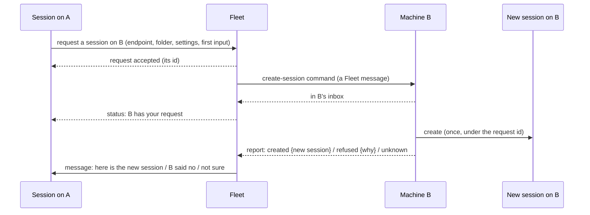

# Specification: remote-sessions (D2) and Fleet-originated messages

What must be observably true when a session is created on another machine, and when the Fleet sends a message of its own. Entities: [E2](entities.md#e2), [E3](entities.md#e3), [E4](entities.md#e4), [E8](entities.md#e8), [E9](entities.md#e9), [E10](entities.md#e10). Builds on D1's mail ([R7–R15](mail.md)).

| ID | Obligation | Failure expectation | Proof obligation | Basis |
| --- | --- | --- | --- | --- |
| R16 | A session on an enrolled Machine can ask for a new Session on another enrolled Machine, naming the endpoint, an absolute folder on that Machine, access, and optionally model, effort, mode and a first input. The request has a UUIDv7 id | A request naming a Machine that is not enrolled, or from a Machine that is not enrolled, is refused at once and nothing is sent | From A, request a session on B: an id comes back; from an unenrolled installation, the request is refused and the Fleet outbox is unchanged | U10 |
| R17 | **Temporary rule:** any Machine enrolled in this Fleet may ask for a Session on any other enrolled Machine; no further permission applies, and the code says it is temporary | n/a | The rule's code carries a comment naming it temporary and pointing to this obligation | U10 (“put note in comments so other agents don't think this is forever”) |
| R18 | The requester sees, in order: “request accepted”, then “B has your request”, then exactly one result: the new Session (its full address, ready to message), a refusal with its reason, “not sure”, or “expired” | **Temporary rule (owner, 2026-11-03: refuse for now; a workaround until remote start is redesigned):** if B has no live connection when the request is made, the request is refused at once with “B is offline” and nothing is stored or queued. If B goes offline after accepting the command, the command waits and expires at D1's 60-day removal (“expired”). The result is one durable Fleet message; handing it to the agent session follows D1's best-effort hand-off (R11) | Request with B offline: refused at once with “B is offline”, and the Fleet outbox is unchanged. Request with B online: the three stages are read in order from A, and one result message arrives in the requesting session | U10 (“best effort”) |
| R19 | B creates at most one Session per request id. A repeated command answers from B's record of that request. If B cannot tell whether it started the Session, it reports “not sure” and never starts another | Same request id with different content is refused as a conflict | Push the same command twice: one Session. Kill B after it starts the Session and before it records the result: on restart B reports “not sure” and no second Session exists | U10 |
| R20 | If a first input was given, it is sent to the new Session at most once, and only when the Session was created with all requested settings applied. The result reports it as `accepted`, `failed`, `unknown` (it may have arrived), `not attempted` (creation pending or settings partial) or `not requested` | A first-input problem never causes a second Session or a second prompt | Create with a first input: the new Session receives it once; with the first input refused, the result says so | U10 |
| R21 | The Fleet can send a Message of its own, through its outbox, to a Session or to a Machine. Its sender reads as the Fleet, never as a session, a human or a project | A Fleet Message cannot be submitted by a Machine; only the Fleet's own producers create one | The create command and the result message both show the Fleet as sender at the recipient; a Machine submitting a Fleet-sender item is refused | U8 |
| R22 | The new Session's own tool approvals work exactly as for a locally created Session | n/a | A tool call in the new Session raises its normal approval on B | U10, D-7 |

**Not in D2:** workspace membership or other permission rules (out of scope); automations as producers of Fleet messages (D4a, D4b).
