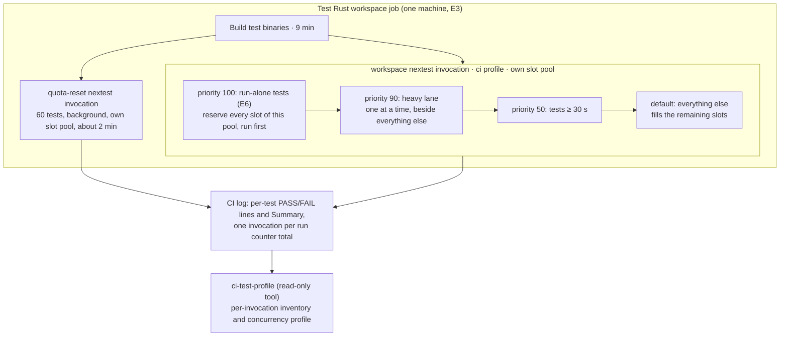

# CI to 30 minutes: Program Design

The design changes when tests start and how many run at once inside the workspace nextest invocation. It doesn't change which tests run or what they prove. Three parts carry it:
- the nextest CI profile, which gains priorities and a thread count;
- the tests that wait on wall-clock time, which change to wait on causal signals;
- a read-only profiling tool, which measures each invocation of a run's test job from its log.

The obligations are in [specification.md](specification.md) (R1–R7) and the needs in [requirements.md](requirements.md).



## Current system

- **Workflow:** `.github/workflows/ci.yml`, the `test` job (required, `ubuntu-latest`, 4 vCPU). It builds the test binaries, then starts two nextest invocations on the same machine (`ci.yml:302-311` on main; the same order on D1):
  - `-p codex-router-quota-reset-test-harness`, in the background, with 60 tests;
  - `--workspace … --exclude codex-router-quota-reset-test-harness`, with 6,518 tests.

  Then comes `wait-all`. The two invocations have separate queues and slot limits; nextest 0.9.137 builds the queue per invocation in `runner/imp.rs:707-807`. Neither excludes the other. The other PR jobs are `static`, `e2e` and `wasm`. `release-cache` and `prune-caches` run only on pushes to main.
- **Scheduler config:** `.config/nextest.toml`, profile `ci`. It has two groups:
  - `process-runtime` (`max-threads = 1`), whose members set `threads-required = "num-test-threads"`, so each reserves its invocation's whole pool. D1 has 9 such blocks.
  - `heavy-tests` (`max-threads = 1`, `threads-required = 1`).

  There is no `test-threads` (so 4 slots, the CPU count) and no `priority`. nextest is pinned at 0.9.137 (`scripts/tooling/tool-versions.tsv`). At that version, overrides resolve per property, so a block that sets only `priority` leaves earlier groups, threads and timeouts in place (`config/overrides/imp.rs:254-355`).
- **Queue behavior (from source, the Reviewer's reading of future-queue 0.4.0 `future_queue_grouped.rs:243-292`):**
  - the queue stops pulling later work while the next item's slot weight doesn't fit. So a run-alone test that comes up mid-run holds back everything behind it until the pool drains;
  - an item blocked only by its group is set aside without blocking the queue.

  Run-alone tests are therefore cheapest at the start, and the weight-1 heavy lane can overlap the lower bands.
- **Observed effect:** the workspace pool's heavy lane ran from +21 to +39 min, and the pool spent 14.1 minutes with one test running (see the Specification's current-behavior section).

## Structure decision

| Option | What changes | Gain | Cost | Selected |
| --- | --- | --- | --- | --- |
| S · Schedule better on one machine | `priority` overrides, 8 threads, causal waits | the run-alone tests drain once, at the start; the heavy lane overlaps everything else; no new machine; proof unchanged | its runtime effect is unmeasured; 8 threads expose load-sensitive tests, which then need causal fixes | **yes** |
| B · Partition across two test machines | `nextest --partition hash:k/2` in two `test` jobs | a shorter test step | breaks R2 | no; only if Q1 is reached and the owner picks it |
| C · Lighter inputs on PRs | heavy tests take PR-size inputs | a shorter test step | breaks R4 on PRs | no; only if Q1 is reached and the owner picks it |

S is the only option that keeps R2 and R4, and B or C could each be added later without undoing it. How much S saves is an empirical question. The summed elapsed time of the tests is not a lower bound, because much of it is waiting. **What would reopen the choice:** measured PR runs with S that still exceed 30 minutes after the known load-sensitive tests are fixed. That reaches Q1, and the owner chooses.

## Entity binding

| E | Semantic owner | Home | Shape at each boundary | Kind |
| --- | --- | --- | --- | --- |
| E1 CI run | GitHub Actions | existing: workflow `CI` (`.github/workflows/ci.yml`) | the GitHub API run record: `id`, `created_at`, `head_sha`, `event`, `conclusion` | external |
| E2 Required check | `ci.yml` jobs `static`, `test`, `e2e`, `wasm` | existing | the API job record: `name`, `started_at`, `completed_at`, `conclusion` | external |
| E3 Machine | GitHub-hosted runner | existing: one per job | counted from the jobs in a run | external |
| E4 Test | nextest | existing: test binaries | log line `PASS\|FAIL [<secs>s] (<n>/<total>) <binary-id> <test-name>`, where `<total>` is that invocation's run count and matches its `Summary … <total> tests run`; `cargo nextest list` output for selection | derived |
| E5 Proof input | each test's own source | existing: the test file | the Rust source | existing |
| E6 Run-alone test | `.config/nextest.toml` `[[profile.ci.overrides]]` with `threads-required = "num-test-threads"` | existing, modified (members leave as they turn causal) | a nextest filter expression; its scope is one invocation | config |

The profiling tool adds derived shapes only:

```text
InvocationInventory { runTotal: number, summaryRun: number, summaryPassed: number, summaryFailed: number, summarySkipped: number,
                      outcomes: Array<{ binaryId: string, testName: string, result: "pass" | "fail", startSeconds: number, endSeconds: number }> }
InvocationProfile   { runTotal: number, wallMinutes: number, elapsedTestMinutes: number,
                      minutesAtConcurrency: Map<number, number>,
                      soloOwners: Array<{ binaryId: string, testName: string, soloSeconds: number }> }
ProfileResult       = { kind: "profiled", invocations: InvocationProfile[] }
                    | { kind: "inventoryMismatch", runTotal: number, counted: number, summaryRun: number }
                    | { kind: "ambiguousInvocations", runTotal: number }
                    | { kind: "noTimings", reason: "logMissingResultLines" | "summaryNotFound" }
```

An invocation is identified by nextest's own run total: the `<total>` in each result line's `(<n>/<total>)` counter, which equals the `N` in that invocation's `Summary … N tests run`. GitHub's per-step names are not used, for two reasons: a downloaded job log can carry `UNKNOWN STEP` for every line, and the CI test job runs two invocations at once in background steps. Each inventory is checked against the `Summary` with the same total. A mismatch is reported, never smoothed over. Two invocations with the same total in one log are `ambiguousInvocations`, never merged.

## Components

| Component | Job | Owns | Changes because |
| --- | --- | --- | --- |
| nextest `ci` profile (`.config/nextest.toml`) | decides start order and slot count within each invocation | priority bands, `test-threads`, and run-alone and heavy membership | a test's duration or isolation need changes |
| Tests that wait on the clock | prove their behavior without depending on timing on a shared machine | their own waits and fixture signals | their behavior's signal changes |
| `ci-test-profile` (TypeScript, `verification/tooling/`, beside the other TS tooling and its `*.test.ts`) | turns a test job log into per-invocation inventories and profiles | nothing persistent | the nextest log format changes |
| `ci.yml` `test` job | builds and runs both invocations | job and step order | **unchanged under S** |

- **Thread count:** `test-threads = 8` in `profile.ci` applies to both invocations. The quota invocation also runs at 8 slots during its roughly 2 minutes beside the workspace run. That's accepted, because it is part of the measured load.
- **Forbidden:** the profile tool never edits config and is never a CI gate (R1 is judged from GitHub's timestamps). No priority block may set a deadline, retry or group; priority blocks only order tests (R4).

## How a run goes, before and after (workspace invocation)

| Step | Today | Under S |
| --- | --- | --- |
| Start | binaries in order; short tests fill slots; the quota invocation runs beside | the run-alone tests start first and take this pool's slots one at a time; the quota invocation still runs beside |
| Heavy lane | starts when its binary comes up (+21 min) | starts as soon as the run-alone tests have drained; about 15 min of one-at-a-time work beside everything else |
| Long ordinary tests (≥ 30 s) | scattered | start early, beside the heavy lane |
| Everything else | fills slots | fills the remaining slots of 8 |
| End | about 18 min of heavy-lane tail with one test running | ends when the heavy lane or the ordinary pool finishes, whichever is later |

## Failure and load

**A test that fails only at 8 threads is a load-sensitive wait.** Under R5 it gets a causal fix. The known case is `oversized_initialize_frame_is_rejected_and_reaps_owned_process` (`crates/codex-router-host/src/external_provider_runtime/tests/admission_lifecycle_test.rs:444`, identical on main and at D1 `71e466dbf`).

- **What it does today:** it calls `initialize_with_timeout(fixture, 2 s, …)`, and the runtime races the fixture's readiness against that 2 s deadline (`provider_connection_task.rs:708-725`).
- **The fixture** `verification/fixtures/host-failing-initialization-agent.ts` writes its process ID when it starts (line 9). It sends the oversized frame only after it receives initialize (lines 33–39).
- **Why it failed:** in #213 the cold Node start outlasted the 2 s, so the test got `InitializeTimeout` instead of the frame rejection it exists to prove.

The fix reuses the seam the neighboring `held_initialize_times_out_and_reaps_owned_process` test already uses in the same file (from line 401):
1. The test runs on a paused tokio clock (`start_paused = true`).
2. A `spawn_blocking` watcher keeps the clock from auto-advancing until the fixture has **written the oversized frame**. The fixture records that after the `stdout.write` callback, as a marker next to the existing process-ID file.
3. So the simulated 2 s deadline can't elapse during Node startup or before the frame exists. Once the marker exists the frame bytes are already in the pipe, and the runtime reads them before the paused clock advances.
4. The real parser path, `Initialize(_)`, and the reaping assertion stay unchanged. So does the 2 s value.

The timeout path stays proven by `held_initialize_times_out_and_reaps_owned_process`.

- **Assumption to test:** with ready I/O pending, tokio's paused-clock auto-advance polls I/O before advancing time. This is checked by running the fixed test with the fixture's start delayed beyond 2 s (see the verification R5 row).
- **If priority ordering exposes a hidden dependency between tests:** that dependency is a defect under R5. It's fixed in the test, not by lowering the priority.
- **Concurrency:** each test runs in its own process. The design adds no shared state.

## Proof seams

- **R1 and R2:** the GitHub API run and job records of the PR's own runs.
- **R3:** at one source revision, `cargo nextest list --profile ci` with the same package, feature and filter selections, once with the changed config and once with the pre-change config, for each invocation. That gives the complete run and skipped identity sets. Each CI invocation's own `Summary` must match the list for its config.
- **R4:** the diff of each changed test.
- **R5:** each changed test under a controlled delayed start, in its pre-fix and fixed versions.
- **R6:** the `static` job's ratchet step.
- **R7:** the change's branch starts from D1's head and merges D1's later heads forward (`git merge-tree` first to show no conflict), plus each priority filter's member selectors listed separately on the merged head. After D1 lands on main as a squash commit, main is merged into the branch (no rebase) and the listing is repeated.

## Trace table

| U | R | E | Owner | Interface | Shape and home | State | Failure | Proof |
| --- | --- | --- | --- | --- | --- | --- | --- | --- |
| U1 | R1 30-minute run | E1, E2 | nextest `ci` profile (order and slots, per invocation) | `priority`, `test-threads` keys | `.config/nextest.toml`, new blocks appended | none | over 30 after the fixes → report the time; this reaches Q1 | GitHub run and job timestamps |
| U2 | R2 no extra machines | E3 | `ci.yml` | job list | `ci.yml`, unchanged under S | none | any added job → reject | the run's job count |
| U3 | R3 same tests | E4 | nextest `ci` profile | selection is unaffected by `priority` and `test-threads` | `.config/nextest.toml` | none | an identity-set mismatch → defect | same-revision list pair per invocation, and its Summary match |
| U3 | R4 proof kept | E5 | each test's own file | test source | test files and fixtures | none | a fixture shrunk, an assertion dropped or a deadline lengthened → reject | test diff |
| U4 | R5 causal waits | E4, E6 | each test's own file; run-alone membership in `.config/nextest.toml` | the awaited signal (for the known case: the fixture's frame-written marker and the paused-clock watcher) | test source; fixture; override blocks | run-alone → shared | a load failure → causal fix only | pre-fix and fixed under a controlled delayed start |
| U5 | R6 ratchet stays | E2 | `ci.yml` `static` | ratchet step | `ci.yml`, unchanged | none | step removed → reject | `static` job steps |
| U6 | R7 D1 compatibility | E4 | the change author | merge and per-selector resolution | appended blocks only | none | conflict, or a selector matching nothing or the wrong set → fix before merge | merge-forward of D1's head (merge-tree first), plus per-selector lists on the merged head |

Deviations and unresolved decisions:
- Q1 is reached only if measured S runs stay over 30.
- The paused-clock I/O-before-advance assumption gets its own check.
