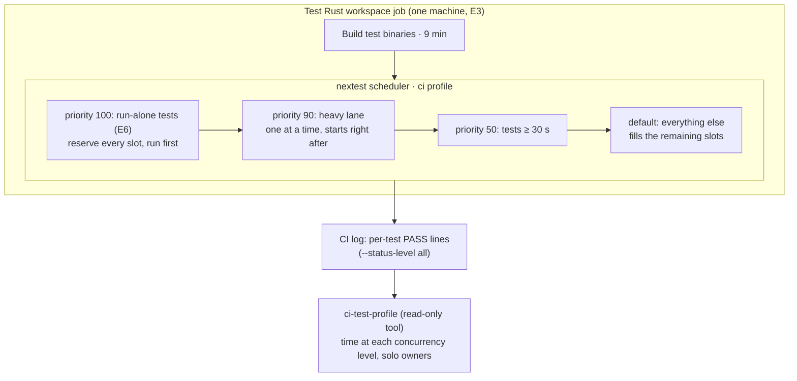

# CI to 30 minutes: Program Design

The design changes when tests start and how many run at once. It doesn't change which tests run or what they prove. Three parts carry it:
- the nextest CI profile, which gains priorities and a thread count;
- the tests that wait on wall-clock time, which change to wait on causal signals;
- a read-only profiling tool, which measures each run's test step from its log.

The obligations are in [specification.md](specification.md) (R1–R7) and the needs in [requirements.md](requirements.md).



## Current system

- **Workflow:** `.github/workflows/ci.yml`. `test` is a required job on `ubuntu-latest` (4 vCPU). It builds the test binaries, then runs one `cargo nextest run --profile ci --status-level all … --workspace` over 6,518 tests (`ci.yml:295-300`, same on D1). On a PR the other required jobs are `static`, `e2e` and `wasm`. `release-cache` and `prune-caches` run only on pushes to main.
- **Scheduler config:** `.config/nextest.toml`, profile `ci`. Two groups:
  - `process-runtime` (`max-threads = 1`), whose members set `threads-required = "num-test-threads"` and so reserve the whole machine. D1 has 9 such override blocks and adds one of them.
  - `heavy-tests` (`max-threads = 1`, `threads-required = 1`).

  There is no `test-threads`, so nextest uses the CPU count (4), and there is no `priority`. nextest is pinned at 0.9.137 (`scripts/tooling/tool-versions.tsv`). The `priority` key arrived in 0.9.91, and I tested it locally on 0.9.150.
- **Observed effect:** the heavy lane starts at +21 min and runs until +39 min. The step spends 14.1 minutes with one test running. See the Specification's current-behavior section.
- **Assumption, not yet observed:** while a run-alone test waits for every slot to free, nextest holds back the tests queued behind it. That would explain the roughly 6 one-test minutes the heavy lane doesn't account for. The first profile after step 1 confirms or refutes it.

## Structure decision

| Option | What changes | Gain | Cost | Selected |
| --- | --- | --- | --- | --- |
| S · Schedule better on one machine | `priority` overrides, `test-threads = 8`, causal waits | removes most of the 14.1 one-test minutes; no new machine; proof unchanged | an estimated 37–44 min job, short of R1; 8 threads expose load-sensitive tests, which then need causal fixes | **yes** |
| B · Partition across two test machines | `nextest --partition hash:k/2` in two `test` jobs | test step about 12–15 min, job about 30 | breaks R2 (5 machines per PR) | no; waits on owner Q1 |
| C · Lighter inputs on PRs | heavy tests take PR-size inputs; full inputs only on main | job may reach about 30 | breaks R4 on PRs | no; waits on owner Q1 |

S is the only option that keeps R2 and R4, and B or C can each be added on top of it later without undoing it. **What would reopen the choice:** a post-S profile with the test step still over about 18 minutes means R1 can't be met without Q1. Then this design gets B or C as a revision, chosen by the owner.

## Entity binding

| E | Semantic owner | Home | Shape at each boundary | Kind |
| --- | --- | --- | --- | --- |
| E1 CI run | GitHub Actions | existing: workflow `CI` (`.github/workflows/ci.yml`) | the GitHub API run record: `id`, `created_at`, `head_sha`, `event`, `conclusion` | external, derived for reading |
| E2 Required check | `ci.yml` jobs `static`, `test`, `e2e`, `wasm` | existing | the API job record: `name`, `started_at`, `completed_at`, `conclusion` | external |
| E3 Machine | GitHub-hosted runner | existing: one per job | not read directly; counted from the jobs in a run | external |
| E4 Test | nextest | existing: test binaries in the workspace | the log line `PASS\|FAIL [<secs>s] (<n>/<total>) <binary-id> <test-name>` | derived from the log |
| E5 Proof input | each test's own source | existing: the test file | the Rust source; no new shape | existing |
| E6 Run-alone test | `.config/nextest.toml` `[[profile.ci.overrides]]` with `threads-required = "num-test-threads"` | existing, modified (members leave as they turn causal) | a nextest filter expression | config |

The profiling tool adds one derived shape and no stored state:

```text
TestTiming     { binaryId: string, testName: string, startSeconds: number, endSeconds: number }   // end = log timestamp; start = end − reported duration
StepProfile    { tests: number, wallMinutes: number, testMinutes: number,
                 minutesAtConcurrency: Map<number, number>,
                 soloOwners: Array<{ binaryId: string, testName: string, soloSeconds: number }> }
ProfileResult  = { kind: "profiled", profile: StepProfile }
               | { kind: "noTimings", reason: "logMissingPassLines" | "stepNotFound" }
```

## Components

| Component | Job | Owns | Changes because |
| --- | --- | --- | --- |
| nextest `ci` profile (`.config/nextest.toml`) | decides start order and concurrency | priority bands, the `test-threads` count, and the membership of the run-alone and heavy groups | a test's duration or isolation need changes |
| Tests that wait on the clock | prove their behavior without timing on the shared machine | their own waits | their behavior's signal changes |
| `ci-test-profile` (TypeScript, `scripts/tooling/`) | turns a test job's log into a `StepProfile` | nothing persistent; it reads a log and prints a report | the nextest log format changes |
| `ci.yml` `test` job | builds and runs the tests | the job and its step order | **unchanged under S** |

Forbidden:
- the profile tool never edits config, and it never runs in CI as a gate (R1 is judged from GitHub's run timestamps, not from this tool);
- no priority block may set a deadline, a retry or a group. Priority blocks only order tests, so they can't weaken proof (R4).

## How a run goes, before and after

| Step | Today | Under S |
| --- | --- | --- |
| Start of the test step | runs binaries in order; slots fill with short tests | the run-alone tests start first and briefly take the whole machine |
| Heavy lane | starts when its binary comes up (+21 min) | starts right after the run-alone tests, about 15 min of one-at-a-time work |
| Long ordinary tests (≥ 30 s) | scattered | start early, beside the heavy lane |
| Everything else | fills slots | fills the remaining 7 slots (8 threads) |
| End | about 18 min of heavy-lane tail with one test running | ends when the heavy lane or the ordinary pool finishes, whichever is later |

## Failure and load

- A test that fails only at 8 threads is a load-sensitive wait. Under R5 it is fixed causally. The known case is `admission_lifecycle_test.rs:444` `oversized_initialize_frame_is_rejected_and_reaps_owned_process`. It calls `initialize_with_timeout(…, 2 s)`, and at 8 threads it got `InitializeTimeout` before the fixture wrote its oversized frame.
  - **What it proves:** frame rejection, then the process being reaped (lines 463–467).
  - **The fix:** the 2 s budget is not that proof, so the wait ends when the runtime returns its initialize result for the fixture's frame. The 2 s budget is not lengthened.
  - **Timeout coverage:** the timeout path stays proven by its own test. If no such test exists, that's a gap, and the plan must find it.
- If priority ordering exposes a hidden ordering dependency between tests, that dependency is a defect under R5. It's fixed in the test, not by lowering the priority.
- Concurrency: nextest owns the order. Every test already runs in its own process, so the design adds no shared state.

## Proof seams

- **R1 and R2:** the GitHub API run and job records for the PR's own runs.
- **R3:** nextest's `Starting N tests … (M skipped)` line and the per-test PASS identities, compared at one commit with and without the change.
- **R4 and R5:** the diff of each changed test.
- **R6:** the `static` job's ratchet step.
- **R7:** `git merge-tree` against D1's head, plus `cargo nextest list` on D1 (run on Sunclaw) for each priority filter.

## Trace table

| U | R | E | Owner | Interface | Shape and home | State | Failure | Proof |
| --- | --- | --- | --- | --- | --- | --- | --- | --- |
| U1 | R1 30-minute run | E1, E2 | nextest `ci` profile (order and threads) | `priority`, `test-threads` keys | `.config/nextest.toml`, new blocks at the end of the file | none | over 30 → report the time; Q1 decides B or C | GitHub run and job timestamps (seam R1) |
| U2 | R2 no extra machines | E3 | `ci.yml` | job list | `ci.yml`, unchanged under S | none | any added job → reject | the run's job count |
| U3 | R3 same tests | E4 | nextest `ci` profile | filters select nothing new and skip nothing new | `.config/nextest.toml` | none | a count or identity mismatch → defect | nextest start line and identities at one commit |
| U3 | R4 proof kept | E5 | each test's own file | test source | the test files | none | a fixture shrunk, an assertion dropped or a deadline lengthened → reject | the test diff |
| U4 | R5 causal waits | E4, E6 | each test's own file; run-alone membership in `.config/nextest.toml` | the awaited signal | test source; override blocks | run-alone → shared | a load failure → causal fix only | the diff names the signal, plus a run at 8 threads |
| U5 | R6 ratchet stays | E2 | `ci.yml` `static` | ratchet step | `ci.yml:126-129`, unchanged | none | step removed → reject | the `static` job's steps |
| U6 | R7 D1 compatibility | E4 | the change author | merge and filter resolution | appended blocks only, no edits to D1's blocks | none | conflict or a filter that matches nothing → fix before merge | `git merge-tree` and `nextest list` on D1 |

Deviations and unresolved decisions:
- Q1 (owner) decides whether B or C follows S.
- The run-alone hold-back assumption is unobserved until step 1's profile.
