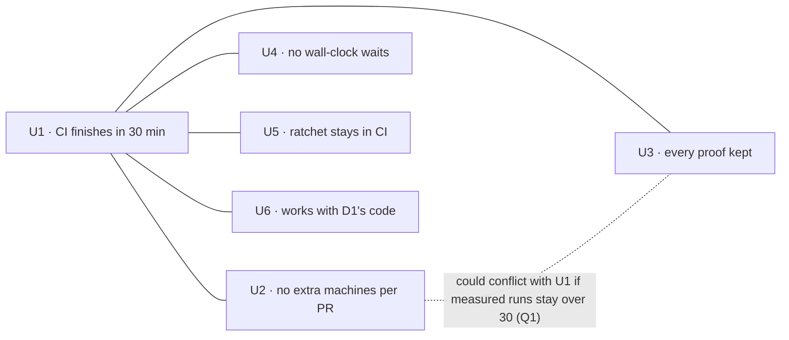

# CI to 30 minutes: Requirements

The owner, and every agent waiting on a merge gate, wait for CI on every pull request and every push to main. Today a run takes about 55 minutes. The owner asked for 30, under four standing limits:
- no extra machines per pull request;
- no tests that wait on wall-clock time;
- no weakened proof;
- the module-cycle ratchet stays in CI.

This document records those needs and limits. The observable obligations are in [specification.md](specification.md).

## Who is affected

| Class | Job | Current pain | Evidence |
| --- | --- | --- | --- |
| Owner (merges and releases) | merge reviewed PRs and release; owner release authority requires a green head and green main CI | a merge-and-release round waits about 55 min per CI run | main run 41826050980 (`0f9af21f6`): 12:03:58Z → 12:58:50Z |
| Leads and helper agents | push a fix and wait for a green PR before review or merge | each correction round costs about an hour of waiting | the same run; #213's run took 47 min to a failure |

There is no user-facing UI change (`no current UI`).

## Needs

| ID | Need | Why it matters | Authority | Priority |
| --- | --- | --- | --- | --- |
| U1 | A CI run's required checks finish within 30 minutes of the run starting | merge, release and correction rounds are gated on CI | `authorized`: owner 2026-11-02, "CI must finish in 30 min" | 1, owner |
| U2 | A pull request's CI uses no more machines than it does today | the org is on GitHub Free, with 20 concurrent jobs shared by every PR | `authorized`: owner 2026-11-02, "never add machines per PR; count machines and runner-minutes per DAG first" | 1, owner |
| U3 | Every test keeps the inputs, assertions and deadlines that make it a proof; no test is removed, skipped or loosened to save time | a faster CI that proves less is not the goal | `authorized`: owner standing rule, "ask before weakening required proof" (global instructions) | 1, owner |
| U4 | A test waits on a causal signal or an injected clock; a flaky test is never fixed with a longer timeout | wall-clock waits make CI slow and flaky at once | `authorized`: owner 2026-10-29 | 1, owner |
| U5 | The workspace module-cycle ratchet stays a CI check | it stops cycles from growing while the existing ones are fixed | `authorized`: owner 2026-11-04 | 2, owner |
| U6 | The changes are designed against D1's current code, so they hold once D1 merges and don't block it | D1 changes 1,173 test and CI files and merges in about 1–2 days | `authorized`: owner 2026-11-04, "lets make design based on current d1 code" | 2, owner |

## Boundary

- **In scope:** the CI workflow's required checks on pull requests and main pushes, the nextest CI profile, test scheduling, and test code that waits on wall-clock time.
- **Protected:** the production Router process, release publication, and the Homebrew tap.
- **Non-goals:**
  - shortening the Static validation job's ratchet. The owner wants the cycles fixed, and that is separate work;
  - splitting crates (a separate design);
  - local developer build speed;
  - the main-only Apple Silicon cache warm-up (see Q2).

## Open owner questions

- **Q1 · U1 against U2 and U3.** After setup and the build, a 30-minute test job leaves about 15 minutes for the test step. Nobody knows yet whether one runner can reach that. The 113 summed test-minutes are elapsed time, and much of it is spent waiting on processes, sockets and timers rather than using the CPU, so the sum is no bound on wall time. A measured run over 30 minutes after the scheduling work triggers Q1: the owner then decides how to proceed, whether that's more work within the limits or relaxing U2 (a second test runner) or U3 (lighter inputs on PRs). A miss shows only that the scheduling work fell short, not that the limits must change. Status: **not decided, and not yet triggered**. Work that relaxes neither U2 nor U3 doesn't wait on it.
- **Q2 · Which jobs U1 covers.** This document reads U1 as the required checks a PR waits on. The main-only Apple Silicon cache job (35 min) runs after merge and gates nothing. Status: assumption, not confirmed.
