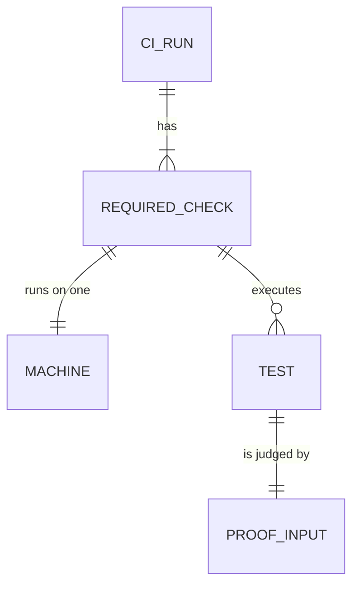

# CI to 30 minutes: Specification

A CI run's required checks finish within 30 minutes. They run the same tests with the same proof on the same number of machines, and no test waits on a clock. The needs this serves are in [requirements.md](requirements.md). One obligation, R1, can conflict with R2 and R4; that conflict is owner question Q1 there.

## Current behavior

Main run 41826050980 at `0f9af21f6` took 55 minutes. Its required jobs on a PR are Static validation (26 min), Test Rust workspace (54), Rust local end-to-end (25) and Central Worker (12).

The test job runs two nextest invocations on the same machine. The quota-reset harness (60 tests) starts in the background, and the workspace run (6,518 tests) starts about a second later. The quota run finishes after about 2 minutes, while the workspace run continues.

The workspace invocation took 39 minutes on 4 threads:
- For 14.1 minutes its pool had one test running, and for 24.2 minutes it had four.
- Its tests' elapsed times add up to 112.7 minutes. Much of that is waiting, not CPU work.
- From +21 minutes on, its heavy tests ran one at a time. Two of them, `held_queue_depth` (295 s) and `history_growing_records` (189 s), account for 7.8 of the one-test minutes.

An 8-thread run (#213) brought the workspace invocation to 34.4 minutes, with one deadline test failing. Its pool still spent long stretches with one test running. That profile has to be measured again per invocation, because the saved one mixes the quota run's 60 results into the workspace step.

Evidence: `tmp/design-workflows/2026-11-04-ci-30-minutes/` in the design worktree (profiles and compressed logs).

## Entities

| ID | Term | Identity rule | Relationships | Invariants | Observable states | Basis |
| --- | --- | --- | --- | --- | --- | --- |
| E1 | CI run | One run of the `CI` workflow for one commit and one event (pull request or push to main); GitHub's run ID identifies it. A rerun attempt is the same run. | has 1..n required checks | its start is the run's creation time | queued → running → completed (success, failure or cancelled) | U1 |
| E2 | Required check | One job in a run that a PR must pass before merge (today: Static validation, Test Rust workspace, Rust local end-to-end, Central Worker build). Two checks are the same when they have the same job name in the same run. | belongs to one CI run; runs on exactly one machine | — | queued → running → completed | U1, U2 |
| E3 | Machine | One GitHub-hosted runner allocated to one job. | serves exactly one required check | counts toward the org's 20 concurrent jobs | allocated → released | U2 |
| E4 | Test | One test case nextest runs, identified by its binary ID and full test name; a renamed test is a different test. | executed by one required check; judged by its proof input | — | passed, failed, skipped | U3 |
| E5 | Proof input | Everything a test uses to decide pass or fail: its fixture sizes, limits, assertions and every deadline. | belongs to exactly one test | changes only when its owner approves | — | U3, U4 |
| E6 | Run-alone test | A test whose CI configuration reserves every test slot of its own nextest invocation, so no other test of that invocation runs beside it. It doesn't exclude a separate invocation on the same machine. | is a test | — | run-alone or shared | U4 |

## Obligations

| ID | Obligation | Traces to | Proof obligation |
| --- | --- | --- | --- |
| R1 | Every required check of a CI run completes within **30 minutes** of the run's creation. | U1 (E1, E2) | V1: on a PR run and a main run, the latest completion of the run's required checks minus the run's creation time is at most 30 min, using GitHub's own timestamps. Reference: the owner's 30-minute cap. Target: GitHub-hosted `ubuntu-latest` (4 vCPU), normal caches. A run that queues waiting for a free machine still counts its queue time. |
| R2 | A PR run uses no more machines than the four required checks use today. | U2 (E3) | V2: a PR run's job count, from the run's job list, is at most 4. Reference: run 41826050980. |
| R3 | A run executes exactly the tests it would execute without this change, with the same skips. | U3 (E4) | V3: compared at the same commit, the identities of tests run and skipped (from nextest output) match before and after, with zero removed. Reference: the same commit's run without the change. |
| R4 | No proof input is weakened: no fixture is made smaller, no assertion is removed and no deadline is lengthened. | U3 (E5) | V4: every changed test's diff keeps its fixture sizes and assertions, and any deadline it touches is either unchanged or replaced by a wait for a causal signal. Reference: the test at its pre-change commit. |
| R5 | A test that waited on wall-clock time and is touched by this work waits on a causal signal or injected clock afterward. A test that fails under the new scheduling is fixed by a causal wait, never by a longer timeout or by moving it to a run-alone group. | U4 (E4, E6) | V5: each changed test names the signal it now awaits, and a version that waits on the clock instead is shown to fail or flake under load. Reference: the owner's no-wall-clock rule. |
| R6 | The module-cycle ratchet stays a step of a required check. | U5 (E2) | V6: the run's Static validation job contains the ratchet step and it passes. |
| R7 | The change is built on D1's current code and stays current with it: it carries D1's latest head without conflicts, and every test it names exists under that name on that head. | U6 (E4) | V7: D1's head at the time of the check merges into the change's branch without conflicts, and every name a filter selects resolves to the tests it is meant to on the merged head. Reference: D1 at its current head (`71e466dbf` when the base moved to D1, 2026-11-05). |

### Failure cases

- **R1 exceeded with R2–R5 held:** the run is reported as over its cap, with its measured time. That is Q1's trigger. R2 and R4 are never relaxed to make R1 pass without the owner's decision.
- **A test fails only under the new scheduling:** that is a real defect under R5, fixed causally. It is never retried or grouped away.
- **D1 changes a named test after this is written:** R7 is checked again each time D1's head moves, and once more after D1 lands on main (as a squash commit) and main is merged into the change's branch.

## Cross-cutting qualities

- **Reliability:** R5 covers it. Faster scheduling must not create flakes.
- **Cost:** R2 covers machine count. Runner-minutes per PR run should not grow, though they may shrink. This is a constraint, not a threshold.
- **Security, privacy, accessibility:** not applicable. No product surface, credential or user data changes.
